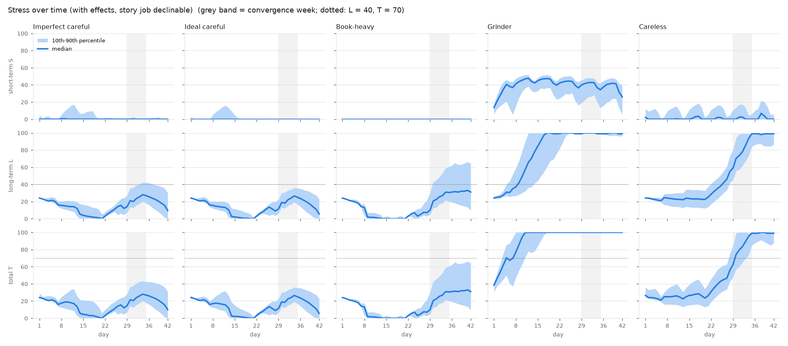
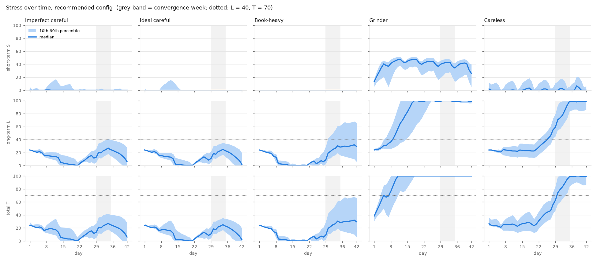

# Paws & Paychecks: economy simulation report — round 3 (spec v0.4)

This report covers round 3 of the economy simulation, specified in `design/SIM_BASELINE.md` §10 (v0.4).
- **What ran:** six policies (new: imperfect careful; careful is now "ideal careful") × {with effects, no effects}
  × {story job declinable, always taken}; the stress, starting-cash, H and CAT-price searches; a sensitivity sweep
  (30 rows); and a re-run with recommended config changes.
- **What's new in v0.4:** two-layer stress (S and L, with conversion), money tiers with "poor", the $400 loan and
  −$100 parents' floor, the skip choice, value-based shop buys, the changed effects, the 9,000-word story job.
- **Where things live:** economy numbers in `data/economy.yaml`, player behaviour in `data/policies.yaml`,
  the recommended overlay in `data/economy.recommended.yaml`. Interpretation choices are in §12.

**Headlines**
- **Tuned values:** starting cash **$1,500**, **H = 62.5 h**, CAT tool **$55/week** (unchanged). The stress search
  moved most stress numbers a long way from the spec (§1). The main variant meets **23 of 39** targets; with the
  recommended overlay, **25 of 39**.
- **Money now works as designed.** The lower finance bar, the $400 loan and the −$100 floor removed round 2's
  money conflict. At $1,500:
  - book-heavy's best ending is 53% (target 45–55%);
  - careless ends with the parents or in debt in 75% (≥ 60%);
  - book-heavy reaches the parents' ending or poor finances in 14% (15–30%; 18% with the overlay).
- **Stress doesn't bite careful players.** Their short-term stress S stays at 0 almost every day: a careful day has
  almost no S drivers (6.5 planned hours, jobs that fit, a full night), and rest, her and the book outweigh them.
  So their total stress is long-term stress only, and only 3 of 8 stress targets are met:
  - imperfect careful's average T is 17 (target 25–40) and its median week-5 peak is 30 (55–75);
  - it misses the stress goal in 5% of runs (10–15%).
  Pushing L up to reach the averages and the peak makes L linger past day 42, and the stress-goal misses jump to
  20–60%. No tuning of the listed parameters meets both (§3, §12 issue 1).
- **So imperfect careful's endings are too good:** best 49% (target 25–35%), good or better 90% (70–80%). Its slips
  (0.8 skipped evenings, 1.2 short pet-care days, 0.8 unfit jobs per run) rarely cost a goal. Best tracks its
  book-finish rate one for one (§1, step 3).
- **Effects mostly in band:** imperfect careful holds 9.4 effects (7–9; 8.8 with the overlay), effect boost +10% /
  +14% (in band), CAT pick 47% (in band). Five offered effects are dead, including the nap habit (S never passes 50).
- **Feedback** is 76% for imperfect careful (target 80%), lower for book-heavy (54%) and the grinder (63%).
- **The grinder now pays for overwork in money too.** The tuned conversion pins its stress at 100 from about day 10
  (efficiency −50%, 4.5 illness days); its median end value fell from $6,062 to $1,314. That ends round 2's
  "neglect pays most", but a stress of 100 for 30 days is extreme (§12 issue 3).

Reproduce with `python -m sim.run --all` (2,000 seeds per policy and variant; deterministic per (config, policy, seed)). Earlier rounds: `SIM_REPORT_round1.md`, `SIM_REPORT_round2.md`.

Sections: 1 Tuning · 2 Endings and money tiers · 3 Stress · 4 Money, stress, time · 5 Acceptance targets ·
6 Cash charts · 7 Effects · 8 Clients, story job, slips · 9 Sensitivity · 10 Comparison with round 2 ·
11 Recommended changes and re-run · 12 Open issues

## 1. Tuning: stress, starting cash, H, CAT price

- **Starting cash (after day-1 rent): $1,500** (first pass: $1,500).
- **Book: H = 62.5 hours** of hard chapters left (±5% per run: 59.4–65.6 h). With a whole book of 215 h (sim choice), the implied starting progress is **71%**.
- **CAT tool: $55/week.**

Order (§10.3): stress parameters → starting cash → H → starting cash again → CAT price.

### Step 1: stress parameters (§7.6)

A coordinate search: each parameter in turn (in §7.6's suggested order, then the starting L from §5), over the values listed, with the others fixed; two passes. Each point runs imperfect careful, ideal careful, book-heavy and grinder at a provisional starting cash of $1,200 (the round-2 probe value, §5), with effects and the story job declinable, 600 seeds. A value is chosen by the smallest total distance to the eight §7.6 targets (shares in points of 100%, stress levels in points of 100), then by targets met, then by closeness to the current value.

| Pass | Parameter | Before | Chosen | Values tried | §7.6 met | Distance |
|---|---|---|---|---|---|---|
| 1 | `stress.short.sleep_recovery_full` | 0.3 | **0.15** | 0.15, 0.2, 0.25, 0.3, 0.4, 0.5 | 2/8 | 1.163 |
| 1 | `stress.short.sleep_recovery_short` | 0.15 | **0.05** | 0.05, 0.1, 0.15, 0.2, 0.25 | 3/8 | 1.133 |
| 1 | `stress.conversion.threshold` | 60 | **40** | 40, 45, 50, 55, 60, 70 | 3/8 | 1.133 |
| 1 | `stress.conversion.share` | 0.25 | **0.5** | 0.1, 0.25, 0.4, 0.5 | 3/8 | 1.133 |
| 1 | `stress.long.runway_low` | 1 | **3** | 0.5, 1, 1.5, 2, 3 | 3/8 | 1.084 |
| 1 | `stress.long.runway_very_low` | 2 | **6** | 1, 2, 3, 4, 6 | 3/8 | 1.041 |
| 1 | `stress.long.rent_due` | 2 | **6** | 1, 2, 3, 4, 6 | 3/8 | 0.968 |
| 1 | `stress.long.her_crunch_day` | 1 | **4** | 0.5, 1, 1.5, 2, 2.5, 3, 4 | 3/8 | 0.480 |
| 1 | `stress.long.payment_arrives` | -2 | **-1** | -3, -2, -1.5, -1, -0.5 | 2/8 | 0.383 |
| 1 | `stress.long.book_milestone` | -8 | **-8** | -10, -8, -6, -4, -2 | 2/8 | 0.383 |
| 1 | `stress.long.her_good_week` | -3 | **-3** | -4, -3, -2, -1 | 2/8 | 0.383 |
| 1 | `stress.long.calm_day` | -1 | **-1** | -1, -0.75, -0.5, -0.25, 0 | 2/8 | 0.383 |
| 1 | `start.stress_long` | 10 | **20** | 5, 10, 15, 20, 25, 30 | 4/8 | 0.356 |
| 2 | `stress.short.sleep_recovery_full` | 0.15 | **0.4** | 0.15, 0.2, 0.25, 0.3, 0.4, 0.5 | 4/8 | 0.353 |
| 2 | `stress.short.sleep_recovery_short` | 0.05 | **0.1** | 0.05, 0.1, 0.15, 0.2, 0.25 | 4/8 | 0.353 |
| 2 | `stress.conversion.threshold` | 40 | **40** | 40, 45, 50, 55, 60, 70 | 4/8 | 0.353 |
| 2 | `stress.conversion.share` | 0.5 | **0.5** | 0.1, 0.25, 0.4, 0.5 | 4/8 | 0.353 |
| 2 | `stress.long.runway_low` | 3 | **2** | 0.5, 1, 1.5, 2, 3 | 4/8 | 0.341 |
| 2 | `stress.long.runway_very_low` | 6 | **3** | 1, 2, 3, 4, 6 | 4/8 | 0.326 |
| 2 | `stress.long.rent_due` | 6 | **6** | 1, 2, 3, 4, 6 | 4/8 | 0.326 |
| 2 | `stress.long.her_crunch_day` | 4 | **4** | 0.5, 1, 1.5, 2, 2.5, 3, 4 | 4/8 | 0.326 |
| 2 | `stress.long.payment_arrives` | -1 | **-0.5** | -3, -2, -1.5, -1, -0.5 | 4/8 | 0.309 |
| 2 | `stress.long.book_milestone` | -8 | **-10** | -10, -8, -6, -4, -2 | 5/8 | 0.288 |
| 2 | `stress.long.her_good_week` | -3 | **-3** | -4, -3, -2, -1 | 5/8 | 0.288 |
| 2 | `stress.long.calm_day` | -1 | **-1** | -1, -0.75, -0.5, -0.25, 0 | 5/8 | 0.288 |
| 2 | `start.stress_long` | 20 | **25** | 5, 10, 15, 20, 25, 30 | 4/8 | 0.276 |

**Reading the stress search**
- **It is a trade-off, not a fit.** Most chosen values are at or near the edge of their grids: crunch load 4/day
  (spec 1), rent load 6 (spec 2), conversion threshold 40 (spec 60), starting L 25 (spec 10). Each step that raises
  careful's average T also raises its stress-goal misses. The search settles where the summed distance is smallest
  (5 of 8 met at $1,200).
- **The provisional cash matters.** The search ran at $1,200, as the spec's order requires (stress before cash).
  The cash search then chose $1,500. More cash means less runway and rent stress, so at the final config only
  3 of 8 are met (careful's averages drop by ~4 points).
- **A first trial that ranked "most targets met" first** (as the cash search does) reached 6 of 8, but with
  imperfect careful missing the stress goal in 66% of runs and ideal careful in 50%. Distance-first is the more
  honest compromise (`DECISIONS.md`).

### Step 2: starting cash, first pass

Each point runs the five player policies at the tuned stress numbers, 2,000 seeds. Scored on the §9.3 rows except book-finish (H sets those), plus imperfect careful's low-point target: most met, then smallest distance, then lower cash.

| Start cash | Imp. careful parents (<=8%) | Imp. careful best (25-35%) | Imp. careful good+ (70-80%) | Imp. careful low d28-35 (>=60%) | Ideal careful parents (<=2%) | Book-heavy best (45-55%) | Book-heavy good (<=2%) | Book-heavy parents/poor (15-30%) | Grinder parents (<=5%) | Careless parents/poor (>=60%) | Met | Distance |
|---|---|---|---|---|---|---|---|---|---|---|---|---|
| 800 | 3% | 15% | 42% | 72% | 2% | 3% | 0% | 70% | 84% | 97% | 9/14 | 1.987 |
| 900 | 2% | 20% | 52% | 65% | 1% | 7% | 0% | 60% | 66% | 95% | 9/14 | 1.518 |
| 1,000 | 1% | 23% | 64% | 65% | 1% | 11% | 0% | 51% | 48% | 93% | 9/14 | 1.054 |
| 1,100 | 1% | 24% | 71% | 66% | 0% | 17% | 0% | 42% | 32% | 91% | 10/14 | 0.672 |
| 1,200 | 1% | 25% | 80% | 66% | 0% | 24% | 0% | 34% | 22% | 89% | 11/14 | 0.416 |
| 1,300 | 0% | 26% | 83% | 63% | 0% | 33% | 0% | 25% | 14% | 86% | 11/14 | 0.250 |
| 1,400 | 0% | 26% | 86% | 62% | 0% | 44% | 0% | 19% | 10% | 81% | 11/14 | 0.124 |
| 1,500 **(chosen)** | 0% | 27% | 89% | 62% | 0% | 54% | 0% | 14% | 6% | 75% | 11/14 | 0.107 |
| 1,600 | 0% | 27% | 91% | 61% | 0% | 65% | 0% | 10% | 4% | 70% | 11/14 | 0.254 |
| 1,700 | 0% | 27% | 91% | 61% | 0% | 73% | 0% | 7% | 3% | 63% | 11/14 | 0.376 |
| 1,800 | 0% | 27% | 91% | 61% | 0% | 79% | 0% | 5% | 1% | 56% | 10/14 | 0.499 |
| 1,900 | 0% | 27% | 92% | 61% | 0% | 86% | 0% | 3% | 1% | 49% | 10/14 | 0.659 |
| 2,000 | 0% | 27% | 92% | 61% | 0% | 90% | 0% | 2% | 1% | 43% | 10/14 | 0.775 |
| 2,100 | 0% | 27% | 93% | 61% | 0% | 94% | 0% | 1% | 0% | 36% | 10/14 | 0.887 |
| 2,200 | 0% | 27% | 93% | 61% | 0% | 96% | 0% | 1% | 0% | 30% | 10/14 | 0.975 |
| 2,300 | 0% | 27% | 93% | 61% | 0% | 98% | 0% | 0% | 0% | 24% | 10/14 | 1.058 |
| 2,400 | 0% | 27% | 93% | 61% | 0% | 99% | 0% | 0% | 0% | 20% | 10/14 | 1.118 |

### Step 3: H (starting cash $1,500); target: imperfect careful finishes ~40–50% (aim 45%)

| H (hours) | Imp. careful finishes | Imp. careful near-finished | Imp. careful best | Imp. careful good+ | Ideal careful finishes | Book-heavy finishes | Book-heavy best |
|---|---|---|---|---|---|---|---|
| 50 | 88% | 8% | 84% | 91% | 99% | 100% | 44% |
| 52.5 | 84% | 11% | 81% | 91% | 98% | 100% | 45% |
| 55 | 77% | 17% | 74% | 91% | 94% | 100% | 46% |
| 57.5 | 68% | 23% | 67% | 90% | 87% | 100% | 49% |
| 60 | 59% | 29% | 58% | 90% | 80% | 100% | 51% |
| 62.5 **(chosen)** | 50% | 35% | 49% | 90% | 73% | 100% | 53% |
| 65 | 39% | 40% | 39% | 89% | 62% | 100% | 54% |
| 67.5 | 27% | 46% | 27% | 89% | 46% | 100% | 54% |
| 70 | 15% | 51% | 15% | 89% | 27% | 100% | 54% |
| 72.5 | 7% | 50% | 7% | 88% | 13% | 100% | 54% |
| 75 | 2% | 47% | 2% | 88% | 5% | 100% | 54% |
| 77.5 | 1% | 40% | 1% | 88% | 1% | 100% | 53% |
| 80 | 0% | 31% | 0% | 88% | 0% | 100% | 53% |

### Step 4: starting cash, re-check (H = 62.5)

| Start cash | Imp. careful parents (<=8%) | Imp. careful best (25-35%) | Imp. careful good+ (70-80%) | Imp. careful low d28-35 (>=60%) | Ideal careful parents (<=2%) | Book-heavy best (45-55%) | Book-heavy good (<=2%) | Book-heavy parents/poor (15-30%) | Grinder parents (<=5%) | Careless parents/poor (>=60%) | Met | Distance |
|---|---|---|---|---|---|---|---|---|---|---|---|---|
| 800 | 3% | 30% | 46% | 71% | 2% | 3% | 0% | 70% | 84% | 97% | 10/14 | 1.847 |
| 900 | 2% | 36% | 57% | 64% | 1% | 7% | 0% | 60% | 66% | 95% | 9/14 | 1.434 |
| 1,000 | 1% | 42% | 67% | 65% | 1% | 11% | 0% | 51% | 48% | 93% | 9/14 | 1.067 |
| 1,100 | 1% | 45% | 75% | 65% | 0% | 17% | 0% | 41% | 32% | 91% | 10/14 | 0.756 |
| 1,200 | 0% | 47% | 81% | 66% | 0% | 23% | 0% | 33% | 22% | 89% | 9/14 | 0.548 |
| 1,300 | 0% | 48% | 85% | 63% | 0% | 33% | 0% | 24% | 14% | 86% | 10/14 | 0.392 |
| 1,400 | 0% | 48% | 87% | 62% | 0% | 43% | 0% | 18% | 10% | 81% | 10/14 | 0.271 |
| 1,500 **(chosen)** | 0% | 49% | 90% | 62% | 0% | 53% | 0% | 14% | 6% | 75% | 10/14 | 0.261 |
| 1,600 | 0% | 50% | 91% | 61% | 0% | 64% | 0% | 9% | 4% | 70% | 10/14 | 0.398 |
| 1,700 | 0% | 50% | 92% | 61% | 0% | 72% | 0% | 7% | 3% | 63% | 10/14 | 0.517 |
| 1,800 | 0% | 50% | 92% | 60% | 0% | 78% | 0% | 5% | 1% | 56% | 9/14 | 0.650 |
| 1,900 | 0% | 50% | 92% | 61% | 0% | 86% | 0% | 3% | 1% | 49% | 9/14 | 0.806 |
| 2,000 | 0% | 50% | 92% | 61% | 0% | 90% | 0% | 2% | 1% | 43% | 9/14 | 0.930 |
| 2,100 | 0% | 50% | 93% | 61% | 0% | 94% | 0% | 1% | 0% | 36% | 9/14 | 1.038 |
| 2,200 | 0% | 50% | 93% | 61% | 0% | 96% | 0% | 1% | 0% | 30% | 9/14 | 1.128 |
| 2,300 | 0% | 50% | 93% | 61% | 0% | 98% | 0% | 0% | 0% | 24% | 9/14 | 1.208 |
| 2,400 | 0% | 50% | 93% | 61% | 0% | 99% | 0% | 0% | 0% | 19% | 9/14 | 1.269 |

### Step 5: CAT-tool price; target: imperfect careful picks it 40–60% of the time when offered

| Price/week | Imp. careful pick rate |
|---|---|
| $30 | 89% |
| $35 | 84% |
| $40 | 83% |
| $45 | 78% |
| $50 | 69% |
| $55 **(chosen)** | 47% |
| $60 | 42% |
| $65 | 37% |
| $70 | 31% |
| $75 | 13% |
| $80 | 0% |
| $85 | 0% |
| $90 | 0% |
| $95 | 0% |
| $100 | 0% |

### Values moved by the tuning

Search starting values are the spec's v0.4 numbers (or round 2's, where the spec carries them over).

| Config key | Spec / starting value | Tuned |
|---|---|---|
| `stress.short.sleep_recovery_full` | 0.3 | 0.4 |
| `stress.short.sleep_recovery_short` | 0.15 | 0.1 |
| `stress.conversion.threshold` | 60 | 40 |
| `stress.conversion.share` | 0.25 | 0.5 |
| `stress.long.runway_low` | 1 | 2 |
| `stress.long.runway_very_low` | 2 | 3 |
| `stress.long.rent_due` | 2 | 6 |
| `stress.long.her_crunch_day` | 1 | 4 |
| `stress.long.payment_arrives` | -2 | -0.5 |
| `stress.long.book_milestone` | -8 | -10 |
| `start.stress_long` | 10 | 25 |
| `start.cash` | 1900 | 1500 |
| `book.remaining_hours` | 67.5 | 62.5 |

**Reading the other searches**
- **Starting cash.** $1,500 meets 11 of 14 scored rows with the least distance. Lower cash puts book-heavy's
  parents-or-poor rate in band (≥ 15% below $1,500) but drops its best ending below 45% (44% at $1,400). The
  grinder's parents' ending crosses 5% below $1,600.
- **H.** Imperfect careful's best ending equals its book-finish rate almost exactly at every H (88/84% at 50 h,
  50/49% at 62.5 h, 27/27% at 67.5 h), and good or better stays at ~90%. So H can put the book-finish row in band
  or the best row, not both: best 25–35% with finishing 40–50% needs a third of the finishers to miss another
  goal. That is the stress issue again.
- **CAT tool.** $55 gives a 47% pick rate (target 40–60%); no change.

## 2. Endings and money tiers

Tier shares of all runs; goal rates over all runs (a parents' run is measured up to its last day). "Most missed" counts runs that did not end with the parents. *Greedy-optimal is search-based and reads the run's future offers.

### With effects, story job declinable (main)

| Policy | Best | Good | Mixed | Hard | Parents | Good or better | Goal: pet | Goal: relationship | Goal: book | Goal: stress | Goal: finances | Most missed goal (share of all runs) | Book near-finished |
|---|---|---|---|---|---|---|---|---|---|---|---|---|---|
| Imperfect careful | 49% | 41% | 8% | 3% | 0% | 90% | 94% | 98% | 50% | 95% | 99% | book (50%) | 35% |
| Ideal careful | 72% | 26% | 2% | 0% | 0% | 98% | 100% | 100% | 73% | 98% | 100% | book (27%) | 25% |
| Book-heavy | 53% | 0% | 44% | 0% | 3% | 53% | 100% | 100% | 100% | 68% | 62% | finances (36%) | 0% |
| Grinder | 0% | 0% | 0% | 94% | 6% | 0% | 0% | 0% | 0% | 0% | 72% | book (94%) | 0% |
| Careless | 0% | 0% | 0% | 43% | 57% | 0% | 0% | 0% | 0% | 0% | 7% | book (43%) | 0% |
| Greedy-optimal* | 0% | 0% | 0% | 100% | 0% | 0% | 0% | 0% | 0% | 0% | 99% | book (100%) | 0% |

Money tiers (with effects, story job declinable): good = no debt and end value ≥ $750; okay = no debt, less; poor = a loan or deferred rent still open on day 42.

| Policy | Money: good | Money: okay | Money: poor | Money: parents | Parents or poor | Loan taken | Loan after day 35 | Loan open on day 42 |
|---|---|---|---|---|---|---|---|---|
| Imperfect careful | 99% | 0% | 0% | 0% | 1% | 1% | 1% | 0% |
| Ideal careful | 100% | 0% | 0% | 0% | 0% | 1% | 1% | 0% |
| Book-heavy | 62% | 24% | 11% | 3% | 14% | 16% | 16% | 11% |
| Grinder | 72% | 13% | 9% | 6% | 15% | 18% | 17% | 9% |
| Careless | 7% | 18% | 18% | 57% | 75% | 78% | 72% | 18% |
| Greedy-optimal* | 99% | 0% | 0% | 0% | 1% | 1% | 1% | 0% |

### With effects, story job always taken

| Policy | Best | Good | Mixed | Hard | Parents | Good or better | Goal: pet | Goal: relationship | Goal: book | Goal: stress | Goal: finances | Most missed goal (share of all runs) | Book near-finished |
|---|---|---|---|---|---|---|---|---|---|---|---|---|---|
| Imperfect careful | 44% | 45% | 8% | 3% | 0% | 89% | 93% | 97% | 45% | 95% | 99% | book (55%) | 37% |
| Ideal careful | 65% | 33% | 2% | 0% | 0% | 98% | 100% | 100% | 65% | 98% | 100% | book (35%) | 31% |
| Book-heavy | 55% | 0% | 42% | 0% | 2% | 55% | 100% | 100% | 100% | 70% | 64% | finances (34%) | 0% |
| Grinder | 0% | 0% | 0% | 95% | 5% | 0% | 0% | 0% | 0% | 0% | 73% | book (95%) | 0% |
| Careless | 0% | 0% | 0% | 44% | 56% | 0% | 0% | 0% | 0% | 0% | 7% | book (44%) | 0% |
| Greedy-optimal* | 0% | 0% | 0% | 100% | 0% | 0% | 0% | 0% | 0% | 0% | 99% | book (100%) | 0% |

Money tiers (with effects, story job always taken): good = no debt and end value ≥ $750; okay = no debt, less; poor = a loan or deferred rent still open on day 42.

| Policy | Money: good | Money: okay | Money: poor | Money: parents | Parents or poor | Loan taken | Loan after day 35 | Loan open on day 42 |
|---|---|---|---|---|---|---|---|---|
| Imperfect careful | 99% | 0% | 0% | 0% | 0% | 1% | 1% | 0% |
| Ideal careful | 100% | 0% | 0% | 0% | 0% | 1% | 1% | 0% |
| Book-heavy | 64% | 23% | 11% | 2% | 13% | 15% | 15% | 11% |
| Grinder | 73% | 13% | 9% | 5% | 14% | 16% | 16% | 9% |
| Careless | 7% | 19% | 19% | 56% | 74% | 77% | 72% | 19% |
| Greedy-optimal* | 99% | 0% | 0% | 0% | 1% | 1% | 0% | 0% |

**Reading the tables**
- **Imperfect careful** misses mostly the book (50%). It loses the pet goal in 6% of runs, her in 2%, stress in 5%.
  That gives good or better 90% (target 70–80%).
- **Ideal careful** is the upper bound: best 72%, good or better 98%, parents' ending 0%.
- **Book-heavy** finishes the book in every run and never gets a "good" ending (as targeted). Its best ending
  (53%) is decided by money and, newly, stress: it misses the stress goal in 32% of runs, mostly through L above
  40 on day 42 when money is tight.
- **Poor finances** (debt on day 42) appear as intended: 11% of book-heavy runs, 18% of careless. Almost every
  loan is taken after day 35 (late crises around the deferred rent), which is why the parents' ending via an
  overdue loan stays near 0% and the floor does the work (careless: 56% via the floor).
- **Story job always taken:** imperfect careful's best falls 49% → 44% (less book time); book-heavy's best rises to
  55% (just outside its band).

## 3. Stress (two layers)

S = short-term, L = long-term, T = min(100, S + L), all at the end of the day before the night's sleep. "Peak T d29-35" = each run's highest T in the convergence week; the table shows the median over runs. "Conversion days" = days on which S above the threshold moved into L.

### Per policy (with effects, story job declinable)

| Policy | Average T | Peak T d29-35 (median) | L on day 42 (median) | L >= 40 on day 42 | Days T > 70 | Avg T d36-42 | Conversion days | S moved into L | Illness days | Stress goal met |
|---|---|---|---|---|---|---|---|---|---|---|
| Imperfect careful | 17.3 | 30 | 10 | 4% | 0.1 | 22 | 0.0 | 0.0 | 0.01 | 95% |
| Ideal careful | 14.9 | 28 | 6 | 2% | 0.0 | 18 | 0.0 | 0.0 | 0.00 | 98% |
| Book-heavy | 15.6 | 32 | 31 | 33% | 0.7 | 36 | 0.0 | 0.0 | 0.01 | 68% |
| Grinder | 90.7 | 100 | 99 | 100% | 35.5 | 100 | 22.9 | 118.0 | 4.52 | 0% |
| Careless | 48.2 | 99 | 99 | 100% | 10.9 | 97 | 0.0 | 0.1 | 0.94 | 0% |

### §7.6 stress targets: 3/8 met

| Policy | Target | Result | Met |
|---|---|---|---|
| Imperfect careful | Average T over the run 25-40 | 17.3 | **no** |
| Imperfect careful | Median peak T in days 29-35 55-75 | 29.5 | **no** |
| Imperfect careful | Misses the stress goal in 10-15% of runs | 4.5% | **no** |
| Ideal careful | Average T 15-35 | 14.9 | **no** |
| Ideal careful | Meets the stress goal in >= 95% of runs | 98.0% | yes |
| Book-heavy | Average T 20-40 | 15.6 | **no** |
| Grinder | L >= 40 on day 42 in >= 80% of runs | 100.0% | yes |
| Grinder | Fails the stress goal in >= 80% of runs | 100.0% | yes |

### What moves L: events per run

Situation drivers (runway, rent due, crunch, loan open, pet deficit, sustained S, calm days) are not events and are not in this table.

| L event (sum per run, mean) | Imperfect careful | Ideal careful | Book-heavy | Grinder | Careless |
|---|---|---|---|---|---|
| book_milestone | -24.6 | -27.3 | -30.0 | +0.0 | -0.3 |
| her_good_week | -17.3 | -18.0 | -18.0 | -1.5 | -4.4 |
| her_week_missed | +1.3 | +0.0 | +0.0 | +32.8 | +24.4 |
| loan_repaid | -0.0 | -0.0 | -0.3 | -0.4 | -0.4 |
| payment | -9.7 | -9.9 | -7.9 | -8.7 | -6.9 |
| payment_late | +8.9 | +9.3 | +6.8 | +7.8 | +5.8 |
| pe_switch | +5.0 | +5.0 | +5.0 | +5.0 | +5.0 |
| pet_bill_paid | -4.0 | -4.0 | -4.0 | -4.0 | -4.0 |
| pet_event_start | +8.0 | +8.0 | +8.0 | +8.0 | +8.0 |
| rent_paid | -5.0 | -5.0 | -5.0 | -5.0 | -5.0 |
| skip | -3.1 | -3.4 | -6.2 | -8.5 | +0.0 |

**Reading the stress results**
- **S is flat at 0 for careful and book-heavy** (chart, top row). On a careful weekday the S drivers add about +1
  (0.5 h over 6), while her time, the book and leisure remove 6–8. Halving every S relief in a probe (not part of
  the committed run) moved imperfect careful's average T only from 17 to 20 and its peak not at all. The missing
  piece is *pressure*: careful rarely falls behind, so deadlines, extra hours and cut sleep almost never fire.
- **L carries everything.** For careful it starts at 25, falls through weeks 2–3 (payments, good weeks, calm days),
  rises in weeks 4–5 (her crunch, rent due with cash below the rent, the pet's illness), and falls again after the
  rent and the story job are paid.
- **Grinder:** S sits around 60–80; with the tuned conversion (threshold 40, half the excess moves to L) L reaches
  100 by day ~12 and stays there. Careless reaches L 100 in week 5 through missed weeks, pet deficits and money.
- **Conversion never happens for careful players** (0 conversion days), so the "a crunch leaves a mark" rule
  only touches the grinder in practice.

## 4. Money, stress, time: summary per policy

Means or shares over runs unless marked median. "End value" = cash + 0.9 × receivables − debts.

### With effects, story job declinable (main)

| Policy | Parents' ending (day, median) | via loan / floor | Crisis | Loan taken (repaid on time) | Lowest cash (median) | Low in d28-35 | End value median (p10 / p90) | Money good / okay / poor | Average T | Rel. weeks missed | Pet deficit days (weighted) | Book milestones | Book hours | Effects held | Paid hours | Jobs done | Jobs late | Story job taken |
|---|---|---|---|---|---|---|---|---|---|---|---|---|---|---|---|---|---|---|
| Imperfect careful | 0% (42) | 0% / 0% | 21% | 1% (35%) | 457 | 62% | 2,716 (2,006 / 3,447) | 99% / 0% / 0% | 17 | 0.2 | 1.4 | 2.46 | 58 | 9.4 | 195 | 19.7 | 0.1 | 91% |
| Ideal careful | 0% (41) | 0% / 0% | 20% | 1% (43%) | 469 | 61% | 2,714 (2,051 / 3,387) | 100% / 0% / 0% | 15 | 0.0 | 0.0 | 2.73 | 61 | 9.6 | 187 | 20.3 | 0.0 | 92% |
| Book-heavy | 3% (41) | 0% / 2% | 75% | 16% (16%) | -222 | 94% | 899 (280 / 1,561) | 62% / 24% / 11% | 16 | 0.0 | 0.0 | 3.00 | 62 | 7.9 | 124 | 15.7 | 0.0 | 93% |
| Grinder | 6% (41) | 0% / 6% | 54% | 18% (20%) | -29 | 61% | 1,314 (360 / 2,230) | 72% / 13% / 9% | 91 | 5.5 | 16.8 | 0.00 | 0 | 7.2 | 330 | 17.4 | 1.9 | 77% |
| Careless | 57% (38) | 0% / 56% | 89% | 78% (5%) | -542 | 44% | -312 (-910 / 580) | 7% / 18% / 18% | 48 | 4.1 | 17.0 | 0.03 | 16 | 7.5 | 154 | 12.2 | 7.1 | 69% |
| Greedy-optimal* | 0% (37) | 0% / 0% | 8% | 1% (37%) | 425 | 16% | 3,469 (2,139 / 4,754) | 99% / 0% / 0% | 73 | 6.0 | 42.0 | 0.00 | 0 | 7.4 | 339 | 22.9 | 1.4 | 62% |

### With effects, story job always taken

| Policy | Parents' ending (day, median) | via loan / floor | Crisis | Loan taken (repaid on time) | Lowest cash (median) | Low in d28-35 | End value median (p10 / p90) | Money good / okay / poor | Average T | Rel. weeks missed | Pet deficit days (weighted) | Book milestones | Book hours | Effects held | Paid hours | Jobs done | Jobs late | Story job taken |
|---|---|---|---|---|---|---|---|---|---|---|---|---|---|---|---|---|---|---|
| Imperfect careful | 0% (40) | 0% / 0% | 21% | 1% (33%) | 441 | 64% | 2,720 (2,004 / 3,453) | 99% / 0% / 0% | 18 | 0.2 | 1.5 | 2.39 | 57 | 9.4 | 197 | 19.6 | 0.1 | 100% |
| Ideal careful | 0% (-) | 0% / 0% | 20% | 1% (50%) | 463 | 62% | 2,743 (2,063 / 3,400) | 100% / 0% / 0% | 15 | 0.0 | 0.0 | 2.65 | 61 | 9.6 | 189 | 20.2 | 0.0 | 100% |
| Book-heavy | 2% (41) | 0% / 2% | 76% | 15% (16%) | -226 | 98% | 936 (297 / 1,604) | 64% / 23% / 11% | 16 | 0.0 | 0.0 | 3.00 | 62 | 7.9 | 126 | 15.6 | 0.0 | 100% |
| Grinder | 5% (41) | 0% / 5% | 55% | 16% (15%) | -43 | 67% | 1,331 (388 / 2,238) | 73% / 13% / 9% | 91 | 5.5 | 16.8 | 0.00 | 0 | 7.1 | 333 | 17.1 | 2.0 | 100% |
| Careless | 56% (38) | 0% / 55% | 90% | 77% (5%) | -535 | 50% | -319 (-898 / 580) | 7% / 19% / 19% | 48 | 4.1 | 17.0 | 0.03 | 16 | 7.5 | 155 | 11.9 | 7.1 | 100% |
| Greedy-optimal* | 0% (30) | 0% / 0% | 8% | 1% (40%) | 423 | 17% | 3,750 (2,332 / 5,163) | 99% / 0% / 0% | 74 | 6.0 | 42.0 | 0.00 | 0 | 7.4 | 351 | 23.3 | 1.6 | 100% |

### No effects (control), story job declinable

| Policy | Parents' ending (day, median) | via loan / floor | Crisis | Loan taken (repaid on time) | Lowest cash (median) | Low in d28-35 | End value median (p10 / p90) | Money good / okay / poor | Average T | Rel. weeks missed | Pet deficit days (weighted) | Book milestones | Book hours | Effects held | Paid hours | Jobs done | Jobs late | Story job taken |
|---|---|---|---|---|---|---|---|---|---|---|---|---|---|---|---|---|---|---|
| Imperfect careful | 0% (39) | 0% / 0% | 24% | 2% (23%) | 406 | 75% | 2,222 (1,553 / 2,866) | 99% / 0% / 1% | 19 | 0.3 | 1.5 | 2.13 | 54 | 0.0 | 200 | 17.1 | 0.3 | 88% |
| Ideal careful | 0% (40) | 0% / 0% | 23% | 1% (24%) | 426 | 76% | 2,231 (1,633 / 2,852) | 99% / 0% / 1% | 16 | 0.0 | 0.0 | 2.49 | 59 | 0.0 | 192 | 17.5 | 0.2 | 89% |
| Book-heavy | 6% (41) | 0% / 5% | 79% | 25% (13%) | -251 | 93% | 733 (96 / 1,315) | 46% / 31% / 17% | 18 | 0.0 | 0.0 | 3.00 | 64 | 0.0 | 126 | 14.3 | 0.5 | 93% |
| Grinder | 5% (41) | 0% / 5% | 44% | 18% (19%) | 83 | 55% | 1,110 (198 / 1,990) | 67% / 18% / 9% | 90 | 5.3 | 16.8 | 0.00 | 0 | 0.0 | 340 | 14.8 | 2.8 | 76% |
| Careless | 56% (39) | 0% / 56% | 92% | 81% (5%) | -460 | 42% | -304 (-728 / 368) | 2% / 20% / 22% | 48 | 4.1 | 16.2 | 0.02 | 16 | 0.0 | 155 | 11.8 | 6.9 | 69% |
| Greedy-optimal* | 0% (40) | 0% / 0% | 4% | 0% (11%) | 777 | 15% | 3,518 (2,345 / 4,558) | 99% / 0% / 0% | 71 | 6.0 | 42.0 | 0.00 | 0 | 0.0 | 372 | 21.8 | 1.8 | 62% |

### No effects (control), story job always taken

| Policy | Parents' ending (day, median) | via loan / floor | Crisis | Loan taken (repaid on time) | Lowest cash (median) | Low in d28-35 | End value median (p10 / p90) | Money good / okay / poor | Average T | Rel. weeks missed | Pet deficit days (weighted) | Book milestones | Book hours | Effects held | Paid hours | Jobs done | Jobs late | Story job taken |
|---|---|---|---|---|---|---|---|---|---|---|---|---|---|---|---|---|---|---|
| Imperfect careful | 0% (39) | 0% / 0% | 24% | 1% (19%) | 395 | 80% | 2,233 (1,555 / 2,891) | 99% / 0% / 1% | 20 | 0.3 | 1.8 | 2.05 | 52 | 0.0 | 203 | 17.1 | 0.4 | 100% |
| Ideal careful | 0% (40) | 0% / 0% | 23% | 1% (25%) | 438 | 80% | 2,269 (1,654 / 2,881) | 99% / 0% / 1% | 17 | 0.0 | 0.0 | 2.39 | 57 | 0.0 | 194 | 17.5 | 0.3 | 100% |
| Book-heavy | 5% (41) | 0% / 5% | 78% | 24% (12%) | -253 | 97% | 756 (128 / 1,377) | 49% / 30% / 16% | 18 | 0.0 | 0.0 | 3.00 | 64 | 0.0 | 128 | 14.2 | 0.5 | 100% |
| Grinder | 4% (41) | 0% / 4% | 44% | 16% (15%) | 85 | 61% | 1,115 (201 / 1,975) | 68% / 19% / 9% | 90 | 5.3 | 16.8 | 0.00 | 0 | 0.0 | 344 | 14.5 | 2.8 | 100% |
| Careless | 55% (40) | 0% / 55% | 93% | 81% (5%) | -455 | 48% | -302 (-704 / 379) | 2% / 20% / 23% | 49 | 4.1 | 16.3 | 0.02 | 16 | 0.0 | 156 | 11.5 | 6.8 | 100% |
| Greedy-optimal* | 0% (42) | 0% / 0% | 4% | 0% (40%) | 772 | 17% | 3,612 (2,455 / 4,672) | 100% / 0% / 0% | 72 | 6.0 | 42.0 | 0.00 | 0 | 0.0 | 380 | 21.8 | 2.2 | 100% |

**Notes**
- **Effects still matter:** with effects off, imperfect careful's median end value falls from $2,716 to $2,222,
  its book milestones from 2.46 to 2.13, and its best ending from 49% to 25%.
- **Crises are common but small for careful players** (21% of runs hit cash < 0 once, usually the day-31 rent),
  resolved by paying rent late or an early payment; they almost never borrow.

### Feedback cadence (with effects)

Job payments include the day-1 job and deposits; pre-move invoices are excluded. The last column counts them, for comparison.

| Policy | Median days delivery→payment | Job payments wk1 | wk2 | wk3 | wk4 | wk5 | wk6 | Runs with a job payment every week | ...counting pre-move invoices |
|---|---|---|---|---|---|---|---|---|---|
| Imperfect careful | 7 | 1.8 | 2.3 | 2.3 | 2.5 | 4.1 | 3.5 | 76% | 89% |
| Ideal careful | 7 | 1.9 | 2.3 | 2.3 | 2.6 | 4.2 | 3.7 | 76% | 89% |
| Book-heavy | 5 | 1.6 | 1.4 | 1.4 | 1.9 | 3.6 | 3.2 | 54% | 77% |
| Grinder | 7 | 2.1 | 3.2 | 2.7 | 1.7 | 2.7 | 2.4 | 63% | 83% |
| Careless | 7 | 1.5 | 1.9 | 2.5 | 2.3 | 2.3 | 1.9 | 58% | 72% |
| Imperfect careful (story forced) | 7 | 1.8 | 2.3 | 2.2 | 2.5 | 4.2 | 3.5 | 75% | 88% |
| Ideal careful (story forced) | 7 | 1.9 | 2.3 | 2.3 | 2.5 | 4.3 | 3.7 | 75% | 88% |
| Book-heavy (story forced) | 6 | 1.6 | 1.4 | 1.4 | 1.8 | 3.6 | 3.2 | 52% | 76% |
| Grinder (story forced) | 7 | 2.1 | 3.2 | 2.6 | 1.5 | 2.7 | 2.4 | 61% | 84% |
| Careless (story forced) | 7 | 1.5 | 1.9 | 2.5 | 2.2 | 2.3 | 1.8 | 57% | 72% |

- **Weeks 2–4 are still the gap** for careful players: the story job (now 9,000 words) still fills week 2–3 and
  pays on day 33. The smaller job raised imperfect careful from 73% to 76%, short of 80%. The spec accepts this
  squeeze as intended (`DECISIONS.md`), so the target and the design disagree slightly (§12).
- **Book-heavy (54%) and the grinder (63%) are further off.** Book-heavy works fewer paid hours. The grinder's
  stress of 100 halves its efficiency, so it finishes fewer jobs and has weeks without a payment.

## 5. Acceptance targets (§10.5)

Main variant (with effects, story job declinable): **23 of 39 met.** The right-hand columns repeat the check with the story job always taken.

| Policy | Target | Result (declinable) | Met | Result (always taken) | Met |
|---|---|---|---|---|---|
| Imperfect careful | Finishes book ~40-50% | 49.9% | yes | 44.6% | yes |
| Imperfect careful | Best ~25-35% | 49.2% | **no** | 44.0% | **no** |
| Imperfect careful | Good or better ~70-80% | 89.8% | **no** | 88.9% | **no** |
| Imperfect careful | Parents' ending <= 8% | 0.1% | yes | 0.1% | yes |
| Ideal careful | Parents' ending <= 2% | 0.1% | yes | 0.0% | yes |
| Book-heavy | Finishes book >= 95% | 100.0% | yes | 100.0% | yes |
| Book-heavy | Best ~45-55% | 53.1% | yes | 55.4% | **no** |
| Book-heavy | Good or better = best (good ending <= 2%) | 0.0% | yes | 0.0% | yes |
| Book-heavy | Parents' ending or poor finances 15-30% | 13.9% | **no** | 12.8% | **no** |
| Grinder | Finishes book ~0% (<= 2%) | 0.0% | yes | 0.0% | yes |
| Grinder | Best 0% | 0.0% | yes | 0.0% | yes |
| Grinder | Good or better <= 10% | 0.0% | yes | 0.0% | yes |
| Grinder | Parents' ending <= 5% | 6.0% | **no** | 5.1% | **no** |
| Careless | Finishes book ~0-5% | 0.0% | yes | 0.0% | yes |
| Careless | Best ~0% (<= 2%) | 0.0% | yes | 0.0% | yes |
| Careless | Good or better <= 10% | 0.0% | yes | 0.0% | yes |
| Careless | Parents' ending or poor finances >= 60% | 75.0% | yes | 74.5% | yes |
| Greedy-optimal* | Best 0% | 0.0% | yes | 0.0% | yes |
| Greedy-optimal* | Good or better 0% | 0.0% | yes | 0.0% | yes |
| Imperfect careful | Average T over the run 25-40 | 17.3 | **no** | 17.9 | **no** |
| Imperfect careful | Median peak T in days 29-35 55-75 | 29.5 | **no** | 30.5 | **no** |
| Imperfect careful | Misses the stress goal in 10-15% of runs | 4.5% | **no** | 5.0% | **no** |
| Ideal careful | Average T 15-35 | 14.9 | **no** | 15.3 | yes |
| Ideal careful | Meets the stress goal in >= 95% of runs | 98.0% | yes | 98.0% | yes |
| Book-heavy | Average T 20-40 | 15.6 | **no** | 15.5 | **no** |
| Grinder | L >= 40 on day 42 in >= 80% of runs | 100.0% | yes | 100.0% | yes |
| Grinder | Fails the stress goal in >= 80% of runs | 100.0% | yes | 100.0% | yes |
| Imperfect careful | Lowest cash in days 28-35 in >= 60% of runs | 61.5% | yes | 64.2% | yes |
| Imperfect careful | Holds 7-9 effects at the end | 9.4 | **no** | 9.4 | **no** |
| Effects | No single offered effect in > 70% of top-decile runs (any policy) | highest: specialist_niche for careful, 74% | **no** | highest: specialist_niche for careful, 75% | **no** |
| Imperfect careful | CAT tool picked 40-60% of the time when offered | 47% | yes | 47% | yes |
| Effects | No dead effects | deposit_terms, invoice_reminders, nap_habit, neighbor_sitter, sunday_brunch | **no** | deposit_terms, invoice_reminders, nap_habit, neighbor_sitter, sunday_brunch | **no** |
| Effects | Every shop item bought by a value-based policy in >= 10% of runs | standing_desk, puppy_class below 10% | **no** | standing_desk, puppy_class below 10% | **no** |
| Imperfect careful | Effect boost: average +5-12% | +10.1% | yes | +10.0% | yes |
| Imperfect careful | Effect boost: last 5 workdays +10-20% | +13.6% | yes | +13.6% | yes |
| Imperfect careful | Feedback: a job payment in each of weeks 1-6 in >= 80% of runs | 76% | **no** | 75% | **no** |
| Book-heavy | Feedback: a job payment in each of weeks 1-6 in >= 80% of runs | 54% | **no** | 52% | **no** |
| Grinder | Feedback: a job payment in each of weeks 1-6 in >= 80% of runs | 63% | **no** | 61% | **no** |
| Imperfect careful | Story job accepted in >= 70% of runs (declinable) | 91% | yes | 100% | yes |

The ending rows that miss are imperfect careful's best and good-or-better (the stress issue) and the grinder's
parents' ending (6% vs ≤ 5%). "Always taken" changes little.

## 6. Cash charts

## 7. Effects

**How the policies pick effects.** Value-based policies rate each offered effect with a short analytic estimate
(`sim/src/effect_value.py`) in money, stress points (S and L alike), book hours, free hours and risk, weighted by
hand-set weights in `data/policies.yaml`. **New in v0.4:** a policy skips an offer when no effect beats the skip
reward (3 L × its stress weight), and buys a shop item when its estimated value exceeds its price over the rest of
the run, keeping a 14-day cash reserve (7 for the grinder and greedy-optimal). Careless picks at random and never
skips. **Pick, skip and buy rates measure these heuristics, not real players.**

### Offers by source, skips and effects held (per run, mean)

| Policy | Weekly | Work milestone | Book milestone | Shop buys | Skip rate | Skip rate: weekly / work / book | Held at end | Effect boost avg / last 5 workdays |
|---|---|---|---|---|---|---|---|---|
| Imperfect careful | 5.0 | 1.14 | 2.46 | 1.83 | 12% | 8% / 12% / 20% | 9.4 | +10.1% / +13.6% |
| Ideal careful | 5.0 | 1.18 | 2.73 | 1.82 | 13% | 8% / 11% / 21% | 9.6 | +10.5% / +13.8% |
| Book-heavy | 5.0 | 0.93 | 3.00 | 1.00 | 23% | 23% / 50% / 15% | 7.9 | +3.6% / +4.0% |
| Grinder | 5.0 | 1.00 | 0.00 | 4.00 | 47% | 46% / 55% / - | 7.2 | +14.2% / +18.2% |
| Careless | 5.0 | 0.58 | 0.03 | 1.90 | 0% | 0% / 0% / 0% | 7.5 | +4.5% / +8.4% |
| Greedy-optimal* | 5.0 | 1.44 | 0.00 | 3.00 | 31% | 30% / 35% / - | 7.4 | +15.6% / +21.5% |

Targets: imperfect careful holds 7–9 (§8.1); its boost is +5–12% on average and +10–20% in the last 5 workdays (§8.2). "Effect boost" = the effects' multiplier on pay per paid hour (efficiency × throughput × rate effects), averaged over the hours worked. Careless never skips (it picks at random).

### Offered effects: pick rate when offered, and share of runs holding each

Left block: pick rate when the effect is one of the three offered. Right block: share of all runs holding it at the end / share of top-decile runs (by end value) that picked it from an offer.

| Effect | Category | pick: Imperfect careful | pick: Ideal careful | pick: Book-heavy | pick: Grinder | pick: Careless | pick: Greedy-optimal* | held all / top10: Imperfect careful | held all / top10: Ideal careful | held all / top10: Book-heavy | held all / top10: Grinder | held all / top10: Careless | held all / top10: Greedy-optimal* |
|---|---|---|---|---|---|---|---|---|---|---|---|---|---|
| deep_focus | efficiency 📖 | 32% | 29% | 57% | 57% | 33% | 53% | 23% / 20% | 22% / 18% | 38% / 40% | 27% / 37% | 16% / 16% | 28% / 32% |
| context_switcher | efficiency | 54% | 59% | 43% | 27% | 35% | 18% | 34% / 34% | 38% / 40% | 31% / 30% | 13% / 10% | 16% / 14% | 10% / 10% |
| morning_person | efficiency | 83% | 82% | 55% | 73% | 32% | 51% | 48% / 52% | 50% / 50% | 38% / 40% | 33% / 39% | 15% / 18% | 27% / 34% |
| night_owl | efficiency | 0% | 0% | 0% | 0% | 32% | 54% | 0% / 0% | 0% / 0% | 0% / 0% | 0% / 0% | 15% / 8% | 27% / 24% |
| pomodoro | efficiency | 90% | 91% | 60% | 0% | 32% | 0% | 52% / 53% | 54% / 60% | 40% / 38% | 0% / 0% | 14% / 16% | 0% / 0% |
| sunday_planning | efficiency | 44% | 44% | 22% | 73% | 33% | 67% | 28% / 25% | 29% / 29% | 16% / 18% | 33% / 37% | 16% / 21% | 33% / 32% |
| cat_tool | throughput | 47% | 47% | 0% | 92% | 34% | 91% | 31% / 32% | 32% / 32% | 0% / 0% | 38% / 39% | 16% / 11% | 41% / 40% |
| termbase | throughput | 4% | 4% | 1% | 37% | 33% | 40% | 3% / 2% | 3% / 2% | 1% / 2% | 17% / 16% | 15% / 10% | 20% / 18% |
| pe_veteran | throughput 📖 | 4% | 5% | 4% | 35% | 33% | 27% | 3% / 0% | 4% / 3% | 3% / 4% | 17% / 16% | 16% / 11% | 15% / 12% |
| direct_network | rate | 10% | 11% | 28% | 44% | 32% | 53% | 11% / 2% | 12% / 2% | 28% / 10% | 27% / 22% | 19% / 18% | 34% / 22% |
| specialist_niche | rate | 92% | 93% | 70% | 95% | 33% | 95% | 66% / 70% | 68% / 74% | 56% / 66% | 50% / 56% | 21% / 21% | 52% / 56% |
| rush_specialist | rate | 11% | 12% | 14% | 81% | 33% | 80% | 12% / 2% | 13% / 4% | 15% / 6% | 44% / 44% | 20% / 19% | 46% / 46% |
| loyal_client | rate | 11% | 11% | 23% | 27% | 33% | 30% | 11% / 4% | 12% / 4% | 24% / 12% | 18% / 10% | 20% / 16% | 20% / 12% |
| fast_invoicer | cash_flow | 35% | 34% | 8% | 0% | 33% | 0% | 32% / 28% | 33% / 26% | 9% / 10% | 0% / 0% | 20% / 17% | 0% / 0% |
| invoice_reminders | cash_flow | 9% | 10% | 0% | 0% | 32% | 0% | 9% / 12% | 10% / 10% | 0% / 0% | 0% / 0% | 20% / 20% | 0% / 0% |
| deposit_terms | cash_flow | 8% | 9% | 0% | 0% | 35% | 0% | 8% / 6% | 9% / 8% | 0% / 0% | 0% / 0% | 20% / 68% | 0% / 0% |
| side_class | cash_flow | 76% | 77% | 0% | 0% | 32% | 82% | 56% / 60% | 58% / 66% | 0% / 0% | 0% / 0% | 19% / 22% | 48% / 50% |
| frugal_cooking | cash_flow | 66% | 65% | 38% | 0% | 32% | 70% | 52% / 62% | 54% / 64% | 35% / 50% | 0% / 0% | 20% / 30% | 42% / 45% |
| morning_pages | stress | 45% | 43% | 88% | 0% | 33% | 0% | 39% / 40% | 38% / 34% | 63% / 63% | 0% / 0% | 19% / 22% | 0% / 0% |
| nap_habit | stress | 0% | 0% | 0% | 0% | 33% | 0% | 0% / 0% | 0% / 0% | 0% / 0% | 0% / 0% | 20% / 16% | 0% / 0% |
| boundaries | stress | 7% | 7% | 90% | 0% | 32% | 0% | 7% / 5% | 8% / 5% | 67% / 70% | 0% / 0% | 20% / 20% | 0% / 0% |
| shared_calendar | her | 21% | 21% | 23% | 0% | 36% | 0% | 20% / 22% | 21% / 16% | 23% / 20% | 0% / 0% | 22% / 18% | 0% / 0% |
| sunday_brunch | her | 0% | 0% | 0% | 0% | 34% | 0% | 0% / 0% | 0% / 0% | 0% / 0% | 0% / 0% | 20% / 13% | 0% / 0% |
| quiet_company | her 📖 | 20% | 19% | 0% | 0% | 35% | 0% | 19% / 20% | 19% / 18% | 0% / 0% | 0% / 0% | 20% / 15% | 0% / 0% |
| evening_walks | her | 28% | 28% | 29% | 0% | 34% | 0% | 27% / 27% | 28% / 28% | 27% / 31% | 0% / 0% | 20% / 15% | 0% / 0% |
| walk_routine | pet | 69% | 69% | 86% | 0% | 36% | 0% | 51% / 46% | 53% / 53% | 64% / 62% | 0% / 0% | 21% / 18% | 0% / 0% |
| reading_aloud | pet 📖 | 68% | 65% | 40% | 0% | 31% | 0% | 54% / 56% | 54% / 56% | 33% / 32% | 0% / 0% | 19% / 26% | 0% / 0% |
| neighbor_sitter | pet | 6% | 6% | 4% | 0% | 34% | 0% | 7% / 6% | 7% / 5% | 5% / 2% | 0% / 0% | 20% / 23% | 0% / 0% |
| margin_notes | book 📖 | 6% | 5% | 33% | 0% | 33% | 0% | 6% / 6% | 6% / 6% | 29% / 29% | 0% / 0% | 20% / 14% | 0% / 0% |
| writing_group | book 📖 | 55% | 53% | 58% | 0% | 34% | 0% | 45% / 36% | 46% / 40% | 43% / 40% | 0% / 0% | 20% / 20% | 0% / 0% |

### Shop items: share of runs that bought each

Value-based policies buy when the item's estimated value exceeds its price (§8.5), keeping a cash reserve. Careless buys at random.

| Item | Category | Price | Imperfect careful | Ideal careful | Book-heavy | Grinder | Careless | Greedy-optimal* |
|---|---|---|---|---|---|---|---|---|
| coworking | efficiency | $0 + $60/wk | 0% | 0% | 0% | 100% | 32% | 100% |
| headphones | efficiency | $120 | 100% | 100% | 100% | 100% | 31% | 100% |
| second_monitor | throughput | $180 | 83% | 82% | 0% | 100% | 31% | 100% |
| standing_desk | stress | $150 | 0% | 0% | 0% | 0% | 32% | 0% |
| puppy_class | pet | $120 | 0% | 0% | 0% | 0% | 32% | 0% |
| sturdy_toys | pet | $40 | 0% | 0% | 0% | 100% | 31% | 0% |

**Dead effects** (held by no run of any policy, or picked < 10% of the time when offered by every value-based policy): deposit_terms, invoice_reminders, nap_habit, neighbor_sitter, sunday_brunch.

**Shop items no value-based policy buys in ≥ 10% of runs:** standing_desk, puppy_class.

### Synergies: share of runs holding both effects

| Policy | quiet_house | first_audience | steady_hands |
|---|---|---|---|
| Imperfect careful | 23% | 26% | 0% |
| Ideal careful | 22% | 27% | 0% |
| Book-heavy | 38% | 20% | 0% |
| Grinder | 27% | 0% | 3% |
| Careless | 5% | 3% | 3% |
| Greedy-optimal* | 28% | 0% | 3% |

### Cap hits: share of runs where a category's summed bonus went over its cap at least once

| Policy | efficiency (cap +40%) | throughput (cap +15%) | rate (cap +25%) | stress_relief (cap +30%) | book (cap +20%) |
|---|---|---|---|---|---|
| Imperfect careful | 0% | 1% | 3% | 65% | 0% |
| Ideal careful | 0% | 1% | 3% | 66% | 0% |
| Book-heavy | 0% | 0% | 2% | 74% | 2% |
| Grinder | 0% | 8% | 5% | 0% | 0% |
| Careless | 0% | 4% | 1% | 32% | 0% |
| Greedy-optimal* | 0% | 9% | 11% | 0% | 0% |

### Combos over-represented in the top decile (lift = share in top 10% / share overall)

| Policy | Top combos |
|---|---|
| Imperfect careful | morning_person+shared_calendar (×1.51), invoice_reminders+specialist_niche (×1.49), frugal_cooking+side_class (×1.43) |
| Ideal careful | frugal_cooking+side_class (×1.40), pomodoro+quiet_company (×1.34), pomodoro+side_class (×1.33) |
| Book-heavy | evening_walks+frugal_cooking (×1.62), frugal_cooking+specialist_niche (×1.62), specialist_niche+sunday_planning (×1.61) |
| Grinder | deep_focus+rush_specialist (×1.69), deep_focus+sunday_planning (×1.67), cat_tool+deep_focus (×1.52) |
| Careless | deposit_terms+sturdy_toys (×3.61), deposit_terms+second_monitor (×3.44), deposit_terms+puppy_class (×3.12) |
| Greedy-optimal* | deep_focus+morning_person (×1.56), morning_person+specialist_niche (×1.33), morning_person+side_class (×1.33) |

**Reading the tables**
- **Skip** is used: 12% of imperfect careful's offers (20% of book-milestone offers, when the pool left is mostly
  work effects it doesn't need), 23% for book-heavy, 47% for the grinder (it values only work effects).
- **Effect count:** imperfect careful 9.4 (target 7–9). Fewer work-milestone offers (every 12th job) and skips
  took it from round 2's 10.5; the overlay's larger skip reward brings it to 8.8.
- **Top decile:** specialist niche is in 74% of ideal careful's top decile (limit 70%). The overlay's 0.12 rate bonus
  fixes it; the Saturday class then sits just over the line (70.5%).
- **Dead effects** (each needs a design look; §12):
  - nap habit: never triggers, S never passes 50 for careful players;
  - Sunday brunch: no value-based policy picks it (it saves 2 h per crunch-week half-day, worth less than $25 to them);
  - the neighbor: now costs 2 h on Sunday, which cancels most of the day's care it saves;
  - deposit terms and invoice reminders (8–10%): liquidity is worth little to players who rarely run out of cash.
- **Shop:** headphones (all value-based policies), second monitor (careful players 83%, grinder), coworking and
  sturdy toys (grinder) sell. Puppy class sells only at $60 (overlay; bought by book-heavy). **Standing desk never sells**: careful players
  rarely work more than 6 paid hours, and the grinder's value weights stress at 0.3.

## 8. Regular clients, the story job and imperfect careful's slips

Jobs accepted per run from each regular client (B includes the day-1 job; A includes the story job).

| Policy | Client A jobs | Client B jobs | Client C jobs | Story job taken | Story job declined |
|---|---|---|---|---|---|
| Imperfect careful | 3.5 | 4.3 | 0.9 | 91% | 9% |
| Ideal careful | 3.3 | 4.6 | 0.8 | 92% | 8% |
| Book-heavy | 2.6 | 4.0 | 0.5 | 93% | 7% |
| Grinder | 3.0 | 3.4 | 1.0 | 77% | 23% |
| Careless | 3.4 | 3.6 | 1.6 | 69% | 31% |
| Greedy-optimal* | 3.6 | 5.8 | 2.2 | 62% | 38% |
| Imperfect careful (story forced) | 3.6 | 4.2 | 0.9 | 100% | 0% |
| Ideal careful (story forced) | 3.5 | 4.5 | 0.8 | 100% | 0% |
| Book-heavy (story forced) | 2.7 | 4.0 | 0.5 | 100% | 0% |
| Grinder (story forced) | 3.2 | 3.2 | 0.9 | 100% | 0% |
| Careless (story forced) | 3.9 | 3.6 | 1.6 | 100% | 0% |
| Greedy-optimal* (story forced) | 4.3 | 5.7 | 2.2 | 100% | 0% |

**Imperfect careful's slips per run (main variant):** 0.79 skipped evenings with her, 1.16 days with 0.5 h less pet care, 0.80 jobs accepted that didn't fit.

- **Story job:** imperfect careful takes it in 91% of declinable runs (target ≥ 70%).
- **Slips:** 0.79 skipped evenings, 1.16 short pet-care days and 0.80 unfit jobs per run. The pressure trigger
  (T > 55 or behind) fires rarely because T stays low, so slips stay rare. Most skipped evenings are made up by the
  Saturday half-day.

## 9. Sensitivity

Each parameter at its low / baseline / high value (±25% unless stated), all else at the tuned config, with effects and the story job declinable, 2,000 seeds per point. Sorted by the largest change in any player policy's parents' / best / good-or-better / stress-goal-missed share. NET is fixed (§4) and shown as a reference row only. "Stress missed" = share of runs missing the stress goal.

| Parameter | Max swing | Imp. careful best | Imp. careful good+ | Imp. careful stress missed | Imp. careful finishes book | Ideal careful stress missed | Book-heavy best | Book-heavy parents/poor | Grinder stress missed | Careless parents/poor |
|---|---|---|---|---|---|---|---|---|---|---|
| book remaining hours H (-25% / +25%) | 71 pp | 86% / 49% / 0% | 90% / 90% / 88% | 4% / 5% / 7% | 92% / 50% / 0% | 3% / 2% / 4% | 45% / 53% / 53% | 12% / 14% / 15% | 100% / 100% / 100% | 74% / 75% / 75% |
| starting cash (-25% / +25%) | 38 pp | 45% / 49% / 50% | 77% / 90% / 92% | 20% / 5% / 1% | 49% / 50% / 50% | 13% / 2% / 0% | 18% / 53% / 84% | 39% / 14% / 4% | 100% / 100% / 100% | 91% / 75% / 51% |
| rent (-25% / +25%) | 38 pp | 50% / 49% / 46% | 92% / 90% / 82% | 2% / 5% / 14% | 50% / 50% / 49% | 0% / 2% / 8% | 83% / 53% / 19% | 4% / 14% / 38% | 100% / 100% / 100% | 52% / 75% / 90% |
| L load: her crunch (-25% / +25%) | 25 pp | 50% / 49% / 47% | 92% / 90% / 82% | 2% / 5% / 15% | 50% / 50% / 49% | 1% / 2% / 7% | 59% / 53% / 38% | 14% / 14% / 14% | 100% / 100% / 100% | 71% / 75% / 78% |
| effect sizes (-25% / +25%) | 18 pp | 44% / 49% / 67% | 89% / 90% / 93% | 5% / 5% / 4% | 45% / 50% / 69% | 2% / 2% / 1% | 44% / 53% / 58% | 17% / 14% / 13% | 100% / 100% / 100% | 80% / 75% / 71% |
| finance-good bar (-25% / +25%) | 12 pp | 49% / 49% / 49% | 90% / 90% / 90% | 5% / 5% / 5% | 50% / 50% / 50% | 2% / 2% / 2% | 61% / 53% / 42% | 14% / 14% / 14% | 100% / 100% / 100% | 75% / 75% / 75% |
| regular-client job rate (-25% / +25%) | 10 pp | 53% / 49% / 48% | 90% / 90% / 90% | 6% / 5% / 4% | 54% / 50% / 48% | 3% / 2% / 2% | 44% / 53% / 61% | 19% / 14% / 12% | 100% / 100% / 100% | 77% / 75% / 74% |
| L load: runway (-25% / +25%) | 10 pp | 49% / 49% / 49% | 90% / 90% / 89% | 4% / 5% / 6% | 50% / 50% / 50% | 2% / 2% / 3% | 56% / 53% / 49% | 14% / 14% / 14% | 100% / 100% / 100% | 75% / 75% / 76% |
| random offer rate (-25% / +25%) | 7 pp | 54% / 49% / 46% | 91% / 90% / 90% | 5% / 5% / 5% | 56% / 50% / 46% | 2% / 2% / 1% | 46% / 53% / 59% | 17% / 14% / 12% | 100% / 100% / 100% | 76% / 75% / 76% |
| payment delays (client types) (-25% / +25%) | 6 pp | 50% / 49% / 49% | 91% / 90% / 88% | 3% / 5% / 7% | 50% / 50% / 50% | 1% / 2% / 3% | 58% / 53% / 49% | 10% / 14% / 17% | 100% / 100% / 100% | 73% / 75% / 77% |
| L relief: good week (-25% / +25%) | 5 pp | 49% / 49% / 49% | 88% / 90% / 90% | 6% / 5% / 4% | 50% / 50% / 50% | 2% / 2% / 2% | 51% / 53% / 54% | 14% / 14% / 14% | 100% / 100% / 100% | 76% / 75% / 75% |
| L load: rent (-25% / +25%) | 5 pp | 50% / 49% / 49% | 91% / 90% / 88% | 4% / 5% / 6% | 50% / 50% / 49% | 1% / 2% / 3% | 56% / 53% / 50% | 14% / 14% / 14% | 100% / 100% / 100% | 75% / 75% / 76% |
| transformation-bill odds (-25% / +25%) | 5 pp | 49% / 49% / 49% | 90% / 90% / 89% | 4% / 5% / 5% | 50% / 50% / 50% | 2% / 2% / 2% | 56% / 53% / 51% | 12% / 14% / 16% | 100% / 100% / 100% | 70% / 75% / 77% |
| late-payment share (-25% / +25%) | 4 pp | 49% / 49% / 49% | 90% / 90% / 89% | 4% / 5% / 6% | 50% / 50% / 50% | 2% / 2% / 3% | 55% / 53% / 51% | 13% / 14% / 15% | 100% / 100% / 100% | 74% / 75% / 76% |
| regular-client rate bonus (-25% / +25%) | 4 pp | 49% / 49% / 49% | 89% / 90% / 90% | 5% / 5% / 4% | 50% / 50% / 50% | 2% / 2% / 2% | 50% / 53% / 57% | 15% / 14% / 12% | 100% / 100% / 100% | 77% / 75% / 74% |
| PE share (-25% / +25%) | 3 pp | 50% / 49% / 49% | 90% / 90% / 90% | 5% / 5% / 4% | 50% / 50% / 50% | 2% / 2% / 2% | 55% / 53% / 50% | 13% / 14% / 15% | 100% / 100% / 100% | 74% / 75% / 76% |
| parents'-ending cash floor (-25% / +25%) | 3 pp | 49% / 49% / 49% | 90% / 90% / 90% | 5% / 5% / 5% | 50% / 50% / 50% | 2% / 2% / 2% | 53% / 53% / 53% | 14% / 14% / 14% | 100% / 100% / 100% | 75% / 75% / 75% |
| L relief: book milestone (-25% / +25%) | 3 pp | 49% / 49% / 49% | 88% / 90% / 90% | 6% / 5% / 4% | 50% / 50% / 50% | 3% / 2% / 2% | 52% / 53% / 54% | 14% / 14% / 14% | 100% / 100% / 100% | 75% / 75% / 75% |
| L relief: payment (-25% / +25%) | 3 pp | 49% / 49% / 49% | 89% / 90% / 90% | 5% / 5% / 4% | 50% / 50% / 50% | 2% / 2% / 2% | 52% / 53% / 54% | 14% / 14% / 14% | 100% / 100% / 100% | 76% / 75% / 74% |
| skip reward (-25% / +25%) | 3 pp | 49% / 49% / 49% | 90% / 90% / 90% | 5% / 5% / 4% | 50% / 50% / 49% | 2% / 2% / 2% | 52% / 53% / 54% | 14% / 14% / 14% | 100% / 100% / 100% | 75% / 75% / 75% |
| loan cap (-25% / +25%) | 2 pp | 49% / 49% / 49% | 90% / 90% / 90% | 5% / 5% / 5% | 50% / 50% / 50% | 2% / 2% / 2% | 53% / 53% / 53% | 14% / 14% / 14% | 100% / 100% / 100% | 75% / 75% / 75% |
| S sleep-recovery shares (-25% / +25%) | 2 pp | 49% / 49% / 49% | 90% / 90% / 90% | 5% / 5% / 4% | 50% / 50% / 50% | 2% / 2% / 2% | 53% / 53% / 53% | 14% / 14% / 14% | 100% / 100% / 100% | 76% / 75% / 75% |
| regular-client payment days (-25% / +25%) | 2 pp | 50% / 49% / 49% | 91% / 90% / 89% | 3% / 5% / 6% | 50% / 50% / 50% | 2% / 2% / 3% | 55% / 53% / 52% | 13% / 14% / 15% | 100% / 100% / 100% | 75% / 75% / 75% |
| story job size (-25% / +25%) | 2 pp | 50% / 49% / 48% | 91% / 90% / 89% | 4% / 5% / 5% | 51% / 50% / 49% | 2% / 2% / 2% | 52% / 53% / 55% | 14% / 14% / 12% | 100% / 100% / 100% | 76% / 75% / 76% |
| leisure cap (-25% / +25%) | 1 pp | 49% / 49% / 49% | 90% / 90% / 90% | 5% / 5% / 4% | 50% / 50% / 50% | 2% / 2% / 2% | 53% / 53% / 53% | 14% / 14% / 14% | 100% / 100% / 100% | 76% / 75% / 75% |
| L load: loan (-25% / +25%) | 0 pp | 49% / 49% / 49% | 90% / 90% / 90% | 4% / 5% / 5% | 50% / 50% / 50% | 2% / 2% / 2% | 53% / 53% / 53% | 14% / 14% / 14% | 100% / 100% / 100% | 75% / 75% / 75% |
| conversion rate (-25% / +25%) | 0 pp | 49% / 49% / 49% | 90% / 90% / 90% | 4% / 5% / 4% | 50% / 50% / 50% | 2% / 2% / 2% | 53% / 53% / 53% | 14% / 14% / 14% | 100% / 100% / 100% | 75% / 75% / 75% |
| sustained-S days (2 days / 4 days) | 0 pp | 49% / 49% / 49% | 90% / 90% / 90% | 5% / 5% / 5% | 50% / 50% / 50% | 2% / 2% / 2% | 53% / 53% / 53% | 14% / 14% / 14% | 100% / 100% / 100% | 75% / 75% / 75% |
| loan repayment window (5 days / 9 days) | 0 pp | 49% / 49% / 49% | 90% / 90% / 90% | 5% / 5% / 5% | 50% / 50% / 50% | 2% / 2% / 2% | 53% / 53% / 53% | 14% / 14% / 14% | 100% / 100% / 100% | 75% / 75% / 75% |
| conversion threshold (-25% / +25%) | 0 pp | 49% / 49% / 49% | 90% / 90% / 90% | 5% / 5% / 4% | 50% / 50% / 50% | 2% / 2% / 2% | 53% / 53% / 53% | 14% / 14% / 14% | 100% / 100% / 100% | 75% / 75% / 75% |
| NET factor (fixed; reference only) (-25% / +25%) | (reference) | 43% / 49% / 60% | 74% / 90% / 95% | 17% / 5% / 2% | 49% / 50% / 60% | 10% / 2% / 0% | 5% / 53% / 86% | 63% / 14% / 2% | 100% / 100% / 100% | 96% / 75% / 39% |

**What moves the endings**
- **H** decides imperfect careful's book and best ending (86% → 0% best over ±25%).
- **Starting cash and rent** decide book-heavy's best ending (18–84%) and careless's parents-or-poor rate (51–91%).
  They are also the strongest stress levers for careful players: +25% rent raises imperfect careful's stress-goal
  misses from 5% to 14%. Money is the main source of careful's L.
- **Her crunch load** is the strongest stress-only lever (imperfect careful misses 2% → 15%, book-heavy best
  59% → 38%).

**What barely matters:** the sleep-recovery shares, the conversion numbers, the sustained-S days and the skip
reward move careful players by ≤ 2 points: S rarely leaves 0 for them. The loan window, loan cap and parents' floor
matter only for careless.

## 10. Comparison with round 2

Round 2 (spec v0.3, `SIM_REPORT_round2.md`): starting cash $1,900, H = 67.5 h, one stress layer, finance bar $1,500. Round 3: tuned v0.4 config. Both: with effects, story job declinable. Round 2 had one careful policy; both careful policies here are compared with it. Round 2's stress was a single level; here "average stress" is T.

| Policy | Parents' ending | Best | Good or better | Book finished | Finances good | Stress goal met | Average stress | End value (median) | Effects held | Effect boost (avg) | Job payment every week | Story job taken |
|---|---|---|---|---|---|---|---|---|---|---|---|---|
| Imperfect careful (vs. round-2 careful) | 0% → 0% | 49% → 49% | 100% → 90% | 49% → 50% | 100% → 99% | 100% → 95% | 0 → 17 | 3,288 → 2,716 | 10.5 → 9.4 | +8% → +10% | 73% → 76% | 88% → 91% |
| Ideal careful (vs. round-2 careful) | 0% → 0% | 49% → 72% | 100% → 98% | 49% → 73% | 100% → 100% | 100% → 98% | 0 → 15 | 3,288 → 2,714 | 10.5 → 9.6 | +8% → +10% | 73% → 76% | 88% → 92% |
| Book-heavy | 0% → 3% | 55% → 53% | 55% → 53% | 100% → 100% | 55% → 62% | 100% → 68% | 0 → 16 | 1,562 → 899 | 10.4 → 7.9 | +4% → +4% | 48% → 54% | 89% → 93% |
| Grinder | 0% → 6% | 0% → 0% | 0% → 0% | 0% → 0% | 100% → 72% | 82% → 0% | 28 → 91 | 6,062 → 1,314 | 13.2 → 7.2 | +17% → +14% | 94% → 63% | 96% → 77% |
| Careless | 6% → 57% | 0% → 0% | 0% → 0% | 0% → 0% | 4% → 7% | 100% → 0% | 2 → 48 | 483 → -312 | 8.2 → 7.5 | +5% → +5% | 61% → 58% | 69% → 69% |
| Greedy-optimal* | 0% → 0% | 0% → 0% | 0% → 0% | 0% → 0% | 100% → 99% | 82% → 0% | 25 → 73 | 5,533 → 3,469 | 10.8 → 7.4 | +15% → +16% | 92% → 90% | 62% → 62% |

**What changed and why**
- **Careless's parents' ending 6% → 57%** (75% with poor finances): the $400 loan and the −$100 floor.
- **Book-heavy's best ending stays ~53%** at $400 less starting cash, thanks to the $750 finance bar.
- **Stress is no longer near 0**, but for careful players it only comes from L (average 15–17).
- **Grinder and greedy-optimal** lose most of their money lead (median end value $6,062 → $1,314 and
  $5,533 → $3,469): high stress now costs efficiency and illness days.
- **Effects:** fewer held (10.5 → 9.4), a slightly larger boost (+8% → +10%; smaller story job, more paid jobs).

## 11. Recommended changes and re-run

The changes live in `data/economy.recommended.yaml` as an overlay on the tuned config. They are **not** merged into `economy.yaml`, pending the owner's review.

| Config key | Tuned value | Recommended | Why | Expected effect |
|---|---|---|---|---|
| `effects.skip_long_relief` | 3 | 5 | Imperfect careful holds 9.4 effects at the end (target 7-9); it skips 12% of offers. A larger skip reward makes skipping a real choice more often. | Imperfect careful ~8.9 effects; skip rate up by a few points; effect boost stays in band. |
| `effects.pool.specialist_niche.standard_rate_bonus` | 0.15 | 0.12 | Specialist niche is picked ~93% of the time by both careful policies and is in 74% of ideal careful's top decile (limit 70%). | Below the 70% top-decile limit. Book-heavy's end money falls a little, which moves its parents-or-poor share into the 15-30% band (best stays in band). |
| `effects.pool.puppy_class.price` | 120 | 60 | No value-based policy buys it: 0.5 h/day less care from day 14 is worth less than $120 plus 6 Saturday hours to every policy's value estimate. | Bought in most grinder/greedy runs; no longer flagged as an unsold shop item. |

**Result:** 25 of 39 targets met (tuned config: 23).

Only effect numbers change. Nothing here touches the stress structure or the ending targets: those need owner
decisions (§12).

### Acceptance targets with the recommendations

Main variant (with effects, story job declinable): **25 of 39 met.** The right-hand columns repeat the check with the story job always taken.

| Policy | Target | Result (declinable) | Met | Result (always taken) | Met |
|---|---|---|---|---|---|
| Imperfect careful | Finishes book ~40-50% | 49.4% | yes | 44.1% | yes |
| Imperfect careful | Best ~25-35% | 48.8% | **no** | 43.5% | **no** |
| Imperfect careful | Good or better ~70-80% | 90.2% | **no** | 89.1% | **no** |
| Imperfect careful | Parents' ending <= 8% | 0.1% | yes | 0.1% | yes |
| Ideal careful | Parents' ending <= 2% | 0.1% | yes | 0.0% | yes |
| Book-heavy | Finishes book >= 95% | 100.0% | yes | 100.0% | yes |
| Book-heavy | Best ~45-55% | 47.4% | yes | 49.8% | yes |
| Book-heavy | Good or better = best (good ending <= 2%) | 0.0% | yes | 0.0% | yes |
| Book-heavy | Parents' ending or poor finances 15-30% | 17.9% | yes | 16.7% | yes |
| Grinder | Finishes book ~0% (<= 2%) | 0.0% | yes | 0.0% | yes |
| Grinder | Best 0% | 0.0% | yes | 0.0% | yes |
| Grinder | Good or better <= 10% | 0.0% | yes | 0.0% | yes |
| Grinder | Parents' ending <= 5% | 6.3% | **no** | 5.2% | **no** |
| Careless | Finishes book ~0-5% | 0.0% | yes | 0.0% | yes |
| Careless | Best ~0% (<= 2%) | 0.0% | yes | 0.0% | yes |
| Careless | Good or better <= 10% | 0.0% | yes | 0.0% | yes |
| Careless | Parents' ending or poor finances >= 60% | 74.9% | yes | 74.4% | yes |
| Greedy-optimal* | Best 0% | 0.0% | yes | 0.0% | yes |
| Greedy-optimal* | Good or better 0% | 0.0% | yes | 0.0% | yes |
| Imperfect careful | Average T over the run 25-40 | 16.6 | **no** | 17.2 | **no** |
| Imperfect careful | Median peak T in days 29-35 55-75 | 29.0 | **no** | 29.5 | **no** |
| Imperfect careful | Misses the stress goal in 10-15% of runs | 3.8% | **no** | 4.0% | **no** |
| Ideal careful | Average T 15-35 | 14.2 | **no** | 14.6 | **no** |
| Ideal careful | Meets the stress goal in >= 95% of runs | 98.6% | yes | 98.6% | yes |
| Book-heavy | Average T 20-40 | 15.4 | **no** | 15.3 | **no** |
| Grinder | L >= 40 on day 42 in >= 80% of runs | 100.0% | yes | 100.0% | yes |
| Grinder | Fails the stress goal in >= 80% of runs | 100.0% | yes | 100.0% | yes |
| Imperfect careful | Lowest cash in days 28-35 in >= 60% of runs | 62.0% | yes | 64.7% | yes |
| Imperfect careful | Holds 7-9 effects at the end | 8.8 | yes | 8.8 | yes |
| Effects | No single offered effect in > 70% of top-decile runs (any policy) | highest: side_class for careful, 70% | **no** | highest: side_class for careful, 71% | **no** |
| Imperfect careful | CAT tool picked 40-60% of the time when offered | 45% | yes | 46% | yes |
| Effects | No dead effects | deposit_terms, invoice_reminders, nap_habit, neighbor_sitter, sunday_brunch | **no** | deposit_terms, invoice_reminders, nap_habit, neighbor_sitter, sunday_brunch | **no** |
| Effects | Every shop item bought by a value-based policy in >= 10% of runs | standing_desk below 10% | **no** | standing_desk below 10% | **no** |
| Imperfect careful | Effect boost: average +5-12% | +9.6% | yes | +9.4% | yes |
| Imperfect careful | Effect boost: last 5 workdays +10-20% | +12.4% | yes | +12.3% | yes |
| Imperfect careful | Feedback: a job payment in each of weeks 1-6 in >= 80% of runs | 76% | **no** | 75% | **no** |
| Book-heavy | Feedback: a job payment in each of weeks 1-6 in >= 80% of runs | 54% | **no** | 52% | **no** |
| Grinder | Feedback: a job payment in each of weeks 1-6 in >= 80% of runs | 63% | **no** | 62% | **no** |
| Imperfect careful | Story job accepted in >= 70% of runs (declinable) | 91% | yes | 100% | yes |

### Endings with the recommendations

Tier shares of all runs; goal rates over all runs (a parents' run is measured up to its last day). "Most missed" counts runs that did not end with the parents. *Greedy-optimal is search-based and reads the run's future offers.

### With effects, story job declinable (main)

| Policy | Best | Good | Mixed | Hard | Parents | Good or better | Goal: pet | Goal: relationship | Goal: book | Goal: stress | Goal: finances | Most missed goal (share of all runs) | Book near-finished |
|---|---|---|---|---|---|---|---|---|---|---|---|---|---|
| Imperfect careful | 49% | 41% | 8% | 2% | 0% | 90% | 94% | 98% | 49% | 96% | 99% | book (50%) | 35% |
| Ideal careful | 72% | 26% | 2% | 0% | 0% | 98% | 100% | 100% | 73% | 99% | 100% | book (27%) | 25% |
| Book-heavy | 47% | 0% | 49% | 0% | 4% | 47% | 100% | 100% | 100% | 68% | 53% | finances (43%) | 0% |
| Grinder | 0% | 0% | 0% | 94% | 6% | 0% | 0% | 0% | 0% | 0% | 73% | book (94%) | 0% |
| Careless | 0% | 0% | 0% | 44% | 56% | 0% | 0% | 0% | 0% | 0% | 8% | book (44%) | 0% |
| Greedy-optimal* | 0% | 0% | 0% | 100% | 0% | 0% | 0% | 0% | 0% | 0% | 99% | book (100%) | 0% |

Money tiers (with effects, story job declinable): good = no debt and end value ≥ $750; okay = no debt, less; poor = a loan or deferred rent still open on day 42.

| Policy | Money: good | Money: okay | Money: poor | Money: parents | Parents or poor | Loan taken | Loan after day 35 | Loan open on day 42 |
|---|---|---|---|---|---|---|---|---|
| Imperfect careful | 99% | 0% | 0% | 0% | 0% | 1% | 1% | 0% |
| Ideal careful | 100% | 0% | 0% | 0% | 0% | 1% | 1% | 0% |
| Book-heavy | 53% | 29% | 14% | 4% | 18% | 22% | 22% | 14% |
| Grinder | 73% | 12% | 9% | 6% | 15% | 18% | 17% | 9% |
| Careless | 8% | 18% | 19% | 56% | 75% | 78% | 72% | 19% |
| Greedy-optimal* | 99% | 0% | 0% | 0% | 1% | 1% | 1% | 0% |

### With effects, story job always taken

| Policy | Best | Good | Mixed | Hard | Parents | Good or better | Goal: pet | Goal: relationship | Goal: book | Goal: stress | Goal: finances | Most missed goal (share of all runs) | Book near-finished |
|---|---|---|---|---|---|---|---|---|---|---|---|---|---|
| Imperfect careful | 44% | 46% | 8% | 2% | 0% | 89% | 93% | 97% | 44% | 96% | 100% | book (56%) | 37% |
| Ideal careful | 65% | 34% | 2% | 0% | 0% | 98% | 100% | 100% | 65% | 99% | 100% | book (35%) | 30% |
| Book-heavy | 50% | 0% | 47% | 0% | 3% | 50% | 100% | 100% | 100% | 70% | 56% | finances (41%) | 0% |
| Grinder | 0% | 0% | 0% | 95% | 5% | 0% | 0% | 0% | 0% | 0% | 74% | book (95%) | 0% |
| Careless | 0% | 0% | 0% | 45% | 55% | 0% | 0% | 0% | 0% | 0% | 7% | book (45%) | 0% |
| Greedy-optimal* | 0% | 0% | 0% | 100% | 0% | 0% | 0% | 0% | 0% | 0% | 99% | book (100%) | 0% |

Money tiers (with effects, story job always taken): good = no debt and end value ≥ $750; okay = no debt, less; poor = a loan or deferred rent still open on day 42.

| Policy | Money: good | Money: okay | Money: poor | Money: parents | Parents or poor | Loan taken | Loan after day 35 | Loan open on day 42 |
|---|---|---|---|---|---|---|---|---|
| Imperfect careful | 100% | 0% | 0% | 0% | 0% | 1% | 1% | 0% |
| Ideal careful | 100% | 0% | 0% | 0% | 0% | 1% | 1% | 0% |
| Book-heavy | 56% | 28% | 14% | 3% | 17% | 21% | 21% | 14% |
| Grinder | 74% | 13% | 8% | 5% | 14% | 16% | 15% | 8% |
| Careless | 7% | 18% | 20% | 55% | 74% | 77% | 72% | 20% |
| Greedy-optimal* | 99% | 0% | 0% | 0% | 1% | 1% | 0% | 0% |

### Stress with the recommendations

| Policy | Average T | Peak T d29-35 (median) | L on day 42 (median) | L >= 40 on day 42 | Days T > 70 | Avg T d36-42 | Conversion days | S moved into L | Illness days | Stress goal met |
|---|---|---|---|---|---|---|---|---|---|---|
| Imperfect careful | 16.6 | 29 | 6 | 4% | 0.1 | 19 | 0.0 | 0.0 | 0.01 | 96% |
| Ideal careful | 14.2 | 26 | 2 | 1% | 0.0 | 15 | 0.0 | 0.0 | 0.00 | 99% |
| Book-heavy | 15.4 | 31 | 30 | 33% | 0.7 | 35 | 0.0 | 0.0 | 0.01 | 68% |
| Grinder | 90.6 | 100 | 99 | 100% | 35.4 | 100 | 23.0 | 118.6 | 4.50 | 0% |
| Careless | 48.2 | 99 | 99 | 100% | 10.9 | 97 | 0.0 | 0.1 | 0.94 | 0% |

**Result:** 25 of 39 met (23 without).
- **Now met:** imperfect careful's effect count (8.8), book-heavy's parents-or-poor rate (18%; its best stays in
  band at 47%), puppy class sold (book-heavy buys it).
- **Not fixed:** the top-decile row (Saturday class 70.5% for ideal careful, just over the line), the dead effects,
  the standing desk, and the stress and feedback rows.

## 12. Open issues

### Needs an owner decision
1. **Careful players have no short-term stress, so the stress targets conflict.** S stays at 0: a careful day has
   almost no S drivers, because careful plans 6.5 h and accepts only jobs that fit. Halving all S reliefs barely
   helps (§3). Raising L instead pushes the average and peak up, but then L stays above 40 on day 42 and the
   stress-goal misses jump far above 10–15%. Options:
   - **put real pressure into the convergence week:** e.g. a fixed week-5 job or deadline (client C's commission,
     a revision of the story job) that even a careful schedule can't absorb in planned hours;
   - make S drivers apply to careful players' days too: e.g. her crunch evenings or the pet's illness as S, not
     only L;
   - restate the targets around L (e.g. imperfect careful's average T 15–25, peak 30–45).
   This also decides imperfect careful's endings (best 49% vs 25–35%, good or better 90% vs 70–80%). Its slips
   only trigger above T 55, which it rarely reaches.
2. **The tuned stress numbers are far from the spec's** (crunch ×4, rent ×3, starting L 25, conversion at 40 moving
   half the excess). They are the best compromise for targets that conflict (issue 1), not a calibration. Keep them,
   or go back to the spec values after issue 1 is decided?
3. **The grinder sits at T = 100 from about day 10.** With the tuned conversion, any overwork goes straight into L
   and stays. Overwork now costs money (round 2's "neglect pays" is gone), but a plateau at 100 is extreme.
   A cap on L from conversion, or a slower conversion, would keep the grinder stressed but not maxed.
4. **Feedback target vs. the intended squeeze.** The 9,000-word story job lifted imperfect careful only to 76%
   (target 80%). `DECISIONS.md` accepts the weeks 2–4 gap as intended, so the target may need restating.
5. **Dead effects:** nap habit (tied to S, see issue 1), Sunday brunch, the neighbor (its 2-hour Sunday cost now
   cancels its benefit), deposit terms and invoice reminders. Standing desk never sells. Rework, or accept as niche.
6. **Apply the recommended overlay?** Skip reward 5, specialist niche +12%, puppy class $60 (§11).

### Interpretation choices (simplest reasonable reading; review)
**Stress**
- **Order of a day:** S drivers, then L drivers and the day's L events, then conversion, then calm-day recovery;
  the day's T is recorded; then sleep lowers S. Efficiency and illness use the morning T.
- **Sleep recovery:** the full share needs ≥ 8 h of sleep; any shorter night gets the short-night share.
- **Leisure** is free time only (her time has its own −2/h), counted up to 4 h/day.
- **Bad interruption:** a 25% chance per day with paid work (one roll per day).
- **Runway** = cash at the end of the day ÷ that day's living costs and pet food (rent not included).
- **Rent due within 5 days** = days 26–30 for the day-31 rent, and deferred rent within 5 days of its due date.
- **"A payment arrives"** counts job invoices and pre-move invoices, not deposits, Saturday-class income or an
  early payment. **"Late"** = an invoice that hasn't arrived on its expected day (noticed once).
- **Rent paid −5 L** is withdrawn if the rent is deferred the same night.
- **Pet illness:** +8 L when it starts and −4 when the bill is paid, both on day 30 (the bill is always paid that day).
- **Stress search** ran at a provisional $1,200 (§5's probe value), before the cash search, as §10.3 orders. It
  also searched the starting L (§5 marks it "tune") and the calm-day recovery (read as an L relief size).

**Money**
- "Poor" = a loan or deferred rent still open on day 42. Money tiers on a parents' run are "parents".

**Policies and effects**
- **Imperfect careful:** "a deadline at risk" = it needs more than its planned hours today. Only weekday evenings
  count as "planned evenings" (not the Saturday half-day). The unfit job is the best-paying offer that failed the
  check, once in a slip week.
- **Skip value** = skip reward × the policy's stress weight (S and L points valued alike). Careless never skips.
- **Shop:** value-based policies buy when value > price × money weight, keeping 14 days of costs (grinder and
  greedy-optimal: 7) in cash. No day limit.
- **Deposit terms** apply to all medium and large jobs, including the story job (9,000 words counts as medium).
- **The neighbor:** used at most once a week, on a day the policy is behind or short on care; the 2 hours are taken
  from the next Sunday.
- **The top-decile check** counts offered effects only; shop items are reported separately.
- Round-2 choices not listed here are unchanged (`SIM_REPORT_round2.md` §11).

### Ideas for the next version
- Re-run the stress search at the final starting cash (or alternate the stress and cash searches until stable).
- Model a convergence-week job for careful players and measure its S (issue 1).
- Calibrate the value weights against playtest choices once a prototype exists.
