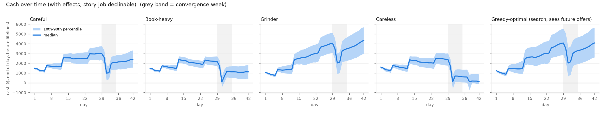
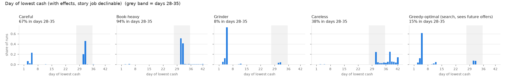
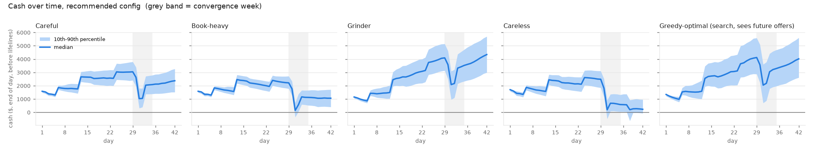
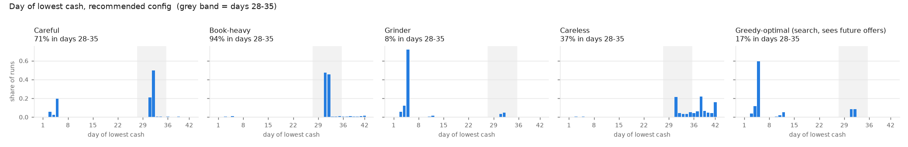

# Paws & Paychecks: economy simulation report — round 2 (spec v0.3)

This report covers round 2 of the economy simulation, specified in `design/SIM_BASELINE.md` §10 (v0.3).
- **What ran:** five policies × {with effects, no effects} × {story job declinable, story job always taken}; the
  starting-cash search, H tuning and CAT-price check; a sensitivity sweep; and a re-run with recommended config
  changes.
- **What's new in v0.3:** regular clients A/B/C, the fixed day-1 and story jobs, her loan and the parents' ending,
  the five ending goals, and the 36-effect pool with caps and synergies.
- **Where things live:** economy numbers in `data/economy.yaml`, player behaviour in `data/policies.yaml`.
  Interpretation choices for ambiguous parts of the spec are in §11.

**Headlines**
- **Tuned values:** starting cash **$1,900**, book **H = 67.5 h** (implied starting progress ~69%), CAT tool
  **$55/week**. The main variant meets **16 of 31** targets. Grinder, careless and greedy-optimal meet all their
  ending rows except careless's parents' rate. Careful's book-finish and low-point targets are met. So are the CAT
  pick rate and the story-job acceptance.
- **The ending targets can't all be met together, by any tuning.** Three reasons, each needing an owner decision (§11):
  1. **Careful meets the four non-book goals in every run.** Its stress stays near 0 under the spec's stress
     numbers, and it meets her and the pet by definition. So careful's best rate equals its book-finish rate
     (49% vs 25–35%), and good-or-better is 100% (vs 70–80%).
  2. **Book-heavy finishes the book in 100% of runs at any H from 50 to 80 h.** It plans ~117 book hours. Its
     85–95% finish target, and good-or-better being above best, can't come from H.
  3. **Money pulls the targets apart.** Book-heavy's best (45–55%) needs half its runs to end with ≥ $1,500, which
     takes high starting cash. Careless's parents' ending (≥ 60%) and book-heavy's (15–30%) need low cash. At
     $1,900, careless reaches the parents' ending in only 6% of runs and book-heavy in 0%.
- **Effects are smaller, as intended.** Careful's effect boost is +8% on average and +12% at the end (targets
  +10–20% and +20–35%). Careful holds 10.5 effects (target 7–9). The 36-effect pool fixes round 1's sameness:
  except the Saturday class, no effect is in more than 70% of any policy's top decile.
- **Feedback improves** a lot over round 1 (careful 41% → 73% of runs with a job payment every week). It still
  misses 90%: the story job fills weeks 2–4 and pays on day 33.
- **Strongest levers:** H (careful's book finish 95% → 0% over ±25%), starting cash, rent, effect sizes. The loan
  window, the parents' floor and the late-payment share barely matter at the tuned cash.
- **Recommended overlay (§10):** a parents' floor of −$100 and a $400 loan cap; work-milestone offers every 12th
  job; Saturday-class income cut to $60; the neighbor made free; starting cash $2,000. Result: **17 of 31** met.
  The overlay fixes the top-decile target and the dead neighbor, and lifts careless's parents' ending to 17%.
  It doesn't touch the structural conflicts above.

Reproduce with `python -m sim.run --all` (2,000 seeds per policy and variant; deterministic per (config, policy, seed)). Round 1 is archived in `SIM_REPORT_round1.md`.

Sections: 1 Tuning · 2 Endings · 3 Money, stress, time · 4 Acceptance targets · 5 Charts · 6 Effects ·
7 Regular clients and the story job · 8 Sensitivity · 9 Comparison with round 1 · 10 Recommended changes and
re-run · 11 Open issues

## 1. Tuning: starting cash, book hours H, CAT price

- **Starting cash (after day-1 rent): $1,900** (first pass: $1,900).
- **Book: H = 67.5 hours** of hard chapters left (±5% per run: 64.1–70.9 h), 10,125 words at 150 w/h. With a whole book of 215 h (sim choice), the implied starting progress is **69%** (67%–70%).
- **CAT tool: $55/week** (unchanged).

Order (§10.3): starting-cash search → tune H for careful's book target → CAT-price check → re-check starting cash once. Each point runs the four player policies, with effects and the story job declinable, 2,000 seeds. A cash value scores by how many of the §9.3 ending targets (book-finish rows excluded, H sets those) plus careful's low-point target it meets, then by the total distance to the missed ones, then the lower cash.

### Starting-cash search, first pass (H and CAT price from the config file)

| Start cash | Careful parents (<=8%) | Careful best (25-35%) | Careful good+ (70-80%) | Careful low d28-35 (>=60%) | Book-heavy parents (15-30%) | Book-heavy best (45-55%) | Book-heavy good+ (60-70%) | Grinder parents (<=5%) | Careless parents (>=60%) | Met | Distance |
|---|---|---|---|---|---|---|---|---|---|---|---|
| 800 | 0% | 33% | 84% | 77% | 7% | 1% | 1% | 9% | 53% | 7/13 | 1.264 |
| 900 | 0% | 36% | 89% | 77% | 4% | 1% | 1% | 10% | 43% | 6/13 | 1.458 |
| 1,000 | 0% | 38% | 92% | 77% | 3% | 2% | 2% | 4% | 34% | 7/13 | 1.554 |
| 1,100 | 0% | 40% | 94% | 76% | 2% | 4% | 4% | 1% | 29% | 7/13 | 1.607 |
| 1,200 | 0% | 41% | 96% | 76% | 1% | 6% | 6% | 1% | 24% | 7/13 | 1.638 |
| 1,300 | 0% | 42% | 98% | 76% | 1% | 10% | 10% | 0% | 19% | 7/13 | 1.656 |
| 1,400 | 0% | 43% | 99% | 76% | 0% | 13% | 13% | 0% | 15% | 7/13 | 1.649 |
| 1,500 | 0% | 48% | 99% | 67% | 0% | 18% | 18% | 0% | 12% | 7/13 | 1.630 |
| 1,600 | 0% | 49% | 100% | 67% | 0% | 25% | 25% | 0% | 10% | 7/13 | 1.533 |
| 1,700 | 0% | 49% | 100% | 67% | 0% | 34% | 34% | 0% | 8% | 7/13 | 1.383 |
| 1,800 | 0% | 49% | 100% | 67% | 0% | 46% | 46% | 0% | 7% | 8/13 | 1.159 |
| 1,900 **(chosen)** | 0% | 49% | 100% | 67% | 0% | 55% | 55% | 0% | 6% | 8/13 | 1.079 |
| 2,000 | 0% | 49% | 100% | 67% | 0% | 63% | 63% | 0% | 5% | 8/13 | 1.122 |
| 2,100 | 0% | 49% | 100% | 67% | 0% | 71% | 71% | 0% | 4% | 7/13 | 1.210 |
| 2,200 | 0% | 49% | 100% | 67% | 0% | 78% | 78% | 0% | 3% | 7/13 | 1.365 |
| 2,300 | 0% | 49% | 100% | 67% | 0% | 84% | 84% | 0% | 2% | 7/13 | 1.503 |
| 2,400 | 0% | 49% | 100% | 67% | 0% | 89% | 89% | 0% | 2% | 7/13 | 1.597 |

### H search (starting cash $1,900); target: careful finishes ~40–50% (aim 45%)

| H (hours) | Careful finishes | Careful near-finished | Careful best | Careful good+ | Book-heavy finishes | Book-heavy best | Book-heavy parents |
|---|---|---|---|---|---|---|---|
| 50 | 96% | 4% | 96% | 100% | 100% | 59% | 0% |
| 52.5 | 92% | 8% | 92% | 100% | 100% | 58% | 0% |
| 55 | 88% | 12% | 88% | 100% | 100% | 57% | 0% |
| 57.5 | 82% | 16% | 82% | 100% | 100% | 56% | 0% |
| 60 | 77% | 18% | 77% | 100% | 100% | 56% | 0% |
| 62.5 | 72% | 21% | 72% | 100% | 100% | 56% | 0% |
| 65 | 64% | 25% | 64% | 100% | 100% | 55% | 0% |
| 67.5 **(chosen)** | 49% | 37% | 49% | 100% | 100% | 55% | 0% |
| 70 | 31% | 49% | 31% | 100% | 100% | 54% | 0% |
| 72.5 | 17% | 59% | 17% | 100% | 100% | 54% | 0% |
| 75 | 7% | 65% | 7% | 100% | 100% | 54% | 0% |
| 77.5 | 2% | 64% | 2% | 100% | 100% | 53% | 0% |
| 80 | 0% | 54% | 0% | 100% | 100% | 52% | 0% |

### CAT-tool price check; target: careful picks it 40–60% of the time when offered

| Price/week | Careful pick rate |
|---|---|
| $30 | 82% |
| $35 | 77% |
| $40 | 76% |
| $45 | 72% |
| $50 | 63% |
| $55 **(chosen)** | 45% |
| $60 | 39% |
| $65 | 36% |
| $70 | 31% |
| $75 | 17% |
| $80 | 5% |
| $85 | 5% |
| $90 | 3% |
| $95 | 1% |
| $100 | 0% |

### Starting-cash re-check (H = 67.5, CAT $55/week)

| Start cash | Careful parents (<=8%) | Careful best (25-35%) | Careful good+ (70-80%) | Careful low d28-35 (>=60%) | Book-heavy parents (15-30%) | Book-heavy best (45-55%) | Book-heavy good+ (60-70%) | Grinder parents (<=5%) | Careless parents (>=60%) | Met | Distance |
|---|---|---|---|---|---|---|---|---|---|---|---|
| 800 | 0% | 33% | 84% | 77% | 7% | 1% | 1% | 9% | 53% | 7/13 | 1.264 |
| 900 | 0% | 36% | 89% | 77% | 4% | 1% | 1% | 10% | 43% | 6/13 | 1.458 |
| 1,000 | 0% | 38% | 92% | 77% | 3% | 2% | 2% | 4% | 34% | 7/13 | 1.554 |
| 1,100 | 0% | 40% | 94% | 76% | 2% | 4% | 4% | 1% | 29% | 7/13 | 1.607 |
| 1,200 | 0% | 41% | 96% | 76% | 1% | 6% | 6% | 1% | 24% | 7/13 | 1.638 |
| 1,300 | 0% | 42% | 98% | 76% | 1% | 10% | 10% | 0% | 19% | 7/13 | 1.656 |
| 1,400 | 0% | 43% | 99% | 76% | 0% | 13% | 13% | 0% | 15% | 7/13 | 1.649 |
| 1,500 | 0% | 48% | 99% | 67% | 0% | 18% | 18% | 0% | 12% | 7/13 | 1.630 |
| 1,600 | 0% | 49% | 100% | 67% | 0% | 25% | 25% | 0% | 10% | 7/13 | 1.533 |
| 1,700 | 0% | 49% | 100% | 67% | 0% | 34% | 34% | 0% | 8% | 7/13 | 1.383 |
| 1,800 | 0% | 49% | 100% | 67% | 0% | 46% | 46% | 0% | 7% | 8/13 | 1.159 |
| 1,900 **(chosen)** | 0% | 49% | 100% | 67% | 0% | 55% | 55% | 0% | 6% | 8/13 | 1.079 |
| 2,000 | 0% | 49% | 100% | 67% | 0% | 63% | 63% | 0% | 5% | 8/13 | 1.122 |
| 2,100 | 0% | 49% | 100% | 67% | 0% | 71% | 71% | 0% | 4% | 7/13 | 1.210 |
| 2,200 | 0% | 49% | 100% | 67% | 0% | 78% | 78% | 0% | 3% | 7/13 | 1.365 |
| 2,300 | 0% | 49% | 100% | 67% | 0% | 84% | 84% | 0% | 2% | 7/13 | 1.503 |
| 2,400 | 0% | 49% | 100% | 67% | 0% | 89% | 89% | 0% | 2% | 7/13 | 1.597 |

**Reading the searches**
- **Starting cash.** Most cash-sensitive rows don't move with cash: careful's parents' rate is 0% everywhere, and
  grinder and careless always meet their tier rows. What does move is a trade-off:
  - book-heavy's best ending: 0% at $800 → 55% at $1,900 → 86% at $2,400;
  - careless's parents' ending: ~50% at $800 → 6% at $1,900.

  $1,900 is where book-heavy's best enters its band. That gains one more target than any lower value, so the
  search picks it. **Lower cash would be the right choice if punishing carelessness matters more than book-heavy's
  best ending.** The search can't make that call; it's in §11.
- **H.** Careful's finish rate is steep in H: 69% at 62.5 h, 49% at 67.5 h, 30% at 70 h. ±5% per-run variation
  plus the effects' book bonuses make it a cliff, not a slope. Players near the cliff end "near-finished" (37% of
  careful runs at 67.5 h), which counts toward the good ending.
- **H vs. story text.** The implied starting progress (~69%) assumes a 215-hour book. That number only exists for
  the story text; any other total scales it.
- **CAT tool.** At $60 careful picks it 39% of the time; at $55, 45%. The pick rate depends on the policies'
  hand-set value weights (§6), so read it as "about $55–60 is the balance point for a careful player", not as a
  measured player behaviour.

## 2. Endings

Tier shares of all runs; goal rates over all runs (a parents' run is measured up to its last day). "Most missed" counts runs that did not end with the parents. *Greedy-optimal is search-based and reads the run's future offers.

### With effects, story job declinable (main)

| Policy | Best | Good | Mixed | Hard | Parents | Good or better | Goal: pet | Goal: relationship | Goal: book | Goal: stress | Goal: finances | Most missed goal (share of all runs) | Book near-finished |
|---|---|---|---|---|---|---|---|---|---|---|---|---|---|
| Careful | 49% | 51% | 0% | 0% | 0% | 100% | 100% | 100% | 49% | 100% | 100% | book (51%) | 37% |
| Book-heavy | 55% | 0% | 45% | 0% | 0% | 55% | 100% | 100% | 100% | 100% | 55% | finances (45%) | 0% |
| Grinder | 0% | 0% | 0% | 100% | 0% | 0% | 0% | 0% | 0% | 82% | 100% | book (100%) | 0% |
| Careless | 0% | 0% | 0% | 94% | 6% | 0% | 0% | 0% | 0% | 100% | 4% | book (94%) | 0% |
| Greedy-optimal* | 0% | 0% | 0% | 100% | 0% | 0% | 0% | 0% | 0% | 82% | 100% | book (100%) | 0% |

### With effects, story job always taken

| Policy | Best | Good | Mixed | Hard | Parents | Good or better | Goal: pet | Goal: relationship | Goal: book | Goal: stress | Goal: finances | Most missed goal (share of all runs) | Book near-finished |
|---|---|---|---|---|---|---|---|---|---|---|---|---|---|
| Careful | 40% | 60% | 0% | 0% | 0% | 100% | 100% | 100% | 40% | 100% | 100% | book (60%) | 35% |
| Book-heavy | 59% | 0% | 41% | 0% | 0% | 59% | 100% | 100% | 100% | 100% | 59% | finances (41%) | 0% |
| Grinder | 0% | 0% | 0% | 100% | 0% | 0% | 0% | 0% | 0% | 80% | 100% | book (100%) | 0% |
| Careless | 0% | 0% | 0% | 94% | 6% | 0% | 0% | 0% | 0% | 100% | 4% | book (94%) | 0% |
| Greedy-optimal* | 0% | 0% | 0% | 100% | 0% | 0% | 0% | 0% | 0% | 84% | 100% | book (100%) | 0% |

**Reading the tables**
- **Careful** never misses the pet, relationship, stress or finance goal. It meets her and the pet by
  definition, and its stress stays near 0 (average over days 36–42: 0). Every careful run is best or good,
  split by the book alone.
- **Book-heavy** always finishes the book. Its ending is decided by money: best when the end value is ≥ $1,500
  (55%), mixed otherwise. It never reaches the parents' ending at this cash. When it runs short (46% of runs
  have a crisis), rent-late and early payment cover the gap. The late crisis comes when deferred rent falls due
  on day 38. A loan taken then is due after day 42, so it can't trigger the parents' ending.
- **Grinder and greedy-optimal** miss the pet and relationship goals in every run, so they are always "hard".
  The money system still pays them most: greedy's median end value is ~$5,500, grinder's ~$6,100. As in round 1,
  neglect is punished by the ending, not by money.
- **Careless** misses everything but stress. Mostly "hard"; the parents' ending in 6%.
- **Story job always taken vs. declinable:**
  - careful's best falls 49% → 40% (the extra job takes book time);
  - book-heavy's best rises 55% → 59% (the extra $1,000 net improves its finances);
  - otherwise the same.

## 3. Money, stress, time: summary per policy

Means or shares over runs unless marked median. "End value" = cash + 0.9 × receivables − debts. Finances good = no debt and end value ≥ $1,500; okay = solvent, below that.

### With effects, story job declinable (main)

| Policy | Parents' ending (day, median) | via loan / floor | Crisis | Loan taken (repaid on time) | Lowest cash (median) | Low in d28-35 | End value median (p10 / p90) | Finances good / okay | Days stress>70 | Stress avg d36-42 | Illness days | Rel. weeks missed | Pet deficit days (weighted) | Book milestones | Book hours | Effects held | Paid hours | Jobs done | Jobs late | Story job taken |
|---|---|---|---|---|---|---|---|---|---|---|---|---|---|---|---|---|---|---|---|---|
| Careful | 0% (-) | 0% / 0% | 5% | 0% (-) | 932 | 67% | 3,288 (2,612 / 3,971) | 100% / 0% | 0.0 | 0 | 0.00 | 0.0 | 0.0 | 2.48 | 63 | 10.5 | 189 | 19.6 | 0.0 | 88% |
| Book-heavy | 0% (42) | 0% / 0% | 46% | 2% (30%) | 45 | 94% | 1,562 (922 / 2,198) | 55% / 45% | 0.0 | 0 | 0.00 | 0.0 | 0.0 | 3.00 | 68 | 10.4 | 126 | 15.0 | 0.0 | 89% |
| Grinder | 0% (-) | 0% / 0% | 1% | 0% (-) | 734 | 8% | 6,062 (4,459 / 7,285) | 100% / 0% | 2.8 | 29 | 0.18 | 5.2 | 18.9 | 0.00 | 0 | 13.2 | 357 | 28.8 | 0.1 | 96% |
| Careless | 6% (41) | 1% / 5% | 73% | 48% (21%) | -126 | 38% | 483 (-302 / 1,226) | 4% / 90% | 0.0 | 5 | 0.00 | 4.3 | 17.8 | 0.08 | 17 | 8.2 | 161 | 13.5 | 8.2 | 69% |
| Greedy-optimal* | 0% (-) | 0% / 0% | 3% | 0% (100%) | 826 | 15% | 5,533 (4,165 / 6,862) | 100% / 0% | 2.8 | 24 | 0.13 | 6.0 | 47.4 | 0.00 | 0 | 10.8 | 316 | 25.8 | 0.2 | 62% |

### With effects, story job always taken

| Policy | Parents' ending (day, median) | via loan / floor | Crisis | Loan taken (repaid on time) | Lowest cash (median) | Low in d28-35 | End value median (p10 / p90) | Finances good / okay | Days stress>70 | Stress avg d36-42 | Illness days | Rel. weeks missed | Pet deficit days (weighted) | Book milestones | Book hours | Effects held | Paid hours | Jobs done | Jobs late | Story job taken |
|---|---|---|---|---|---|---|---|---|---|---|---|---|---|---|---|---|---|---|---|---|
| Careful | 0% (-) | 0% / 0% | 5% | 0% (-) | 929 | 69% | 3,328 (2,658 / 4,006) | 100% / 0% | 0.0 | 0 | 0.00 | 0.0 | 0.0 | 2.38 | 61 | 10.3 | 192 | 19.2 | 0.0 | 100% |
| Book-heavy | 0% (-) | 0% / 0% | 46% | 2% (23%) | 45 | 99% | 1,628 (956 / 2,279) | 59% / 41% | 0.0 | 0 | 0.00 | 0.0 | 0.0 | 3.00 | 68 | 10.4 | 129 | 14.8 | 0.0 | 100% |
| Grinder | 0% (-) | 0% / 0% | 1% | 0% (-) | 734 | 8% | 6,034 (4,402 / 7,263) | 100% / 0% | 3.3 | 30 | 0.21 | 5.2 | 18.9 | 0.00 | 0 | 13.1 | 358 | 28.6 | 0.2 | 100% |
| Careless | 6% (41) | 1% / 5% | 75% | 47% (21%) | -128 | 41% | 476 (-289 / 1,203) | 4% / 90% | 0.0 | 5 | 0.00 | 4.3 | 17.8 | 0.08 | 17 | 8.2 | 162 | 13.0 | 7.9 | 100% |
| Greedy-optimal* | 0% (-) | 0% / 0% | 4% | 0% (-) | 818 | 17% | 5,784 (4,386 / 7,100) | 100% / 0% | 2.3 | 21 | 0.10 | 6.0 | 47.8 | 0.00 | 0 | 10.8 | 322 | 25.8 | 0.3 | 100% |

### No effects (control), story job declinable

| Policy | Parents' ending (day, median) | via loan / floor | Crisis | Loan taken (repaid on time) | Lowest cash (median) | Low in d28-35 | End value median (p10 / p90) | Finances good / okay | Days stress>70 | Stress avg d36-42 | Illness days | Rel. weeks missed | Pet deficit days (weighted) | Book milestones | Book hours | Effects held | Paid hours | Jobs done | Jobs late | Story job taken |
|---|---|---|---|---|---|---|---|---|---|---|---|---|---|---|---|---|---|---|---|---|
| Careful | 0% (-) | 0% / 0% | 8% | 0% (57%) | 765 | 80% | 2,669 (2,062 / 3,303) | 99% / 1% | 0.0 | 0 | 0.00 | 0.0 | 0.0 | 2.04 | 60 | 0.0 | 192 | 17.0 | 0.2 | 87% |
| Book-heavy | 0% (41) | 0% / 0% | 54% | 4% (17%) | -21 | 94% | 1,192 (632 / 1,743) | 24% / 75% | 0.0 | 0 | 0.00 | 0.0 | 0.0 | 3.00 | 69 | 0.0 | 128 | 13.5 | 0.4 | 89% |
| Grinder | 0% (-) | 0% / 0% | 4% | 1% (82%) | 1,088 | 46% | 2,583 (1,619 / 3,528) | 92% / 8% | 25.7 | 86 | 2.67 | 5.2 | 16.9 | 0.00 | 0 | 0.0 | 358 | 17.0 | 2.1 | 92% |
| Careless | 4% (41) | 1% / 3% | 72% | 45% (19%) | -93 | 32% | 484 (-230 / 1,105) | 1% / 95% | 0.0 | 5 | 0.00 | 4.4 | 16.8 | 0.05 | 17 | 0.0 | 162 | 12.9 | 7.8 | 69% |
| Greedy-optimal* | 0% (40) | 0% / 0% | 2% | 0% (67%) | 1,161 | 24% | 4,899 (3,873 / 5,936) | 100% / 0% | 2.6 | 20 | 0.12 | 6.0 | 42.0 | 0.00 | 0 | 0.0 | 334 | 23.3 | 0.3 | 56% |

### No effects (control), story job always taken

| Policy | Parents' ending (day, median) | via loan / floor | Crisis | Loan taken (repaid on time) | Lowest cash (median) | Low in d28-35 | End value median (p10 / p90) | Finances good / okay | Days stress>70 | Stress avg d36-42 | Illness days | Rel. weeks missed | Pet deficit days (weighted) | Book milestones | Book hours | Effects held | Paid hours | Jobs done | Jobs late | Story job taken |
|---|---|---|---|---|---|---|---|---|---|---|---|---|---|---|---|---|---|---|---|---|
| Careful | 0% (-) | 0% / 0% | 7% | 0% (0%) | 776 | 84% | 2,724 (2,116 / 3,374) | 99% / 1% | 0.0 | 0 | 0.00 | 0.0 | 0.0 | 1.91 | 57 | 0.0 | 197 | 16.8 | 0.3 | 100% |
| Book-heavy | 0% (42) | 0% / 0% | 53% | 3% (17%) | -15 | 100% | 1,250 (681 / 1,840) | 30% / 70% | 0.0 | 0 | 0.00 | 0.0 | 0.0 | 3.00 | 69 | 0.0 | 132 | 13.3 | 0.5 | 100% |
| Grinder | 0% (-) | 0% / 0% | 4% | 0% (80%) | 1,084 | 47% | 2,564 (1,592 / 3,507) | 91% / 9% | 26.0 | 86 | 2.72 | 5.2 | 16.9 | 0.00 | 0 | 0.0 | 359 | 16.7 | 2.2 | 100% |
| Careless | 4% (41) | 1% / 3% | 73% | 45% (19%) | -89 | 35% | 478 (-217 / 1,109) | 1% / 95% | 0.0 | 5 | 0.00 | 4.4 | 16.8 | 0.05 | 17 | 0.0 | 162 | 12.5 | 7.5 | 100% |
| Greedy-optimal* | 0% (-) | 0% / 0% | 2% | 0% (-) | 1,143 | 31% | 4,999 (3,999 / 6,049) | 100% / 0% | 1.4 | 15 | 0.06 | 6.0 | 42.0 | 0.00 | 0 | 0.0 | 344 | 23.3 | 1.4 | 100% |

**Notes**
- **Effects still matter for money and the book**, less than in round 1. With effects off, careful's end value
  falls from $3,288 to $2,669 and book milestones from 2.48 to 2.04. Book-heavy's good finances fall from 55% to
  24%.
- **The loan rarely decides anything at the tuned cash.** Book-heavy borrows in 2% of runs, careless in 48%.
  Careless repays on time in only 21% of its loans, which is how it reaches the parents' ending.
- **Grinder's stress goal holds in ~82% of runs.** It has ~2.8 days above 70 and recovers by days 36–42.

### Feedback cadence (with effects)

Job payments include the day-1 job and deposits; pre-move invoices are excluded (owner decision, 2026-11-27). The last column counts them, for comparison.

| Policy | Median days delivery→payment | Job payments wk1 | wk2 | wk3 | wk4 | wk5 | wk6 | Runs with a job payment every week | ...counting pre-move invoices |
|---|---|---|---|---|---|---|---|---|---|
| Careful | 7 | 1.8 | 2.3 | 2.3 | 2.2 | 3.9 | 3.6 | 73% | 88% |
| Book-heavy | 5 | 1.6 | 1.4 | 1.3 | 1.5 | 3.4 | 3.1 | 48% | 75% |
| Grinder | 7 | 2.2 | 3.9 | 4.6 | 4.0 | 5.2 | 4.6 | 94% | 98% |
| Careless | 7 | 1.5 | 1.9 | 2.5 | 2.4 | 2.1 | 2.0 | 61% | 76% |
| Careful (story forced) | 7 | 1.8 | 2.2 | 2.2 | 2.1 | 3.9 | 3.6 | 69% | 86% |
| Book-heavy (story forced) | 5 | 1.6 | 1.4 | 1.2 | 1.4 | 3.4 | 3.1 | 44% | 72% |
| Grinder (story forced) | 7 | 2.2 | 3.9 | 4.5 | 3.9 | 5.1 | 4.5 | 93% | 97% |
| Careless (story forced) | 7 | 1.5 | 1.9 | 2.5 | 2.3 | 2.0 | 1.9 | 59% | 74% |

- **Week 1 is fixed:** the day-1 job pays on day 4 in every run.
- **The gaps are in weeks 2–4.** Careful and book-heavy take the 12,500-word story job (88% of runs), which fills
  those weeks and pays only on day 33. Few other jobs fit, so some weeks bring no job payment.
- **Grinder works enough hours to take other jobs too**, and meets the target (94%).
- **Other levers move it little.** Raising client B to a job every week moved careful only from 69% to 73% in a
  500-seed probe. The gap is the story job's design, not a tuning gap (§11).

## 4. Acceptance targets (§10.5)

Main variant (with effects, story job declinable): **16 of 31 met.** The right-hand columns repeat the check with the story job always taken.

| Policy | Target | Result (declinable) | Met | Result (always taken) | Met |
|---|---|---|---|---|---|
| Careful | Finishes book ~40-50% | 48.9% | yes | 40.4% | yes |
| Careful | Best ~25-35% | 48.9% | **no** | 40.4% | **no** |
| Careful | Good or better ~70-80% | 100.0% | **no** | 100.0% | **no** |
| Careful | Parents' ending <= 8% | 0.0% | yes | 0.0% | yes |
| Book-heavy | Finishes book ~85-95% | 100.0% | **no** | 100.0% | **no** |
| Book-heavy | Best ~45-55% | 54.8% | yes | 59.2% | **no** |
| Book-heavy | Good or better ~60-70% | 54.8% | **no** | 59.2% | **no** |
| Book-heavy | Parents' ending 15-30% | 0.1% | **no** | 0.0% | **no** |
| Grinder | Finishes book ~0% (<= 2%) | 0.0% | yes | 0.0% | yes |
| Grinder | Best 0% | 0.0% | yes | 0.0% | yes |
| Grinder | Good or better <= 10% | 0.0% | yes | 0.0% | yes |
| Grinder | Parents' ending <= 5% | 0.0% | yes | 0.0% | yes |
| Careless | Finishes book ~0-5% | 0.0% | yes | 0.0% | yes |
| Careless | Best ~0% (<= 2%) | 0.0% | yes | 0.0% | yes |
| Careless | Good or better <= 10% | 0.0% | yes | 0.0% | yes |
| Careless | Parents' ending >= 60% | 6.1% | **no** | 5.8% | **no** |
| Greedy-optimal* | Best 0% | 0.0% | yes | 0.0% | yes |
| Greedy-optimal* | Good or better 0% | 0.0% | yes | 0.0% | yes |
| Careful | Lowest cash in days 28-35 in >= 60% of runs | 66.6% | yes | 68.8% | yes |
| Careful | Holds 7-9 effects at the end | 10.5 | **no** | 10.3 | **no** |
| Grinder | Holds 5-6 effects (or its natural count; report) | 13.2 | **no** | 13.1 | **no** |
| Careless | Holds 5-6 effects (or its natural count; report) | 8.2 | **no** | 8.2 | **no** |
| Effects | No single offered effect in > 70% of top-decile runs (any policy) | highest: side_class for careful, 86% | **no** | highest: side_class for careful, 82% | **no** |
| Careful | CAT tool picked 40-60% of the time when offered | 45% | yes | 45% | yes |
| Effects | No dead effects | deposit_terms, neighbor_sitter | **no** | deposit_terms, neighbor_sitter | **no** |
| Careful | Effect boost: average +10-20% | +7.7% | **no** | +7.2% | **no** |
| Careful | Effect boost: last 5 workdays +20-35% | +11.7% | **no** | +11.4% | **no** |
| Careful | Feedback: a job payment in each of weeks 1-6 in >= 90% of runs | 73% | **no** | 69% | **no** |
| Book-heavy | Feedback: a job payment in each of weeks 1-6 in >= 90% of runs | 48% | **no** | 44% | **no** |
| Grinder | Feedback: a job payment in each of weeks 1-6 in >= 90% of runs | 94% | yes | 93% | yes |
| Careful | Story job accepted in >= 70% of runs (declinable) | 88% | yes | 100% | yes |

"Always taken" changes little except careful's book (40% finished) and book-heavy's best (59%, just outside its
band). The targets that miss do so for the structural reasons in the headlines, not for want of a better number.

## 5. Charts

## 6. Effects

**How the policies pick effects.** Careful, book-heavy, grinder and greedy-optimal rate each offered effect with a
short analytic estimate (`sim/src/effect_value.py`) of what it changes over the rest of the run, for that player's
schedule, in five currencies:
- money;
- stress points;
- book hours;
- free hours;
- risk (expected pet-deficit days or missed weeks).

Each policy has hand-set weights for these in `data/policies.yaml`. Careful, for example: $1 = 1, a stress point
= 2, a book hour = 15, a free hour = 5. Grinder still takes efficiency/throughput/rate effects first. Careless
picks at random. Shop items follow fixed buy rules (cash threshold, by day 28). **Pick rates therefore measure
these heuristics, not real players.**

### Offers by source and effects held (per run, mean)

| Policy | Weekly | Work milestone | Book milestone | Shop buys | Held at end | Effect boost avg / last 5 workdays |
|---|---|---|---|---|---|---|
| Careful | 5.0 | 2.01 | 2.48 | 1.00 | 10.5 | +7.7% / +11.7% |
| Book-heavy | 5.0 | 1.41 | 3.00 | 1.00 | 10.4 | +4.4% / +5.8% |
| Grinder | 5.0 | 3.16 | 0.00 | 5.00 | 13.2 | +16.7% / +21.6% |
| Careless | 5.0 | 1.23 | 0.08 | 1.94 | 8.2 | +5.1% / +9.3% |
| Greedy-optimal* | 5.0 | 2.78 | 0.00 | 3.00 | 10.8 | +15.0% / +18.6% |

Targets: careful holds 7–9, neglectful/narrow 5–6 (§8.1); careful's boost +10–20% on average and +20–35% in the last 5 workdays (§8.2). "Effect boost" = the effects' multiplier on pay per paid hour (efficiency × throughput × rate effects), averaged over the hours worked.

### Pick rate when offered, and share of runs holding each effect

Left block: pick rate when the effect is one of the three offered (shop items: share of runs that bought it). Right block: share of all runs holding it at the end / share of top-decile runs (by end value) that picked it from an offer. Careless picks at random.

| Effect | Category | pick: Careful | pick: Book-heavy | pick: Grinder | pick: Careless | pick: Greedy-optimal* | held all / top10: Careful | held all / top10: Book-heavy | held all / top10: Grinder | held all / top10: Careless | held all / top10: Greedy-optimal* |
|---|---|---|---|---|---|---|---|---|---|---|---|
| deep_focus | efficiency 📖 | 35% | 63% | 66% | 32% | 57% | 27% / 27% | 45% / 39% | 41% / 54% | 17% / 14% | 35% / 36% |
| context_switcher | efficiency | 56% | 47% | 72% | 34% | 18% | 39% / 40% | 36% / 34% | 45% / 40% | 18% / 16% | 13% / 10% |
| morning_person | efficiency | 78% | 53% | 78% | 31% | 53% | 49% / 51% | 39% / 48% | 45% / 48% | 17% / 18% | 33% / 32% |
| night_owl | efficiency | 2% | 2% | 58% | 33% | 51% | 2% / 4% | 2% / 1% | 37% / 34% | 17% / 12% | 31% / 20% |
| pomodoro | efficiency | 87% | 58% | 53% | 37% | 2% | 53% / 57% | 41% / 41% | 35% / 34% | 19% / 24% | 2% / 1% |
| sunday_planning | efficiency | 44% | 26% | 85% | 31% | 72% | 32% / 30% | 21% / 19% | 47% / 52% | 17% / 20% | 42% / 45% |
| coworking (shop) | efficiency | bought 0% | bought 0% | bought 100% | bought 33% | bought 100% | 0% / · | 0% / · | 100% / · | 33% / · | 100% / · |
| headphones (shop) | efficiency | bought 100% | bought 100% | bought 100% | bought 32% | bought 100% | 100% / · | 100% / · | 100% / · | 32% / · | 100% / · |
| cat_tool | throughput | 45% | 10% | 93% | 33% | 89% | 33% / 30% | 8% / 5% | 53% / 60% | 18% / 16% | 46% / 44% |
| second_monitor (shop) | throughput | bought 0% | bought 0% | bought 100% | bought 32% | bought 100% | 0% / · | 0% / · | 100% / · | 32% / · | 100% / · |
| termbase | throughput | 4% | 3% | 61% | 35% | 38% | 4% / 2% | 3% / 2% | 38% / 33% | 19% / 14% | 23% / 23% |
| pe_veteran | throughput 📖 | 20% | 12% | 55% | 32% | 29% | 17% / 12% | 11% / 16% | 35% / 29% | 18% / 13% | 20% / 15% |
| direct_network | rate | 11% | 25% | 61% | 33% | 58% | 13% / 2% | 28% / 18% | 48% / 44% | 22% / 18% | 44% / 50% |
| specialist_niche | rate | 88% | 71% | 97% | 34% | 93% | 67% / 74% | 60% / 64% | 65% / 79% | 23% / 22% | 60% / 64% |
| rush_specialist | rate | 22% | 15% | 80% | 33% | 78% | 24% / 17% | 17% / 9% | 59% / 57% | 22% / 22% | 57% / 58% |
| loyal_client | rate | 13% | 23% | 56% | 32% | 35% | 16% / 8% | 26% / 15% | 43% / 34% | 21% / 25% | 28% / 15% |
| fast_invoicer | cash_flow | 40% | 27% | 4% | 33% | 9% | 42% / 40% | 30% / 31% | 4% / 4% | 22% / 22% | 9% / 10% |
| invoice_reminders | cash_flow | 22% | 22% | 9% | 33% | 13% | 24% / 26% | 25% / 20% | 8% / 8% | 23% / 22% | 12% / 12% |
| deposit_terms | cash_flow | 4% | 5% | 0% | 32% | 0% | 5% / 5% | 5% / 4% | 0% / 0% | 21% / 47% | 0% / 0% |
| side_class | cash_flow | 97% | 59% | 42% | 32% | 89% | 71% / 86% | 53% / 80% | 36% / 44% | 21% / 34% | 58% / 64% |
| frugal_cooking | cash_flow | 65% | 45% | 37% | 34% | 68% | 56% / 60% | 44% / 56% | 31% / 32% | 23% / 32% | 49% / 52% |
| morning_pages | stress | 50% | 87% | 2% | 33% | 21% | 48% / 44% | 64% / 64% | 2% / 1% | 22% / 22% | 18% / 20% |
| nap_habit | stress | 9% | 12% | 13% | 35% | 24% | 10% / 10% | 14% / 15% | 12% / 14% | 24% / 25% | 21% / 26% |
| boundaries | stress | 18% | 90% | 1% | 31% | 0% | 21% / 20% | 70% / 64% | 1% / 0% | 21% / 26% | 0% / 0% |
| standing_desk (shop) | stress | bought 0% | bought 0% | bought 100% | bought 34% | bought 0% | 0% / · | 0% / · | 100% / · | 34% / · | 0% / · |
| shared_calendar | her | 25% | 31% | 29% | 36% | 37% | 27% / 21% | 33% / 35% | 26% / 25% | 24% / 18% | 31% / 30% |
| sunday_brunch | her | 10% | 8% | 1% | 33% | 5% | 12% / 13% | 10% / 9% | 1% / 2% | 22% / 14% | 5% / 4% |
| quiet_company | her 📖 | 29% | 12% | 15% | 35% | 25% | 31% / 26% | 14% / 14% | 15% / 16% | 23% / 18% | 22% / 20% |
| evening_walks | her | 33% | 36% | 6% | 34% | 7% | 35% / 33% | 36% / 40% | 6% / 6% | 23% / 16% | 7% / 6% |
| walk_routine | pet | 66% | 86% | 33% | 35% | 40% | 55% / 46% | 67% / 62% | 29% / 30% | 23% / 17% | 32% / 28% |
| reading_aloud | pet 📖 | 70% | 52% | 21% | 32% | 33% | 61% / 62% | 45% / 43% | 20% / 16% | 22% / 26% | 29% / 27% |
| neighbor_sitter | pet | 3% | 5% | 1% | 34% | 1% | 4% / 2% | 6% / 5% | 1% / 0% | 22% / 20% | 1% / 0% |
| puppy_class (shop) | pet | bought 0% | bought 0% | bought 0% | bought 32% | bought 0% | 0% / · | 0% / · | 0% / · | 32% / · | 0% / · |
| sturdy_toys (shop) | pet | bought 0% | bought 0% | bought 100% | bought 31% | bought 0% | 0% / · | 0% / · | 100% / · | 31% / · | 0% / · |
| margin_notes | book 📖 | 16% | 40% | 12% | 35% | 16% | 18% / 22% | 36% / 38% | 12% / 8% | 25% / 24% | 15% / 14% |
| writing_group | book 📖 | 61% | 69% | 26% | 35% | 46% | 55% / 52% | 54% / 44% | 23% / 22% | 22% / 20% | 36% / 38% |

**Dead effects** (held by no run of any policy, or picked < 10% of the time when offered by every value-based policy): deposit_terms, neighbor_sitter.

### Synergies: share of runs holding both effects

| Policy | quiet_house | first_audience | steady_hands |
|---|---|---|---|
| Careful | 27% | 33% | 0% |
| Book-heavy | 45% | 29% | 1% |
| Grinder | 41% | 5% | 15% |
| Careless | 6% | 4% | 3% |
| Greedy-optimal* | 35% | 8% | 5% |

### Cap hits: share of runs where a category's summed bonus went over its cap at least once

| Policy | efficiency (cap +40%) | throughput (cap +15%) | rate (cap +25%) | stress_relief (cap +50%) | book (cap +20%) |
|---|---|---|---|---|---|
| Careful | 0% | 3% | 5% | 64% | 1% |
| Book-heavy | 0% | 1% | 3% | 57% | 3% |
| Grinder | 0% | 32% | 17% | 0% | 0% |
| Careless | 0% | 5% | 2% | 23% | 0% |
| Greedy-optimal* | 0% | 12% | 18% | 4% | 0% |

### Combos over-represented in the top decile (lift = share in top 10% / share overall)

| Policy | Top combos |
|---|---|
| Careful | margin_notes+sunday_planning (×1.52), invoice_reminders+side_class (×1.42), margin_notes+side_class (×1.39) |
| Book-heavy | pe_veteran+side_class (×2.52), morning_person+side_class (×1.95), frugal_cooking+side_class (×1.88) |
| Grinder | side_class+sunday_planning (×1.61), nap_habit+sunday_planning (×1.57), side_class+specialist_niche (×1.57) |
| Careless | coworking+deposit_terms (×2.41), frugal_cooking+loyal_client (×2.33), deposit_terms+puppy_class (×2.26) |
| Greedy-optimal* | nap_habit+shared_calendar (×1.50), deep_focus+nap_habit (×1.43), nap_habit+side_class (×1.43) |

**Reading the tables**
- **Variety is fixed.** With 30 offered effects no single effect dominates, except the **Saturday class**: +$100
  for 4 hours beats translation per hour, has no deadline and fits a careful player's free Saturday. It is picked
  97% of the time by careful and is held by 86% of careful's top decile.
- **Dead effects** (no value-based policy picks them ≥ 10% of the time):
  - **Deposit terms:** liquidity only, and it costs 25% of large offers.
  - **The neighbor:** $25 a week buys little for players who already meet the pet's needs. The cheaper "2 h of
    help on Sunday" option isn't modeled.
- **Nearly dead:** **Sunday brunch** (10%) saves only 1 hour per half-day.
- **Grinder and greedy-optimal only:** night owl (58% / 51%) and termbase (61% / 38%) are picked often only by the two long-hours players.
- **Synergies happen:**
  - quiet house in 27–45% of careful/book-heavy/grinder runs;
  - first audience in ~30% of careful/book-heavy runs;
  - steady hands almost only for the grinder (15%), since others rarely take loyal client.
- **Caps.**
  - The efficiency cap is never reached (smaller effects; reaching +40% takes 5–6 stacked effects).
  - The stress-relief cap binds often (morning pages + reading aloud, and the writing group's "double" session).
  - The throughput cap binds for the grinder (32% of runs).
- **Effect boost** is +8% for careful, below the +10–20% target. Effects are individually smaller, and many of
  careful's picks are not output effects: the Saturday class, frugal cooking, reading aloud, her effects. Rate
  effects are counted in the boost, but money from side income and savings is not.
- **Held at end:** careful 10.5, book-heavy 10.4, grinder 13.2, careless 8.2. Careful gets ~5 weekly + 2.4
  work-milestone + 2.4 book-milestone + 0.5 shop picks. 7–9 needs fewer offers (§10, §11).

## 7. Regular clients and the story job

Jobs accepted per run from each regular client (B includes the day-1 job; A includes the story job).

| Policy | Client A jobs | Client B jobs | Client C jobs | Story job taken | Story job declined |
|---|---|---|---|---|---|
| Careful | 3.2 | 4.5 | 0.7 | 88% | 12% |
| Book-heavy | 2.5 | 3.9 | 0.5 | 89% | 11% |
| Grinder | 4.8 | 5.0 | 1.7 | 96% | 4% |
| Careless | 3.5 | 3.7 | 1.6 | 69% | 31% |
| Greedy-optimal* | 3.7 | 6.0 | 2.2 | 62% | 38% |
| Careful (story forced) | 3.4 | 4.3 | 0.7 | 100% | 0% |
| Book-heavy (story forced) | 2.7 | 3.8 | 0.4 | 100% | 0% |
| Grinder (story forced) | 4.8 | 4.9 | 1.7 | 100% | 0% |
| Careless (story forced) | 3.9 | 3.7 | 1.6 | 100% | 0% |
| Greedy-optimal* (story forced) | 4.3 | 5.9 | 2.2 | 100% | 0% |

- **Story job acceptance:** careful takes it in 88% of declinable runs (target ≥ 70%), using the rule "take it if
  it fits with the extra hours I allow myself when behind" (§11). Careless takes it 69% of the time (random).
  Greedy-optimal takes it 62% of the time (only when it fits its best-paying plan).
- **Habit jobs** arrive as specified, but careful and book-heavy take few of client C's large jobs (0.5–0.7 per
  run): they don't fit around the story job.

## 8. Sensitivity

Each parameter at its low / baseline / high value (±25% unless stated), all else at the tuned config, with effects and the story job declinable, 2,000 seeds per point. Sorted by the largest change in any player policy's parents' / best / good-or-better share. NET is fixed (§4) and shown as a reference row only.

| Parameter | Max swing | Careful parents | Careful best | Careful good+ | Careful finishes book | Book-heavy parents | Book-heavy best | Grinder parents | Careless parents |
|---|---|---|---|---|---|---|---|---|---|
| book remaining hours H (-25% / +25%) | 49 pp | 0% / 0% / 0% | 95% / 49% / 0% | 100% / 100% / 100% | 95% / 49% / 0% | 0% / 0% / 0% | 59% / 55% / 52% | 0% / 0% / 0% | 6% / 6% / 6% |
| starting cash (-25% / +25%) | 40 pp | 0% / 0% / 0% | 44% / 49% / 49% | 99% / 100% / 100% | 45% / 49% / 49% | 1% / 0% / 0% | 15% / 55% / 88% | 0% / 0% / 0% | 14% / 6% / 2% |
| rent (-25% / +25%) | 31 pp | 0% / 0% / 0% | 49% / 49% / 48% | 100% / 100% / 99% | 49% / 49% / 49% | 0% / 0% / 0% | 83% / 55% / 24% | 0% / 0% / 0% | 3% / 6% / 11% |
| effect sizes (-25% / +25%) | 17 pp | 0% / 0% / 0% | 45% / 49% / 56% | 100% / 100% / 100% | 45% / 49% / 56% | 0% / 0% / 0% | 37% / 55% / 65% | 0% / 0% / 0% | 7% / 6% / 5% |
| regular-client job rate (-25% / +25%) | 10 pp | 0% / 0% / 0% | 51% / 49% / 47% | 100% / 100% / 100% | 51% / 49% / 47% | 0% / 0% / 0% | 45% / 55% / 61% | 0% / 0% / 0% | 7% / 6% / 6% |
| random offer rate (-25% / +25%) | 8 pp | 0% / 0% / 0% | 50% / 49% / 48% | 100% / 100% / 100% | 50% / 49% / 48% | 0% / 0% / 0% | 46% / 55% / 60% | 0% / 0% / 0% | 6% / 6% / 6% |
| story job size (-25% / +25%) | 4 pp | 0% / 0% / 0% | 48% / 49% / 49% | 100% / 100% / 100% | 48% / 49% / 49% | 0% / 0% / 0% | 52% / 55% / 59% | 0% / 0% / 0% | 5% / 6% / 7% |
| regular-client rate bonus (-25% / +25%) | 4 pp | 0% / 0% / 0% | 49% / 49% / 49% | 100% / 100% / 100% | 49% / 49% / 49% | 0% / 0% / 0% | 51% / 55% / 58% | 0% / 0% / 0% | 6% / 6% / 5% |
| transformation-bill odds (-25% / +25%) | 2 pp | 0% / 0% / 0% | 49% / 49% / 49% | 100% / 100% / 100% | 49% / 49% / 49% | 0% / 0% / 0% | 57% / 55% / 52% | 0% / 0% / 0% | 5% / 6% / 6% |
| parents'-ending cash floor (-25% / +25%) | 2 pp | 0% / 0% / 0% | 49% / 49% / 49% | 100% / 100% / 100% | 49% / 49% / 49% | 0% / 0% / 0% | 55% / 55% / 55% | 0% / 0% / 0% | 9% / 6% / 5% |
| loan repayment window (5 days / 9 days) | 2 pp | 0% / 0% / 0% | 49% / 49% / 49% | 100% / 100% / 100% | 49% / 49% / 49% | 0% / 0% / 0% | 55% / 55% / 55% | 0% / 0% / 0% | 8% / 6% / 5% |
| payment delays (client types) (-25% / +25%) | 2 pp | 0% / 0% / 0% | 49% / 49% / 49% | 100% / 100% / 100% | 49% / 49% / 49% | 0% / 0% / 0% | 56% / 55% / 53% | 0% / 0% / 0% | 5% / 6% / 6% |
| PE share (-25% / +25%) | 2 pp | 0% / 0% / 0% | 49% / 49% / 48% | 100% / 100% / 100% | 49% / 49% / 48% | 0% / 0% / 0% | 56% / 55% / 53% | 0% / 0% / 0% | 5% / 6% / 6% |
| regular-client payment days (-25% / +25%) | 1 pp | 0% / 0% / 0% | 49% / 49% / 49% | 100% / 100% / 100% | 49% / 49% / 49% | 0% / 0% / 0% | 55% / 55% / 55% | 0% / 0% / 0% | 6% / 6% / 6% |
| late-payment share (-25% / +25%) | 0 pp | 0% / 0% / 0% | 49% / 49% / 49% | 100% / 100% / 100% | 49% / 49% / 49% | 0% / 0% / 0% | 55% / 55% / 55% | 0% / 0% / 0% | 6% / 6% / 6% |
| leisure cap (-25% / +25%) | 0 pp | 0% / 0% / 0% | 49% / 49% / 49% | 100% / 100% / 100% | 49% / 49% / 49% | 0% / 0% / 0% | 55% / 55% / 55% | 0% / 0% / 0% | 6% / 6% / 6% |
| NET factor (fixed; reference only) (-25% / +25%) | (reference) | 0% / 0% / 0% | 44% / 49% / 47% | 89% / 100% / 100% | 51% / 49% / 47% | 0% / 0% / 0% | 5% / 55% / 94% | 0% / 0% / 0% | 19% / 6% / 2% |

**What moves the endings**
- **H** is by far the strongest lever for careful's endings: 95% → 0% book finished over ±25%.
- **Starting cash, rent and effect sizes** decide book-heavy's best ending (15–88% over ±25% cash).
- **Careless's parents' ending** moves most with starting cash and rent (2–14%). Even at −25% cash it stays far
  below 60%.

**What barely matters**
- **The loan window** (5 or 9 days), the parents' floor (±25%), payment delays, the late-payment share and the
  leisure cap move every ending by ≤ 3 points. At this cash the loan is rarely the deciding factor. The
  recommended floor of −$100 is much more than −25%; §10 shows its effect.
- **NET (reference only)** would still be the strongest money lever if it were tunable. Book-heavy's best ending
  goes 5% → 94% over ±25%.

## 9. Comparison with round 1

Round 1 (spec v0.2, `SIM_REPORT_round1.md`): starting cash $1,400, book unpaid, with effects. Round 2: tuned config, with effects, story job declinable. Round 1's "bankrupt" is compared with round 2's parents' ending; the two rules differ (§6). Round 1's effect boost counted efficiency × throughput only; round 2's also counts rate effects.

| Policy | Bankrupt → parents' ending | Book finished | End value (median) | Low in d28-35 | Effects held | Effect boost (avg) | Job payment every week | Story job taken | Paid hours |
|---|---|---|---|---|---|---|---|---|---|
| Careful | 1% → 0% | 63% → 49% | 2,625 → 3,288 | 58% → 67% | 11.0 → 10.5 | +24% → +8% | 41% → 73% | 48% → 88% | 181 → 189 |
| Book-heavy | 26% → 0% | 100% → 100% | 737 → 1,562 | 58% → 94% | 10.9 → 10.4 | +21% → +4% | 27% → 48% | 22% → 89% | 117 → 126 |
| Grinder | 1% → 0% | 0% → 0% | 3,290 → 6,062 | 28% → 8% | 11.7 → 13.2 | +27% → +17% | 50% → 94% | 89% → 96% | 345 → 357 |
| Careless | 76% → 6% | 0% → 0% | -104 → 483 | 40% → 38% | 9.8 → 8.2 | +19% → +5% | 20% → 61% | 70% → 69% | 157 → 161 |
| Greedy-optimal* | 0% → 0% | 0% → 0% | 5,690 → 5,533 | 8% → 15% | 11.0 → 10.8 | +24% → +15% | 53% → 92% | 30% → 62% | 331 → 316 |

**What changed and why**
- **Bankrupt → parents' ending:** 76% → 6% for careless, 26% → 0% for book-heavy.
  1. The loan is a gentler last resort than round 1's "bankrupt below 0 after lifelines".
  2. Starting cash is higher ($1,900 vs $1,400), because book-heavy's best ending now needs ≥ $1,500 at the end
     and the book pays no advance.
- **Feedback:** careful 41% → 73% of runs with a job payment every week. The day-1 job and the regular clients'
  faster terms fill weeks 1 and 5–6.
- **Story job taken:** careful 48% → 88% (it is now "hard to refuse").
- **Effects are smaller and more varied:** effect boost +24% → +8%; no effect in every top-decile run.
- **Book:** careful's finish rate 63% → 49%. It is now set by H, with only 📖 effects helping.

## 10. Recommended changes and re-run

The changes live in `data/economy.recommended.yaml` as an overlay on the tuned config. They are **not** merged into `economy.yaml`, pending the owner's review.

| Config key | Tuned value | Recommended | Why | Expected effect |
|---|---|---|---|---|
| start.cash | 1900 | 2000 | The two effect changes below (Saturday class, fewer milestone offers) lower book-heavy's end money, and with it the best ending (55% -> ~40% at 1,900). | Book-heavy best back to ~50% (target 45-55%); careless parents' ending ~18% instead of ~22%. |
| lifelines.parents_floor | -300 | -100 | Once her loan is used, a careless player can sit between -300 and 0 for many days without consequence; careless reaches the parents' ending in only ~6% of runs (target >= 60%). | Careless parents' ending rises to ~20% at the tuned starting cash (~60-70% at a starting cash of 1,100-1,200). Careful and grinder stay at ~0%. |
| lifelines.borrow_max | 800 | 400 | An 800 loan covers almost any shortfall, so the loan rarely leads anywhere. A smaller loan keeps it a real but limited rescue. | Together with the floor: more careless and some book-heavy runs end with the parents; careful unaffected (it almost never borrows). |
| effects.work_milestone_every | 8 | 12 | Careful holds ~10.5 effects at the end (target 7-9); about 2.4 of its ~10 picks come from work milestones. | Careful ~9.6 effects, grinder ~12. Still above 9: the rest needs a design decision (fewer weekly offers or a 'skip' choice). |
| effects.pool.side_class.saturday_income | 100 | 60 | +$100 net for 4 hours (~$25/h) pays better than translation (~$24/h net) with no deadline; careful picks it ~96% of the time when offered and it is the most common effect in careful's top decile (86%, limit 70%). | Pick rate ~76%; still attractive but no longer near-automatic. |
| effects.pool.neighbor_sitter.price_per_use | 25 | 0 | Dead effect (picked ~3% when offered): $25 for one day of care a week is worth little to players who already meet the pet's needs. The spec's alternative cost (2 h of help on Sunday) is not modeled. | Careful picks it ~40% of the time when offered. |

The overlay keeps the owner's decisions as they are: no change to the $1,500 finance bar, the targets or the
loan window. Without them, the cash trade-off can't be removed (§11).

### Acceptance targets with the recommendations

Main variant (with effects, story job declinable): **17 of 31 met.** The right-hand columns repeat the check with the story job always taken.

| Policy | Target | Result (declinable) | Met | Result (always taken) | Met |
|---|---|---|---|---|---|
| Careful | Finishes book ~40-50% | 47.9% | yes | 39.4% | **no** |
| Careful | Best ~25-35% | 47.9% | **no** | 39.4% | **no** |
| Careful | Good or better ~70-80% | 99.9% | **no** | 100.0% | **no** |
| Careful | Parents' ending <= 8% | 0.0% | yes | 0.0% | yes |
| Book-heavy | Finishes book ~85-95% | 100.0% | **no** | 100.0% | **no** |
| Book-heavy | Best ~45-55% | 50.1% | yes | 55.2% | **no** |
| Book-heavy | Good or better ~60-70% | 50.1% | **no** | 55.2% | **no** |
| Book-heavy | Parents' ending 15-30% | 0.0% | **no** | 0.0% | **no** |
| Grinder | Finishes book ~0% (<= 2%) | 0.0% | yes | 0.0% | yes |
| Grinder | Best 0% | 0.0% | yes | 0.0% | yes |
| Grinder | Good or better <= 10% | 0.0% | yes | 0.0% | yes |
| Grinder | Parents' ending <= 5% | 0.0% | yes | 0.0% | yes |
| Careless | Finishes book ~0-5% | 0.0% | yes | 0.0% | yes |
| Careless | Best ~0% (<= 2%) | 0.0% | yes | 0.0% | yes |
| Careless | Good or better <= 10% | 0.0% | yes | 0.0% | yes |
| Careless | Parents' ending >= 60% | 17.4% | **no** | 16.2% | **no** |
| Greedy-optimal* | Best 0% | 0.0% | yes | 0.0% | yes |
| Greedy-optimal* | Good or better 0% | 0.0% | yes | 0.0% | yes |
| Careful | Lowest cash in days 28-35 in >= 60% of runs | 71.1% | yes | 74.1% | yes |
| Careful | Holds 7-9 effects at the end | 9.6 | **no** | 9.5 | **no** |
| Grinder | Holds 5-6 effects (or its natural count; report) | 11.9 | **no** | 11.9 | **no** |
| Careless | Holds 5-6 effects (or its natural count; report) | 7.8 | **no** | 7.7 | **no** |
| Effects | No single offered effect in > 70% of top-decile runs (any policy) | highest: specialist_niche for careful, 70% | yes | highest: specialist_niche for careful, 70% | yes |
| Careful | CAT tool picked 40-60% of the time when offered | 46% | yes | 46% | yes |
| Effects | No dead effects | deposit_terms, sunday_brunch | **no** | deposit_terms, sunday_brunch | **no** |
| Careful | Effect boost: average +10-20% | +7.2% | **no** | +6.8% | **no** |
| Careful | Effect boost: last 5 workdays +20-35% | +11.2% | **no** | +10.8% | **no** |
| Careful | Feedback: a job payment in each of weeks 1-6 in >= 90% of runs | 73% | **no** | 69% | **no** |
| Book-heavy | Feedback: a job payment in each of weeks 1-6 in >= 90% of runs | 48% | **no** | 45% | **no** |
| Grinder | Feedback: a job payment in each of weeks 1-6 in >= 90% of runs | 94% | yes | 93% | yes |
| Careful | Story job accepted in >= 70% of runs (declinable) | 88% | yes | 100% | yes |

### Endings with the recommendations

Tier shares of all runs; goal rates over all runs (a parents' run is measured up to its last day). "Most missed" counts runs that did not end with the parents. *Greedy-optimal is search-based and reads the run's future offers.

### With effects, story job declinable (main)

| Policy | Best | Good | Mixed | Hard | Parents | Good or better | Goal: pet | Goal: relationship | Goal: book | Goal: stress | Goal: finances | Most missed goal (share of all runs) | Book near-finished |
|---|---|---|---|---|---|---|---|---|---|---|---|---|---|
| Careful | 48% | 52% | 0% | 0% | 0% | 100% | 100% | 100% | 48% | 100% | 100% | book (52%) | 37% |
| Book-heavy | 50% | 0% | 50% | 0% | 0% | 50% | 100% | 100% | 100% | 100% | 50% | finances (50%) | 0% |
| Grinder | 0% | 0% | 0% | 100% | 0% | 0% | 0% | 0% | 0% | 83% | 100% | book (100%) | 0% |
| Careless | 0% | 0% | 0% | 83% | 17% | 0% | 0% | 0% | 0% | 100% | 5% | book (83%) | 0% |
| Greedy-optimal* | 0% | 0% | 0% | 100% | 0% | 0% | 0% | 0% | 0% | 82% | 100% | book (100%) | 0% |

### With effects, story job always taken

| Policy | Best | Good | Mixed | Hard | Parents | Good or better | Goal: pet | Goal: relationship | Goal: book | Goal: stress | Goal: finances | Most missed goal (share of all runs) | Book near-finished |
|---|---|---|---|---|---|---|---|---|---|---|---|---|---|
| Careful | 39% | 61% | 0% | 0% | 0% | 100% | 100% | 100% | 39% | 100% | 100% | book (61%) | 35% |
| Book-heavy | 55% | 0% | 45% | 0% | 0% | 55% | 100% | 100% | 100% | 100% | 55% | finances (45%) | 0% |
| Grinder | 0% | 0% | 0% | 100% | 0% | 0% | 0% | 0% | 0% | 80% | 100% | book (100%) | 0% |
| Careless | 0% | 0% | 0% | 84% | 16% | 0% | 0% | 0% | 0% | 100% | 5% | book (84%) | 0% |
| Greedy-optimal* | 0% | 0% | 0% | 100% | 0% | 0% | 0% | 0% | 0% | 84% | 100% | book (100%) | 0% |

**Result:** 17 of 31 targets met (main variant), up from 16.
- **Now met:** "no effect in > 70% of the top decile". Specialist niche is the highest, at exactly 70%.
- **Better but still missed:**
  - careless's parents' ending, 6% → 17%;
  - careful's effect count, 10.5 → 9.6.
- **Book-heavy's best ending** stays in band (50%) thanks to the +$100 starting cash.
- **Dead effects:** the neighbor is revived. Sunday brunch slips from 10% to just under 10% and now counts as dead.
- **Unchanged:** feedback, effect boost and the structural ending conflicts.

A probe (500 seeds per point, not part of the committed run) shows what the finance bar would do. With the
overlay's floor and loan cap, $1,200 starting cash and a $750 finance-good bar:
- careless parents' ending ~62%;
- book-heavy best ~51%;
- careful and grinder parents' ending ≤ 1%.

That meets 11 of the 16 ending rows vs. 9 here. It needs the owner to lower the bar from "about one month's rent"
(§11).

## 11. Open issues

### Needs an owner decision
1. **Careful's ending targets assume it sometimes misses a non-book goal; in the simulation it never does.** Careful
   meets her and the pet by definition (round-1 policy), and the stress numbers keep its stress near 0. Best 25–35%
   with good-or-better 70–80% means ~25% of careful runs miss pet, relationship, stress or finances. Options:
   - make careful's schedule imperfect (e.g. it sometimes misses an evening in her crunch weeks);
   - make convergence-week stress bite (larger deadline/rush stress, or weaker leisure relief);
   - relax careful's good-or-better target.
2. **Book-heavy always finishes the book** (~117 planned book hours vs. H = 67.5). The 85–95% target, and "good or
   better" above "best", need either fewer book-heavy hours or a larger book for it. H is tuned for careful by
   spec (§10.2).
3. **Book-heavy's best ending vs. its parents' risk vs. careless's parents' ending.** The $1,500 finance bar ties
   book-heavy's best ending to high starting cash. High cash removes the parents' ending for both book-heavy and
   careless. Options:
   - lower the finance-good bar (a probe at $750 with $1,200 cash meets both book-heavy's best and careless's
     parents' target, §10);
   - accept a careless parents' rate well below 60%;
   - accept book-heavy's best below 45%.
4. **Loans taken after day 35 can't come due within the run.** A late crisis (often the deferred day-31 rent
   falling due on day 38) ends with debt, so finances "okay", but never the parents. Should the parents' ending
   also trigger when a loan is open on day 42, or should the window shorten near the end?
5. **Feedback in weeks 2–4.** The story job (12,500 words, paid day 33) crowds out paid work, so careful gets a job
   payment every week in 73% of runs (target 90%). Options:
   - pay part of the story job on delivery;
   - make it smaller (the sensitivity sweep shows ±25% size barely changes endings);
   - accept the gap as the intended cash-flow squeeze.
6. **Effect count and effect boost.** Careful holds 10.5 effects (target 7–9) and gets +8% boost (target +10–20%).
   Fewer offers (work milestones every 12th job, §10) only reach 9.6. Options: fewer weekly reflections, a
   "skip" choice, or a lower target. The boost target was set before the effects were made smaller; it needs
   restating, or the effect sizes need raising.
7. **Deposit terms is dead under every policy rule.** Liquidity is worth little to players who rarely run out of
   cash. Rework it, e.g. deposits on all large and medium jobs, or no offer penalty.

### Interpretation choices (simplest reasonable reading; review)
**Targets and metrics**
- Target wording: "~a–b%" = the range; "0%" = below 0.5% of runs; "~0%" = at most 2%; "~0–5%" = at most 5%.
- **Top-decile check** counts only effects picked from offers. Shop buys follow fixed policy rules, so a policy
  buying headphones in every run would otherwise fail it mechanically. **Dead-effect check** ignores careless,
  which picks at random (~33%).
- **Feedback:** deposits count as job payments; side-class income and pre-move invoices don't. A run that ends
  early (parents) misses the weeks after its end.
- **Effect boost on paid work** = efficiency × throughput × rate effects per paid hour (round 1: efficiency ×
  throughput).

**Endings and goals**
- Goals are measured up to the last day of a parents' run. If it ended before day 36, the stress goal uses its
  last 7 days. "Most missed goal" counts non-parents runs.
- **Pet goal** uses weighted deficit days (walk routine doubles a skipped day, per §8.4).
- **Relationship goal:** "any loan repaid on time" can only fail through the loan parents' ending; a loan still
  open on day 42 that is not yet due does not fail it (finances do).
- **"No debt left"** includes deferred rent.

**Policies, the loan and the parents' ending**
- **Story job "hard to refuse":** careful, book-heavy and grinder take it if it fits with their planned + extra
  hours (not just planned hours); careless takes it at its usual 70% chance. Policies' definitions are otherwise
  unchanged from round 1.
- **Lifelines:** borrowing is always the last lifeline for every policy (careless shuffled it in round 1). "No
  lifeline left" = rent-late not possible today, early payment used or no job invoice outstanding, and borrowing
  used.
- **Loan repayment:** partial repayments are allowed, keeping 2 days of costs. On the due day a policy pays all
  the cash it has.

**Clients and jobs**
- **Regular clients:**
  - jobs are never rush;
  - A's sizes are 15/70/15% small/medium/large ("mostly medium"); C's are medium/large in the random-offer ratio;
  - the usual day ±1 is clamped to weekdays;
  - "+50% jobs" (loyal client) is an independent second weekly draw at the same chance, visible only with the effect.
- **The PE share of random offers** starts rising on A's switch day and reaches 50% on day 36 (as in v0.2).
- **Day-1 job:** paid exactly 2 days after delivery (no lateness), at B's rate (+10%).

**Effects**
- **Effect details where the spec is short:**
  - Deep focus changes book speed only on days with exactly one paid project.
  - The book cap (+20%) covers all 📖 speed changes, including deep focus and pe_veteran's −5%.
  - The writing group's "double" relief is capped by the +50% stress-relief cap.
  - An hour of quiet company relieves 1 in total (not her 2 + book 2.5).
  - Reading aloud's +0.5 relief applies to all book hours.
  - Termbase's +2 h applies to the first job accepted from each regular client after taking it.
  - Specialist niche's −20% applies to random offers only; deposit terms' −25% to all non-fixed large offers.
  - Shared calendar adds Friday to her crunch-week evenings.
  - A "skipped planned evening" = a planned 2 h evening trimmed below 2 h when the day overflowed.
  - Sunday planning works from the day after the first Sunday after it is taken.
  - Puppy class's Saturday hours apply in weeks 2–4 whenever it is held.
  - The neighbor is used once a week on the first day the policy is behind or short on care, paid in money.
  - The Saturday class's 4 h count as paid hours for stress, so that Saturday loses the no-paid-work relief.
  - The nap happens when stress is above 50 at the start of the day.
  - Boundaries caps paid work at 8 h/day.
  - Rush specialist's 1.4× rush rate counts as +12% in the rate cap.
- **`size_scale`** (sensitivity "effect sizes") scales every up/downside, not prices, time costs, hours or days.
  Extra-offer multipliers above 2× can't be represented.

**Tuning and sensitivity**
- The starting-cash search, H search, CAT check and sensitivity sweep run without greedy-optimal (its 0% targets
  don't depend on them; it would multiply run time by ~4).
- The cash score counts the §9.3 rows except book-finish (H sets those), plus careful's low-point target.
- **Sensitivity rows:**
  - "Regular-client terms" is split into rate bonus and payment days, because they push in opposite directions.
  - "Transformation-bill odds" scales the two higher tiers' odds.
  - The loan window uses 5 / 9 days instead of ±25%.
- **Implied starting progress** assumes a 215-hour whole book (sim choice, story text only).
