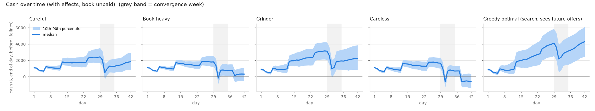
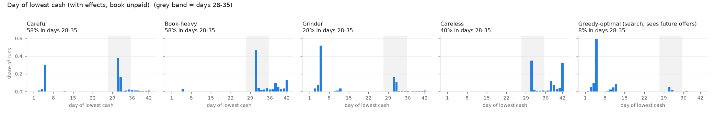
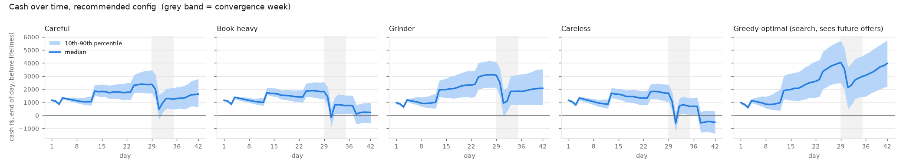
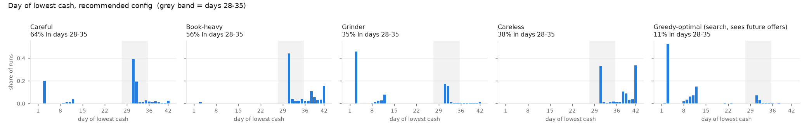

# Paws & Paychecks: economy simulation report — round 1 (spec v0.2)

> Archived round-1 report, kept for reference. It was generated by the round-1 simulator (git history up to commit c44d93c). The current report is `SIM_REPORT.md`.

This report covers the economy simulation specified in `design/SIM_BASELINE.md` §9 (v0.2): five player
policies × {with effects, no effects} × {book unpaid, small advance}, a starting-cash search, a ±25% sensitivity
sweep, and a re-run with recommended config changes. Numbers come from `data/economy.yaml`. Player behaviour comes
from `data/policies.yaml`. Interpretation choices for ambiguous parts of the spec are listed in §8.

**Headlines**
- **Starting cash of $1,400 meets 4 of the 5 cash-sensitive targets.** Careful's lowest cash lands in days 28–35
  in 58% of runs (target 60%). The other low point is day 5: week-1 bills arrive before the first pre-move invoice.
- **The economy separates the strategies as intended.** Careful is safe (1% bankrupt). Book-heavy is risky but
  viable (27%). Careless fails (76%). Grinding is financially safe (1%) but costs stress, the relationship and the
  pet. Greedy-optimal earns about 2× careful but never reaches a good combined ending.
- **Two targets fail for structural reasons, not tuning reasons.**
  1. Effects: the offer pool is too small. Every engaged policy ends up holding nearly the whole pool, so the same
     effects appear in 100% of top-decile runs.
  2. Feedback: work done in week 1 can't pay in week 1 under 7-day agency terms. The target is met only if the
     pre-move invoices count.
- **NET (tax share) is by far the strongest lever**, then rent, starting cash and offer rate. **The book advance
  variant is a large balance decision:** it cuts book-heavy bankruptcy from 27% to 1%.
- **Recommended:** move the day-6 pre-move invoice to day 4, offer a work-milestone effect every 8th job instead of
  every 4th, and set starting cash to $1,450. With these, all policy targets are met except book-heavy at 30.2%
  bankrupt (ceiling 30%; within sampling noise, but reported as a miss). The two structural failures remain and
  need owner decisions (§8).

Reproduce with `python -m sim.run --all` (2,000 seeds per policy and variant; deterministic per (config, policy, seed)).

Sections: 1 Starting cash · 2 Summary per policy · 3 Acceptance targets · 4 Charts · 5 Effects · 6 Sensitivity ·
7 Recommended changes and re-run · 8 Open issues

## 1. Starting cash

**Chosen starting cash (after day-1 rent): $1,400.** Pre-move receivables are unchanged (600 / 900 / 500 on days 6 / 13 / 24).

The search ran every policy with effects and the unpaid book, 2,000 seeds per point. A value scores by how many of the five cash-sensitive targets it meets, then by the total distance to the ones it misses, then by how close book-heavy bankruptcy is to the middle of its 15-30% band.

| Start cash | Careful bankrupt (<=8%) | Careful low in d28-35 (>=60%) | Book-heavy bankrupt (15-30%) | Grinder bankrupt (<=5%) | Careless bankrupt (>=60%) | Met | Distance |
|---|---|---|---|---|---|---|---|
| 800 | 7% | 59% | 68% | 23% | 96% | 2/5 | 0.573 |
| 1,000 | 4% | 59% | 53% | 7% | 92% | 2/5 | 0.265 |
| 1,200 | 2% | 59% | 39% | 3% | 85% | 3/5 | 0.104 |
| 1,400 **(chosen)** | 1% | 58% | 26% | 1% | 76% | 4/5 | 0.018 |
| 1,600 | 0% | 50% | 16% | 0% | 64% | 4/5 | 0.100 |
| 1,800 | 0% | 50% | 8% | 0% | 49% | 2/5 | 0.282 |
| 2,000 | 0% | 50% | 4% | 0% | 36% | 2/5 | 0.453 |
| 2,200 | 0% | 50% | 2% | 0% | 23% | 2/5 | 0.601 |
| 2,400 | 0% | 50% | 1% | 0% | 14% | 2/5 | 0.704 |

**Why $1,400.** It is the only value that meets four of the five cash-sensitive targets with the smallest miss
(careful's low-point share, 58% vs. 60%). The usable window is narrow:
- Below $1,400, book-heavy goes over 30% bankrupt (39% at $1,200).
- Above $1,600, careless drops under 60% bankrupt, so carelessness stops being punished.

Careful's low-point share **does not improve with more cash**. That share depends on *when* the low comes, not how
low it is. Above $1,500 the careful policy also buys headphones on day 1, which deepens the week-1 dip. This is
the reason for the recommended invoice move in §7 rather than a cash change. The spec expected ~1,200–1,600; the
result is inside that range.

## 2. Summary per policy

All values are means or shares over runs unless marked median. "End value" = cash + 0.9 x receivables - debts. "Good combined ending" = not bankrupt, <= 1 relationship week missed, <= 4 pet-care deficit days, <= 6 days with stress > 70 (simulator definition, see Open issues). *Greedy-optimal is search-based and reads the run's future offers.

### With effects, book unpaid

| Policy | Bankrupt | Crisis | Lifelines used | Lowest cash (median) | Low in d28-35 | End value median (p10 / p90) | Days stress>70 | Stress>70 share wk4-5 | Illness days | Rel. weeks missed | Pet deficit days | Book milestones | Book finished | Book hours | Effects held | Paid hours | Jobs done | Jobs late | Good combined ending |
|---|---|---|---|---|---|---|---|---|---|---|---|---|---|---|---|---|---|---|---|
| Careful | 1% | 27% | 0.29 | 405 | 58% | 2,625 (1,895 / 3,392) | 0.0 | 0% | 0.00 | 0.0 | 0.0 | 2.63 | 63% | 65 | 11.0 | 181 | 24.1 | 0.0 | 99% |
| Book-heavy | 26% | 76% | 1.19 | -275 | 58% | 737 (88 / 1,350) | 0.0 | 0% | 0.00 | 0.0 | 0.0 | 3.00 | 100% | 67 | 10.9 | 117 | 19.2 | 0.1 | 74% |
| Grinder | 1% | 16% | 0.18 | 388 | 28% | 3,290 (2,064 / 4,974) | 22.2 | 80% | 2.08 | 5.4 | 16.9 | 0.00 | 0% | 0 | 11.7 | 345 | 24.3 | 0.9 | 0% |
| Careless | 76% | 97% | 1.48 | -963 | 40% | -104 (-852 / 626) | 0.0 | 0% | 0.00 | 4.4 | 16.8 | 0.12 | 0% | 17 | 9.8 | 157 | 14.6 | 8.7 | 0% |
| Greedy-optimal* | 0% | 7% | 0.08 | 361 | 8% | 5,690 (3,915 / 7,361) | 1.5 | 5% | 0.04 | 6.0 | 42.0 | 0.00 | 0% | 0 | 11.0 | 331 | 29.0 | 0.1 | 0% |

### With effects, book small advance

| Policy | Bankrupt | Crisis | Lifelines used | Lowest cash (median) | Low in d28-35 | End value median (p10 / p90) | Days stress>70 | Stress>70 share wk4-5 | Illness days | Rel. weeks missed | Pet deficit days | Book milestones | Book finished | Book hours | Effects held | Paid hours | Jobs done | Jobs late | Good combined ending |
|---|---|---|---|---|---|---|---|---|---|---|---|---|---|---|---|---|---|---|---|
| Careful | 0% | 6% | 0.06 | 623 | 29% | 3,469 (2,688 / 4,236) | 0.0 | 0% | 0.00 | 0.0 | 0.0 | 2.63 | 63% | 65 | 11.0 | 181 | 24.1 | 0.0 | 100% |
| Book-heavy | 1% | 14% | 0.17 | 508 | 38% | 1,715 (1,069 / 2,328) | 0.0 | 0% | 0.00 | 0.0 | 0.0 | 3.00 | 100% | 67 | 11.0 | 117 | 19.2 | 0.1 | 99% |
| Grinder | 1% | 16% | 0.18 | 388 | 28% | 3,290 (2,064 / 4,974) | 22.2 | 80% | 2.08 | 5.4 | 16.9 | 0.00 | 0% | 0 | 11.7 | 345 | 24.3 | 0.9 | 0% |
| Careless | 74% | 97% | 1.47 | -952 | 41% | -54 (-843 / 683) | 0.0 | 0% | 0.00 | 4.4 | 16.8 | 0.12 | 0% | 17 | 9.8 | 157 | 14.6 | 8.7 | 0% |
| Greedy-optimal* | 0% | 7% | 0.08 | 361 | 8% | 5,690 (3,915 / 7,361) | 1.5 | 5% | 0.04 | 6.0 | 42.0 | 0.00 | 0% | 0 | 11.0 | 331 | 29.0 | 0.1 | 0% |

### No effects (control), book unpaid

| Policy | Bankrupt | Crisis | Lifelines used | Lowest cash (median) | Low in d28-35 | End value median (p10 / p90) | Days stress>70 | Stress>70 share wk4-5 | Illness days | Rel. weeks missed | Pet deficit days | Book milestones | Book finished | Book hours | Effects held | Paid hours | Jobs done | Jobs late | Good combined ending |
|---|---|---|---|---|---|---|---|---|---|---|---|---|---|---|---|---|---|---|---|
| Careful | 5% | 46% | 0.62 | 53 | 62% | 1,667 (1,030 / 2,323) | 0.0 | 0% | 0.00 | 0.0 | 0.0 | 2.23 | 23% | 64 | 0.0 | 179 | 17.6 | 0.2 | 95% |
| Book-heavy | 51% | 87% | 1.45 | -497 | 43% | 236 (-354 / 794) | 0.0 | 0% | 0.00 | 0.0 | 0.0 | 3.00 | 100% | 71 | 0.0 | 114 | 14.8 | 0.5 | 49% |
| Grinder | 2% | 22% | 0.28 | 461 | 44% | 1,992 (991 / 3,020) | 22.5 | 83% | 2.23 | 5.2 | 16.9 | 0.00 | 0% | 0 | 0.0 | 350 | 17.3 | 2.0 | 0% |
| Careless | 80% | 98% | 1.36 | -948 | 31% | -270 (-941 / 371) | 0.0 | 0% | 0.00 | 4.4 | 16.8 | 0.04 | 0% | 17 | 0.0 | 157 | 12.1 | 7.3 | 0% |
| Greedy-optimal* | 1% | 10% | 0.12 | 515 | 21% | 4,132 (2,950 / 5,331) | 2.6 | 9% | 0.11 | 6.0 | 42.0 | 0.00 | 0% | 0 | 0.0 | 333 | 21.6 | 0.3 | 0% |

### No effects (control), book small advance

| Policy | Bankrupt | Crisis | Lifelines used | Lowest cash (median) | Low in d28-35 | End value median (p10 / p90) | Days stress>70 | Stress>70 share wk4-5 | Illness days | Rel. weeks missed | Pet deficit days | Book milestones | Book finished | Book hours | Effects held | Paid hours | Jobs done | Jobs late | Good combined ending |
|---|---|---|---|---|---|---|---|---|---|---|---|---|---|---|---|---|---|---|---|
| Careful | 1% | 15% | 0.17 | 533 | 46% | 2,385 (1,724 / 3,068) | 0.0 | 0% | 0.00 | 0.0 | 0.0 | 2.23 | 23% | 64 | 0.0 | 179 | 17.6 | 0.2 | 99% |
| Book-heavy | 4% | 24% | 0.33 | 345 | 38% | 1,214 (628 / 1,762) | 0.0 | 0% | 0.00 | 0.0 | 0.0 | 3.00 | 100% | 71 | 0.0 | 114 | 14.8 | 0.5 | 96% |
| Grinder | 2% | 22% | 0.28 | 461 | 44% | 1,992 (991 / 3,020) | 22.5 | 83% | 2.23 | 5.2 | 16.9 | 0.00 | 0% | 0 | 0.0 | 350 | 17.3 | 2.0 | 0% |
| Careless | 79% | 98% | 1.36 | -942 | 31% | -258 (-926 / 393) | 0.0 | 0% | 0.00 | 4.4 | 16.8 | 0.04 | 0% | 17 | 0.0 | 157 | 12.1 | 7.3 | 0% |
| Greedy-optimal* | 1% | 10% | 0.12 | 515 | 21% | 4,132 (2,950 / 5,331) | 2.6 | 9% | 0.11 | 6.0 | 42.0 | 0.00 | 0% | 0 | 0.0 | 333 | 21.6 | 0.3 | 0% |

**Reading the table**
- **Effects matter a lot.** For careful they lift median end value from $1,667 to $2,625. They raise "book
  finished" from 23% to 63%, because efficiency bonuses also speed up book hours. With effects off, careful's
  bankruptcy rises from 1% to 5% and book-heavy's from 27% to 51%.
- **Grinder vs. careful.** The grinder works ~90% more paid hours than careful (345 h vs. 181 h) but ends only
  ~25% richer (median $3,290 vs. $2,625). Stress above 50 costs efficiency, and the grinder misses deadlines (0.9 late jobs per run).
  The stress→efficiency coupling works as designed: grinding pays a little, and costs a lot elsewhere.
- **Greedy-optimal is a heuristic search, not a true optimum.** It reaches ~$5,700 by taking the best-paying
  offers with full knowledge of future offers. It works 10–12 h days, spends no time with her and only 1 h/day on
  the pet. **The money system gives it no reason not to.** The only money cost of neglect is a higher pet bill.
  This is by design (relationship and pet are not derived from money), so the ending has to carry that cost.
- **The book advance** ($400 gross per milestone) mostly helps the book-heavy player: bankruptcy falls 27% → 1%,
  which makes book-heavy safer than the target band intends. Even at $800 starting cash (the bottom of the search
  range), book-heavy with the advance is only 12% bankrupt (checked separately, 2,000 seeds). The advance and the
  starting cash should be decided together.
- **The week-2 story job** (12,500 words, paid day 33) is accepted in only ~48% of careful runs and ~22% of
  book-heavy runs. Their schedules are often too full on day 8. See Open issues.

### Feedback cadence (with effects, book unpaid)

| Policy | Median days delivery->payment | Job payments wk1 | wk2 | wk3 | wk4 | wk5 | wk6 | Runs with a job payment every week | ...counting pre-move invoices |
|---|---|---|---|---|---|---|---|---|---|
| Careful | 7 | 0.6 | 2.4 | 3.5 | 3.8 | 4.8 | 5.0 | 41% | 98% |
| Book-heavy | 7 | 0.5 | 1.7 | 2.5 | 3.1 | 3.8 | 4.4 | 27% | 91% |
| Grinder | 7 | 0.8 | 3.7 | 4.8 | 3.5 | 3.9 | 3.5 | 50% | 93% |
| Careless | 7 | 0.4 | 1.7 | 2.8 | 2.7 | 2.5 | 2.4 | 20% | 82% |
| Greedy-optimal* | 7 | 0.8 | 3.2 | 4.7 | 4.9 | 5.3 | 5.5 | 53% | 98% |

**Payment cadence.** Payments arrive steadily from week 2 on, and the median delivery-to-payment time is 7 days.
**Week 1 is the gap.** Only direct-client jobs (25% of offers, paid after 2–3 days) can pay inside week 1. A
careful run gets 0.6 job payments in week 1 on average. Counting the pre-move invoice on day 6, 98% of careful
runs are paid every week. Whether the target counts pre-move invoices is an open question (§8).

## 3. Acceptance targets (with effects, book unpaid)

| Policy | Target | Result | Met |
|---|---|---|---|
| Careful | Bankrupt <= 8% | 0.9% | yes |
| Careful | Lowest cash in days 28-35 in >= 60% of runs | 58.2% | **no** |
| Careful | Book finished >= 30% | 63.4% | yes |
| Book-heavy | Bankrupt 15-30% | 26.5% | yes |
| Book-heavy | Book finished >= 70% | 100.0% | yes |
| Grinder | Bankrupt <= 5% | 1.1% | yes |
| Grinder | Stress > 70 on >= 40% of days in weeks 4-5 | 80.4% of days (mean) | yes |
| Grinder | Relationship needs missed >= 2 weeks | 5.4 weeks (mean) | yes |
| Careless | Bankrupt >= 60% | 76.0% | yes |
| Greedy-optimal* | Does not dominate the combined ending | good combined ending in 0.0% of runs | yes |
| effects | No single effect in > 70% of top-decile runs | highest: cat_tool (careful) 100% | **no** |
| effects | No combo exceeds caps (no designed synergies exist yet) | caps enforced by clamping; the efficiency cap was reached in 44.2% of runs | yes |
| Careful | Feedback: a job payment in each of weeks 1-6 (>= 90% of runs) | 41% (incl. pre-move invoices: 98%) | **no** |
| Book-heavy | Feedback: a job payment in each of weeks 1-6 (>= 90% of runs) | 27% (incl. pre-move invoices: 91%) | **no** |
| Grinder | Feedback: a job payment in each of weeks 1-6 (>= 90% of runs) | 50% (incl. pre-move invoices: 93%) | **no** |
| Careless | Feedback: a job payment in each of weeks 1-6 (>= 90% of runs) | 20% (incl. pre-move invoices: 82%) | **no** |
| Greedy-optimal* | Feedback: a job payment in each of weeks 1-6 (>= 90% of runs) | 53% (incl. pre-move invoices: 98%) | **no** |

With the small book advance: Careful bankrupt 0%, book finished 63%; Book-heavy bankrupt 1%, book finished 100%.

**Notes on the misses**
- **Careful low point (58%).** Just short of target; the recommendation in §7 fixes it.
- **Effects dominance (100%).** Structural (§5).
- **Feedback.** Met for every working policy only if pre-move invoices count (careless reaches 82%, which is
  acceptable for a strategy meant to fail).
- **Caps.** No combination can exceed a cap, because the code clamps each category. But the efficiency cap
  (+40%) is reached in 44% of all runs (99.7% of careful runs), mostly via morning person plus
  context switcher or deep focus plus coworking. This is fine while no designed synergies exist.

## 4. Charts

Book-heavy and careless show a second drop around day 38. Those runs used the rent-late lifeline on day 31 and
must pay the rent plus the $75 fee by day 38. The grinder and greedy low points come in week 1, because their
week-2 income is large enough that the convergence week never becomes their lowest point.

## 5. Effects

### Offers by source and effects held (per run, mean)

| Policy | Weekly | Work milestone | Book milestone | Shop buys | Held at end | Offers with empty pool | Effect boost avg / last 5 workdays |
|---|---|---|---|---|---|---|---|
| Careful | 5.0 | 5.6 | 2.6 | 1.0 | 11.0 | 3.27 | +24% / +27% |
| Book-heavy | 5.0 | 4.4 | 3.0 | 0.9 | 10.9 | 2.42 | +21% / +24% |
| Grinder | 5.0 | 5.7 | 0.0 | 2.0 | 11.7 | 0.98 | +27% / +33% |
| Careless | 5.0 | 3.3 | 0.1 | 1.4 | 9.8 | 0.03 | +19% / +36% |
| Greedy-optimal* | 5.0 | 6.9 | 0.0 | 2.0 | 11.0 | 2.87 | +24% / +29% |

Target: careful holds 7-9 effects, neglectful/narrow 5-6; effect boost +15-25% on average, +30-50% at the end (§8.2). "Effect boost" = the effects' multiplier on paid-work output (efficiency x throughput), averaged over hours worked.

### Pick rate (when offered) and share of runs holding each effect

Left block: how often the effect is picked when it is one of the three offered (shop items: share of runs that bought it). Right block: share of all runs / of top-decile runs (by end value) that hold it at the end.

| Effect | pick: Careful | pick: Book-heavy | pick: Grinder | pick: Careless | pick: Greedy-optimal* | held all/top10: Careful | held all/top10: Book-heavy | held all/top10: Grinder | held all/top10: Careless | held all/top10: Greedy-optimal* |
|---|---|---|---|---|---|---|---|---|---|---|
| cat_tool | 97% | 48% | 100% | 34% | 99% | 100% / 100% | 100% / 100% | 100% / 100% | 81% / 86% | 100% / 100% |
| context_switcher | 69% | 63% | 52% | 35% | 22% | 100% / 100% | 100% / 100% | 100% / 100% | 82% / 86% | 100% / 100% |
| coworking | - | - | shop 100% | shop 71% | shop 100% | 0% / 0% | 0% / 0% | 100% / 100% | 71% / 72% | 100% / 100% |
| deep_focus | 30% | 55% | 58% | 34% | 57% | 100% / 100% | 100% / 100% | 100% / 100% | 81% / 86% | 100% / 100% |
| direct_network | 67% | 38% | 86% | 35% | 83% | 100% / 100% | 100% / 100% | 100% / 100% | 85% / 87% | 100% / 100% |
| fast_invoicer | 21% | 19% | 13% | 34% | 18% | 100% / 100% | 100% / 100% | 78% / 97% | 85% / 86% | 100% / 100% |
| headphones | shop 100% | shop 89% | shop 100% | shop 72% | shop 100% | 100% / 100% | 89% / 98% | 100% / 100% | 72% / 70% | 100% / 100% |
| her_spreadsheet | 31% | 28% | 18% | 33% | - | 100% / 100% | 100% / 100% | 95% / 100% | 85% / 86% | 0% / 0% |
| morning_pages | 51% | 96% | 28% | 33% | 27% | 100% / 100% | 100% / 100% | 100% / 100% | 85% / 90% | 100% / 100% |
| morning_person | 81% | 80% | 68% | 34% | 51% | 100% / 100% | 100% / 100% | 100% / 100% | 81% / 87% | 100% / 100% |
| night_owl | 17% | 16% | 54% | 34% | 62% | 100% / 100% | 100% / 100% | 100% / 100% | 83% / 81% | 100% / 100% |
| walk_routine | 42% | 63% | 37% | 35% | 37% | 100% / 100% | 100% / 100% | 100% / 100% | 86% / 79% | 100% / 100% |

### Combos over-represented in the top decile (lift = share in top 10% / share overall)

| Policy | Top combos |
|---|---|
| Careful | cat_tool+context_switcher (x1.00), cat_tool+deep_focus (x1.00), cat_tool+direct_network (x1.00) |
| Book-heavy | cat_tool+headphones (x1.10), context_switcher+headphones (x1.10), deep_focus+headphones (x1.10) |
| Grinder | cat_tool+fast_invoicer (x1.24), context_switcher+fast_invoicer (x1.24), coworking+fast_invoicer (x1.24) |
| Careless | cat_tool+morning_person (x1.18), context_switcher+morning_person (x1.15), deep_focus+morning_person (x1.15) |
| Greedy-optimal* | cat_tool+context_switcher (x1.00), context_switcher+coworking (x1.00), context_switcher+deep_focus (x1.00) |

**The pool is too small for the number of offers.**
- Offers: careful gets ~5 weekly + ~5.6 work-milestone + ~2.6 book-milestone offers + 1 shop buy, about 14 chances.
- Pool: only 10 effects can appear in offers (12 in the starter pool, minus 2 shop-only items).
- Result: careful holds ~11 of the 12 effects by the end (target 7–9), and later offers come from an almost empty
  pool. The top decile therefore holds the same effects as everyone else (100%), and "pick 1 of 3" stops being a
  choice in weeks 4–5.
- Even the spec's own expected counts (5 + 2–3 + 0–3 + 0–2 = 7–13 offers) need a larger pool. A pool of roughly
  25–30 effects would keep late picks meaningful. Adding effects is a design decision for the owner.

**Strength and dead effects**
- The **CAT tool** is picked ~97% of the time by careful and ~100% by the grinder and greedy. Its +15% throughput
  sits in its own category, so the efficiency cap doesn't limit it, and $30/week is cheap.
- **Fast invoicer** (13–21%) and **night owl** (16–17% for careful and book-heavy) are rarely chosen.
- **Her spreadsheet** has no mechanical benefit in the simulation. No policy uses a cash forecast, so it is a dead
  effect here. Its value is narrative or UI.

**Effect boost vs. the §8.2 targets**
- Average over the run: +24% for careful (target +15–25%), met.
- Last 5 workdays: +27% (target +30–50%), slightly low. The cap and the late-offer lean away from efficiency hold
  it down.

## 6. Sensitivity (each parameter -25% / baseline / +25%)

With effects, book unpaid, chosen starting cash, 2,000 seeds per point. Sorted by the largest change in any policy's bankruptcy rate.

| Parameter | Max bankrupt swing | Careful bankrupt | Book-heavy bankrupt | Grinder bankrupt | Careless bankrupt | Careful low d28-35 | Careful book finished | Careful end value (median) | Grinder stress>70 wk4-5 |
|---|---|---|---|---|---|---|---|---|---|
| NET factor | 44 pp | 9% / 1% / 0% | 70% / 26% / 8% | 15% / 1% / 0% | 98% / 76% / 39% | 72% / 58% / 36% | 63% / 63% / 63% | 1,333 / 2,625 / 3,911 | 81% / 80% / 80% |
| rent | 26 pp | 0% / 1% / 3% | 10% / 26% / 53% | 0% / 1% / 3% | 51% / 76% / 91% | 40% / 58% / 70% | 63% / 63% / 63% | 3,010 / 2,625 / 2,232 | 80% / 80% / 81% |
| starting cash | 23 pp | 3% / 1% / 0% | 49% / 26% / 11% | 6% / 1% / 0% | 91% / 76% / 53% | 60% / 58% / 50% | 62% / 63% / 67% | 2,240 / 2,625 / 3,046 | 84% / 80% / 79% |
| offer rate | 14 pp | 2% / 1% / 0% | 40% / 26% / 20% | 1% / 1% / 1% | 80% / 76% / 73% | 67% / 58% / 49% | 63% / 63% / 63% | 2,298 / 2,625 / 2,810 | 61% / 80% / 88% |
| payment delays | 10 pp | 0% / 1% / 3% | 18% / 26% / 36% | 0% / 1% / 2% | 69% / 76% / 81% | 47% / 58% / 67% | 64% / 63% / 63% | 2,663 / 2,625 / 2,607 | 80% / 80% / 81% |
| effect sizes | 8 pp | 2% / 1% / 1% | 34% / 26% / 22% | 3% / 1% / 0% | 82% / 76% / 70% | 62% / 58% / 51% | 53% / 63% / 71% | 2,269 / 2,625 / 2,894 | 86% / 80% / 71% |
| PE share | 3 pp | 1% / 1% / 2% | 26% / 26% / 30% | 1% / 1% / 1% | 74% / 76% / 78% | 56% / 58% / 59% | 63% / 63% / 63% | 2,717 / 2,625 / 2,489 | 81% / 80% / 78% |
| book remaining work (inverse of starting progress) | 2 pp | 1% / 1% / 1% | 24% / 26% / 28% | 1% / 1% / 1% | 76% / 76% / 76% | 57% / 58% / 59% | 100% / 63% / 0% | 2,616 / 2,625 / 2,589 | 80% / 80% / 80% |
| late-payment share | 2 pp | 1% / 1% / 1% | 26% / 26% / 28% | 1% / 1% / 1% | 75% / 76% / 77% | 57% / 58% / 59% | 63% / 63% / 63% | 2,629 / 2,625 / 2,622 | 80% / 80% / 80% |
| week-2 story job size | 1 pp | 1% / 1% / 1% | 28% / 26% / 26% | 1% / 1% / 1% | 75% / 76% / 76% | 53% / 58% / 61% | 63% / 63% / 64% | 2,627 / 2,625 / 2,629 | 78% / 80% / 82% |

**What moves the results most**
1. **NET factor** (±25% shifts careful's median end value from $1,333 to $3,911; book-heavy bankruptcy from 70% to
   8%). Tax handling is the strongest economic lever. If the game shows a "tax jar", its rate is a key balance
   number.
2. **Rent** and **starting cash** are almost mirror images. Each moves book-heavy bankruptcy by 20+ percentage
   points.
3. **Offer rate.** It mainly affects the grinder's stress, since more offers mean more overwork, and book-heavy
   bankruptcy.

**Little effect**
- **Late-payment share and the story job's size** change almost nothing. The late share is mostly absorbed by
  lifelines, and the story job is often not taken.

**Book-finishing is a cliff**
- With 25% less remaining work, careful finishes the book in 100% of runs. With 25% more, in 0%.
- The careful policy's ~1.5–2.5 h/day book budget lands right on the 60–80 h range, so the book target is very
  sensitive to the starting-progress range.

## 7. Recommended changes and re-run

The changes live in `data/economy.recommended.yaml` as an overlay on `data/economy.yaml`. They are **not** merged into `economy.yaml` yet, pending the owner's review.

| Config key | Baseline | Recommended | Why | Expected effect |
|---|---|---|---|---|
| effects.work_milestone_every | 4 | 8 | Jobs are mostly small (careful finishes ~24 per run), so 'every 4th job' gave ~5.6 work-milestone offers per careful run vs. the ~2-3 the spec expects (§8.1). | Work-milestone offers ~2.4 per careful run (in the §8.1 range). Effect boost and income fall slightly, so book-heavy needs a little more starting cash (next row). |
| pre_move_receivables (day 6 -> 4) | 600 on day 6 | 600 on day 4 | In 30% of careful runs the lowest cash is day 5 (supplies + vet in week 1, before the first invoice), not the convergence week. | Careful's lowest cash moves into days 28-35 more often (target >= 60%); week 1 still gets a payment. No change to total money. |
| start.cash | 1400 | 1450 | Re-balances book-heavy bankruptcy after the effect change (fewer effects -> less output). | Book-heavy bankruptcy back to ~30% (edge of the 15-30% band); careful stays <= 2%. Kept below 1500 because the careful policy buys headphones on day 1 at >= 1500, which re-creates the week-1 low (see Open issues). |

**Expected and observed effect.** After the changes, careful's low point falls in the convergence week in 64% of
runs. Work-milestone offers drop to ~2.4 per careful run, inside the §8.1 range. Effect boost falls slightly
(careful +22% average / +27% at the end). Book-heavy bankruptcy rises with fewer effects, and $1,450 brings it
back to 30.2%. That sits at the edge of the band; at 2,000 seeds the sampling error is about ±1 point.

**Why $1,450 and not $1,500.** At $1,500 the careful policy's shop rule buys headphones on day 1, and its low point
slips back to 59% in days 28–35. The window that meets both targets is narrow (~$1,450–1,500). The recommended
changes do not fix the effect-pool problem, which needs content (§8).

### Acceptance targets with the recommendations

| Policy | Target | Result | Met |
|---|---|---|---|
| Careful | Bankrupt <= 8% | 1.1% | yes |
| Careful | Lowest cash in days 28-35 in >= 60% of runs | 63.6% | yes |
| Careful | Book finished >= 30% | 62.1% | yes |
| Book-heavy | Bankrupt 15-30% | 30.2% | **no** |
| Book-heavy | Book finished >= 70% | 100.0% | yes |
| Grinder | Bankrupt <= 5% | 0.8% | yes |
| Grinder | Stress > 70 on >= 40% of days in weeks 4-5 | 81.9% of days (mean) | yes |
| Grinder | Relationship needs missed >= 2 weeks | 5.4 weeks (mean) | yes |
| Careless | Bankrupt >= 60% | 74.7% | yes |
| Greedy-optimal* | Does not dominate the combined ending | good combined ending in 0.0% of runs | yes |
| effects | No single effect in > 70% of top-decile runs | highest: cat_tool (careful) 100% | **no** |
| effects | No combo exceeds caps (no designed synergies exist yet) | caps enforced by clamping; the efficiency cap was reached in 32.4% of runs | yes |
| Careful | Feedback: a job payment in each of weeks 1-6 (>= 90% of runs) | 40% (incl. pre-move invoices: 96%) | **no** |
| Book-heavy | Feedback: a job payment in each of weeks 1-6 (>= 90% of runs) | 26% (incl. pre-move invoices: 90%) | **no** |
| Grinder | Feedback: a job payment in each of weeks 1-6 (>= 90% of runs) | 49% (incl. pre-move invoices: 92%) | **no** |
| Careless | Feedback: a job payment in each of weeks 1-6 (>= 90% of runs) | 20% (incl. pre-move invoices: 80%) | **no** |
| Greedy-optimal* | Feedback: a job payment in each of weeks 1-6 (>= 90% of runs) | 52% (incl. pre-move invoices: 98%) | **no** |

With the small book advance: Careful bankrupt 0%, book finished 62%; Book-heavy bankrupt 2%, book finished 100%.

**Notes on the misses**
- **Careful low point (58%).** Just short of target; the recommendation in §7 fixes it.
- **Effects dominance (100%).** Structural (§5).
- **Feedback.** Met for every working policy only if pre-move invoices count (careless reaches 82%, which is
  acceptable for a strategy meant to fail).
- **Caps.** No combination can exceed a cap, because the code clamps each category. But the efficiency cap
  (+40%) is reached in 44% of all runs (99.7% of careful runs), mostly via morning person plus
  context switcher or deep focus plus coworking. This is fine while no designed synergies exist.

### Summary per policy with the recommendations

All values are means or shares over runs unless marked median. "End value" = cash + 0.9 x receivables - debts. "Good combined ending" = not bankrupt, <= 1 relationship week missed, <= 4 pet-care deficit days, <= 6 days with stress > 70 (simulator definition, see Open issues). *Greedy-optimal is search-based and reads the run's future offers.

### With effects, book unpaid

| Policy | Bankrupt | Crisis | Lifelines used | Lowest cash (median) | Low in d28-35 | End value median (p10 / p90) | Days stress>70 | Stress>70 share wk4-5 | Illness days | Rel. weeks missed | Pet deficit days | Book milestones | Book finished | Book hours | Effects held | Paid hours | Jobs done | Jobs late | Good combined ending |
|---|---|---|---|---|---|---|---|---|---|---|---|---|---|---|---|---|---|---|---|
| Careful | 1% | 28% | 0.31 | 382 | 64% | 2,557 (1,822 / 3,318) | 0.0 | 0% | 0.00 | 0.0 | 0.0 | 2.62 | 62% | 65 | 10.8 | 180 | 23.7 | 0.0 | 99% |
| Book-heavy | 30% | 77% | 1.22 | -286 | 56% | 706 (50 / 1,316) | 0.0 | 0% | 0.00 | 0.0 | 0.0 | 3.00 | 100% | 68 | 10.8 | 117 | 18.8 | 0.1 | 70% |
| Grinder | 1% | 15% | 0.19 | 536 | 35% | 3,142 (1,920 / 4,653) | 22.3 | 82% | 2.17 | 5.4 | 16.9 | 0.00 | 0% | 0 | 9.5 | 344 | 23.4 | 0.9 | 0% |
| Careless | 75% | 97% | 1.47 | -934 | 38% | -123 (-884 / 583) | 0.0 | 0% | 0.00 | 4.4 | 16.8 | 0.11 | 0% | 17 | 7.8 | 157 | 14.1 | 8.3 | 0% |
| Greedy-optimal* | 1% | 6% | 0.07 | 530 | 11% | 5,470 (3,763 / 7,008) | 1.8 | 6% | 0.06 | 6.0 | 42.0 | 0.00 | 0% | 0 | 10.0 | 328 | 27.9 | 0.1 | 0% |

### With effects, book small advance

| Policy | Bankrupt | Crisis | Lifelines used | Lowest cash (median) | Low in d28-35 | End value median (p10 / p90) | Days stress>70 | Stress>70 share wk4-5 | Illness days | Rel. weeks missed | Pet deficit days | Book milestones | Book finished | Book hours | Effects held | Paid hours | Jobs done | Jobs late | Good combined ending |
|---|---|---|---|---|---|---|---|---|---|---|---|---|---|---|---|---|---|---|---|
| Careful | 0% | 6% | 0.06 | 756 | 38% | 3,415 (2,631 / 4,143) | 0.0 | 0% | 0.00 | 0.0 | 0.0 | 2.62 | 62% | 65 | 10.8 | 180 | 23.7 | 0.0 | 100% |
| Book-heavy | 2% | 14% | 0.18 | 541 | 42% | 1,676 (1,029 / 2,281) | 0.0 | 0% | 0.00 | 0.0 | 0.0 | 3.00 | 100% | 68 | 10.9 | 117 | 18.9 | 0.1 | 98% |
| Grinder | 1% | 15% | 0.19 | 536 | 35% | 3,142 (1,920 / 4,653) | 22.3 | 82% | 2.17 | 5.4 | 16.9 | 0.00 | 0% | 0 | 9.5 | 344 | 23.4 | 0.9 | 0% |
| Careless | 74% | 96% | 1.46 | -919 | 39% | -96 (-874 / 637) | 0.0 | 0% | 0.00 | 4.4 | 16.8 | 0.11 | 0% | 17 | 7.8 | 157 | 14.1 | 8.3 | 0% |
| Greedy-optimal* | 1% | 6% | 0.07 | 530 | 11% | 5,470 (3,763 / 7,008) | 1.8 | 6% | 0.06 | 6.0 | 42.0 | 0.00 | 0% | 0 | 10.0 | 328 | 27.9 | 0.1 | 0% |

### No effects (control), book unpaid

| Policy | Bankrupt | Crisis | Lifelines used | Lowest cash (median) | Low in d28-35 | End value median (p10 / p90) | Days stress>70 | Stress>70 share wk4-5 | Illness days | Rel. weeks missed | Pet deficit days | Book milestones | Book finished | Book hours | Effects held | Paid hours | Jobs done | Jobs late | Good combined ending |
|---|---|---|---|---|---|---|---|---|---|---|---|---|---|---|---|---|---|---|---|
| Careful | 4% | 43% | 0.57 | 103 | 64% | 1,722 (1,079 / 2,375) | 0.0 | 0% | 0.00 | 0.0 | 0.0 | 2.23 | 23% | 64 | 0.0 | 179 | 17.6 | 0.2 | 96% |
| Book-heavy | 47% | 85% | 1.41 | -430 | 43% | 287 (-301 / 847) | 0.0 | 0% | 0.00 | 0.0 | 0.0 | 3.00 | 100% | 71 | 0.0 | 114 | 14.8 | 0.5 | 53% |
| Grinder | 2% | 20% | 0.25 | 557 | 49% | 2,046 (1,054 / 3,074) | 22.5 | 83% | 2.22 | 5.2 | 16.9 | 0.00 | 0% | 0 | 0.0 | 349 | 17.3 | 2.0 | 0% |
| Careless | 77% | 97% | 1.35 | -894 | 31% | -219 (-891 / 429) | 0.0 | 0% | 0.00 | 4.4 | 16.8 | 0.04 | 0% | 17 | 0.0 | 157 | 12.1 | 7.3 | 0% |
| Greedy-optimal* | 1% | 9% | 0.11 | 676 | 23% | 4,184 (3,007 / 5,381) | 2.7 | 9% | 0.11 | 6.0 | 42.0 | 0.00 | 0% | 0 | 0.0 | 333 | 21.6 | 0.3 | 0% |

### No effects (control), book small advance

| Policy | Bankrupt | Crisis | Lifelines used | Lowest cash (median) | Low in d28-35 | End value median (p10 / p90) | Days stress>70 | Stress>70 share wk4-5 | Illness days | Rel. weeks missed | Pet deficit days | Book milestones | Book finished | Book hours | Effects held | Paid hours | Jobs done | Jobs late | Good combined ending |
|---|---|---|---|---|---|---|---|---|---|---|---|---|---|---|---|---|---|---|---|
| Careful | 1% | 13% | 0.14 | 641 | 51% | 2,437 (1,775 / 3,118) | 0.0 | 0% | 0.00 | 0.0 | 0.0 | 2.23 | 23% | 64 | 0.0 | 179 | 17.6 | 0.2 | 99% |
| Book-heavy | 3% | 21% | 0.28 | 395 | 40% | 1,265 (681 / 1,812) | 0.0 | 0% | 0.00 | 0.0 | 0.0 | 3.00 | 100% | 71 | 0.0 | 114 | 14.8 | 0.5 | 97% |
| Grinder | 2% | 20% | 0.25 | 557 | 49% | 2,046 (1,054 / 3,074) | 22.5 | 83% | 2.22 | 5.2 | 16.9 | 0.00 | 0% | 0 | 0.0 | 349 | 17.3 | 2.0 | 0% |
| Careless | 76% | 97% | 1.35 | -888 | 32% | -210 (-876 / 452) | 0.0 | 0% | 0.00 | 4.4 | 16.8 | 0.04 | 0% | 17 | 0.0 | 157 | 12.1 | 7.3 | 0% |
| Greedy-optimal* | 1% | 9% | 0.11 | 676 | 23% | 4,184 (3,007 / 5,381) | 2.7 | 9% | 0.11 | 6.0 | 42.0 | 0.00 | 0% | 0 | 0.0 | 333 | 21.6 | 0.3 | 0% |

### Effects with the recommendations

| Policy | Held at end | Boost avg / end | Most common effect in top decile |
|---|---|---|---|
| Careful | 10.8 | +22% / +27% | cat_tool 100% |
| Book-heavy | 10.8 | +18% / +24% | cat_tool 100% |
| Grinder | 9.5 | +23% / +31% | cat_tool 100% |
| Careless | 7.8 | +15% / +29% | morning_pages 75% |
| Greedy-optimal* | 10.0 | +21% / +28% | cat_tool 100% |

## 8. Open issues

### Needs an owner decision

1. **The effect pool is too small for the offer schedule (§5).** With 12 effects and ~11–14 picking chances per
   careful run, everyone ends with nearly the full pool, and the "no effect in > 70% of the top decile" target
   can't be met by tuning. Options:
   - grow the pool to ~25–30 effects;
   - cut offer sources (e.g. weekly reflections only in weeks 1, 3 and 5);
   - let the player skip a pick.
2. **The feedback target counts which payments?** Job payments alone can't arrive in week 1 under the 7-day
   agency terms, except for direct clients. Counting pre-move invoices, the target is met. If job-only is meant,
   week 1 needs a fixed early direct-client job or shorter agency terms.
3. **Is the week-2 story job forced?** It is simulated as an ordinary day-8 offer that policies may decline, so the
   intended week-5 squeeze only happens in ~48% of careful runs. If it is a fixed story event, the game should
   make taking it (near) certain. That would make careful's convergence-week low more reliable.
4. **Book advance and starting cash interact.** The advance makes book-heavy almost risk-free (1% bankrupt). Even
   at $800 starting cash it stays at 12%, below the 15–30% band. If the advance is kept, the book-heavy target
   (or the advance size) needs revisiting, not just the starting cash.
5. **Neglect has no money cost** beyond the pet bill tier. Greedy-optimal and the grinder show that ignoring her
   and the pet is the money-maximizing play. This is consistent with the design ("relationship is not a function
   of money"), so the ending and story events must make that cost felt.
6. **Book-heavy bankruptcy with the recommendations is 30.2%** (ceiling 30%). Either accept this as within
   sampling noise, or nudge starting cash toward $1,500. The latter pushes careful's low-point share back below 60%.

### Degenerate strategies, dead or dominant effects

- **Grinding is financially safe** (≈1% bankrupt). It earns only ~25% more than careful, because stress cuts
  efficiency, but money alone never punishes it.
- **Her spreadsheet** does nothing mechanically in the simulation (no policy uses a forecast).
- **Fast invoicer and night owl** are weak picks.
- **The CAT tool** is a near-automatic pick, because its category has no cap and its price is low.
- **The efficiency cap (+40%) is reached often.** Stacking morning person, deep focus and coworking already hits
  it, so further efficiency picks are wasted.

### Interpretation choices (simplest reading; please check)

**Time and stress**
- *Leisure for stress relief* = free hours left after sleep, routines (2 h), a 1 h lunch on workdays, paid work,
  book, pet care and time with her, capped at 4 h/day (`day.leisure_hours_cap`). Time with her always counts.
  Without a cap, a day off would remove ~25 stress points.
- *Interruptions* (0–25%) remove both paid and book time. Half of them count as pet interruptions (for the
  coworking pass).
- *"Each consecutive short night after the first"* adds +3 once per night while the streak is at least 2.
- *"Deadline due tomorrow"* is +5 per job.
- *"A rush job in progress"* is +2 per day if any rush job is active.
- *Sleep* is the night after the day. Cutting it lowers the next day's efficiency.

**Offers and jobs**
- *Deadlines* are counted in working days, rounded up: est. hours ÷ 6 × U(1.1, 1.8), minimum 1. A job is due at
  the end of that working day. Missing the deadline marks it late (−20% payment). Work continues until delivery.
- *Rush jobs* aren't specified, so they were set as follows: 15% of non-PE offers; deadline × 0.5; rate × 1.25.
- *Post-editing* pays $0.055/word for all clients.
- *The PE switch day* is uniform over days 8–21. The PE share is 25% before the switch and rises linearly to 50% by
  day 36.
- *Reputation* is tracked per client type, as there are no individual clients. For 7 days after a missed deadline,
  each offer from that type is dropped with 50% chance and pays × 0.9.
- *Direct-client network* = a second, independent stream of direct-client offers (doubling them). Each direct job
  gets +1 h of unpaid revision work.

**Payments and lifelines**
- *Payments:* direct clients pay after 2–3 days (uniform), agencies after 7, slow agencies after 14. A 20% chance
  of +3–7 days late is drawn per job, independent of the player.
- *The story job* is a fixed day-8 offer: 12,500 words, standard agency, normal deadline formula. It is paid on
  day 33, or 7 days after delivery if that is later.
- *Crisis and bankruptcy*, checked at end of day:
  1. If rent fell due today and rent-late is unused, it is deferred first (+$75, due within 7 days).
  2. If cash is still below −$300 → bankrupt.
  3. Otherwise the policy uses "pay early" (job invoices only, −10% of the smallest invoice that covers the gap)
     and/or "borrow" (gap + $200, up to $800).
  4. Still negative → bankrupt.
- *After bankruptcy*, the run continues to day 42 with no lifelines left. Her loan is not repaid in-run; it counts
  as debt in the end value, as does unpaid deferred rent.

**Costs and the pet**
- *Transformation bill* tier odds (300/500/800) depend on pet-care deficit days before day 30: 0 days →
  60/30/10%; 1–3 days → 30/40/30%; 4+ days → 10/40/50%.
- *Pet damage:* each deficit day has a 25% chance of a $20–150 damage cost.
- *Walk routine:* a skipped walk counts as 2 deficit days.
- *Stress illness:* stress above 85 for 2+ days gives a 15% daily chance of an illness day (no work, $0–80).

**Effects**
- *Shop:* headphones and the coworking pass are shop-only and never drawn in offers. Coworking costs $60/week from
  purchase and adds 0.5 h of pet care on days worked there. CAT tool and coworking fees are charged weekly from
  the day they are taken.
- *Morning person / night owl:* the first 4 work hours of a day count as "before 13:00"; hours beyond 8 count as
  "after 19:00". Paid work comes first in the day, then the book.
- *Deep focus* counts paid projects only. *Context switcher* counts paid projects plus the book as tasks.
- *Efficiency bonuses* also apply to book hours. The CAT tool does not.
- *Late-offer lean (§8.2):* from day 22, efficiency and throughput effects are drawn at half weight.
- *Morning pages'* 30 minutes come out of free time. Its book relief (3.5) is under the +50% stress-relief cap
  (3.75).
- *The work-milestone offer* fires on every 4th delivered job, the story job included.

**Book**
- *Remaining work* maps linearly from starting progress: 75% done → 60 h left, 60% done → 80 h left. The
  sensitivity row "book starting progress" scales this remaining work ±25%, rather than the progress share.
- *The small advance* is paid net (× 0.78) on reaching each milestone.

**Report measures**
- *Effect boost* = the effects' multiplier on paid-work output (efficiency × throughput), averaged over hours
  worked. "End" = the last 5 days with paid work.
- *"Top decile"* = top 10% of runs by end money value, per policy.
- *"Good combined ending"* (simulator-only, for the greedy-optimal check): not bankrupt, ≤ 1 relationship week
  missed, ≤ 4 pet-care deficit days, ≤ 6 days with stress > 70.
- *The feedback target* is scored as "≥ 90% of runs get a payment in each of weeks 1–6".

### Modelling of player strategies (`data/policies.yaml`)

- **Careful:**
  - 6.5 paid h on weekdays, plus up to 2 h when a deadline is at risk (up to 4 h on weekends, only then).
  - Book 1.5 h on weekdays, 2.5 h on weekends.
  - Meets her needs: Mon/Wed/Fri evenings, or Tue/Thu + a Saturday half-day in her crunch weeks. Meets pet care.
  - Sleeps 8 h, cutting 1 h only when behind.
  - Accepts offers in $/h order if an earliest-deadline-first (EDF) check at 80% efficiency still fits.
  - Buys headphones once cash ≥ $1,500.
- **Book-heavy:** like careful, but 4.5 paid h and 2.5/3.5 h of book; buys headphones at ≥ $1,800.
- **Grinder:**
  - 9.5 h on weekdays and 8 h on weekends; sleeps 6–7 h on weekdays and 7 h on weekends.
  - Covers pet care fully on 60% of days.
  - Spends one evening a week with her, a second with 50% chance, and a Saturday half-day with 50% chance.
  - Picks effects by efficiency/rate value.
  - Results depend on this weekend definition: with 6 h of weekend work and 8 h of sleep, its stress resets
    every weekend and the stress target fails.
- **Careless:**
  - 5.5 h on weekdays only, with no schedule check.
  - Accepts 70% of offers at random and works on the book on 30% of days.
  - Cuts sleep randomly on 30% of nights; covers pet care fully on 60% of days.
  - Picks effects at random.
- **Greedy-optimal (search-based; reads hidden future state, as allowed):**
  - For each seed, it simulates 12 plans: weekday hours {8, 10, 12} × weekend {0, 6} × sleep {8, 6}.
  - In each plan it pre-selects jobs from the full offer stream by net $/h, keeping a job only if it fits the
    remaining capacity between its offer day and deadline.
  - It keeps the plan with the highest end value.
  - Pet care 1 h/day, no time with her, no book.
  - This is a strong heuristic, not a proven optimum.

### Housekeeping

- **Starting cash in `data/economy.yaml`** is set to the search result (1400). The recommended overlay
  (`data/economy.recommended.yaml`) is not merged; merging it is the owner's call.
- **Spec numbers** in `SIM_BASELINE.md` were not edited.
- **Not swept:** the leisure cap, the bankruptcy floor and the transformation odds aren't in the spec's
  sensitivity list, but they will matter for balance.

